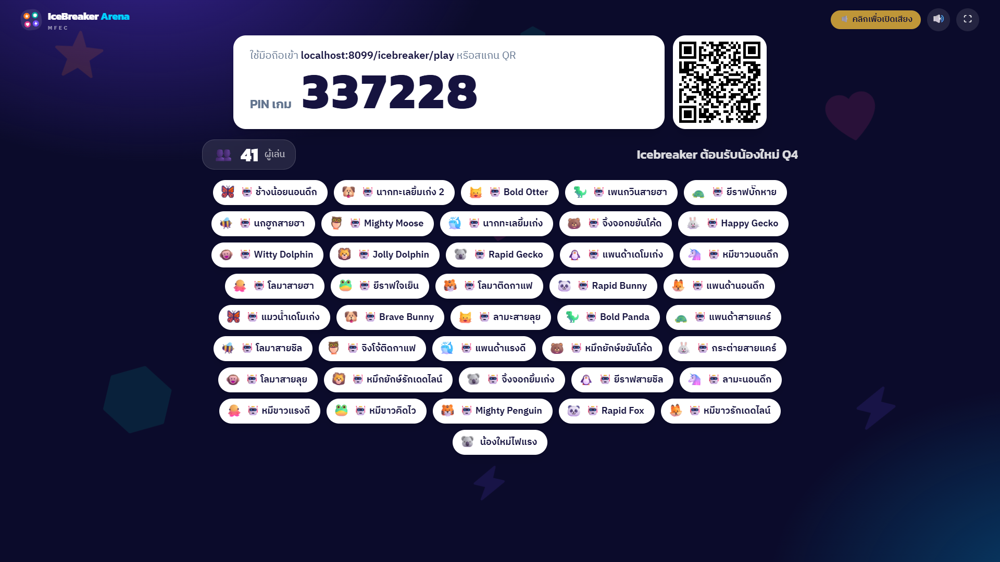
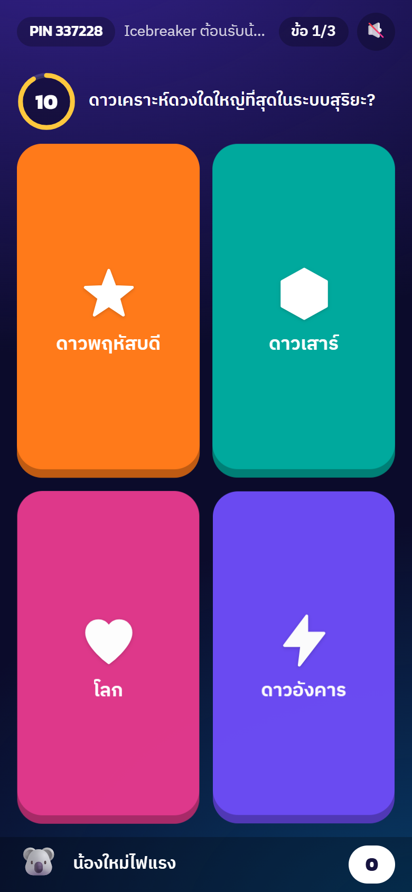
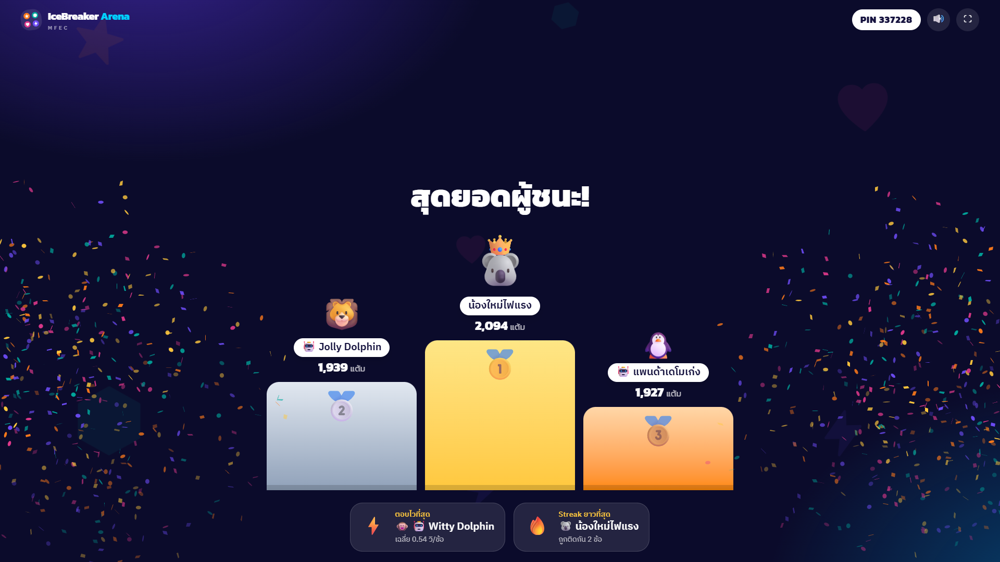

# MFEC Pika Arena

[](https://github.com/sakanarm/IcebreakerArena/actions/workflows/checks.yml)
[](https://github.com/sakanarm/IcebreakerArena/actions/workflows/screens.yml)

เกม Icebreaker / Quiz แบบเล่นสดสำหรับทีม MFEC ผู้จัดสร้างคำถามเองแบ่งเป็นหลายด่าน เปิดห้องขึ้นจอใหญ่ ทุกคนสแกน QR แล้วตอบจากมือถือของตัวเอง แข่งเก็บแต้มแบบเรียลไทม์จนถึงโพเดียม

| จอใหญ่ (โปรเจกเตอร์) | มือถือผู้เล่น | ประกาศผล |
| --- | --- | --- |
|  |  |  |

ภาพหน้าจอครบทุกหน้า 39 ภาพ เรียงตามลำดับการเล่นจริง อยู่ใน [docs/screenshots/](docs/screenshots/)

## จัดเกมยังไง

1. **สร้างเกม** ที่ `/editor` ตั้งชื่อเกม แบ่งด่าน ใส่คำถามได้ 6 แบบ (ควิซ จริงหรือเท็จ โพล เรียงลำดับ พิมพ์คำตอบ และทายตัวเลข) หรือทำสำเนาเกมตัวอย่างไปแก้ต่อ
2. **เปิดห้อง** ที่ `/host` เลือกเกมแล้วกด "▶ เริ่มห้อง" จะได้ PIN 6 หลักและ QR Code
3. **ขึ้นจอใหญ่** เอาหน้า Host ขึ้นโปรเจกเตอร์ได้เลย หรือกด "🖥️ จอแยก" เพื่อเปิดจอแสดงผลแยก ลิงก์ของจอแยกมีรหัสต่อท้าย (`/stage/<PIN>#<รหัส>`) ส่งไปเปิดที่เครื่องที่ต่อโปรเจกเตอร์ได้ แต่คนที่รู้แค่ PIN เปิดจอใหญ่ไม่ได้ บนมือถือและแท็บเล็ต ปุ่มนี้เปิดเมนูแชร์ของเครื่องเพื่อส่งลิงก์ (มือถือแนวตั้งมีปุ่มนี้เฉพาะก่อนเริ่มเกม) จอที่เพิ่งเปิดต้องคลิกหนึ่งครั้งก่อนถึงจะมีเสียง เพราะเบราว์เซอร์บล็อกเสียงอัตโนมัติ
4. **ผู้เล่นเข้าห้อง** สแกน QR หรือเปิดหน้าแรกแล้วใส่ PIN ตั้งชื่อเล่น ไม่ต้องล็อกอิน
5. **เล่นจนจบ** เดินเกมจากแถบควบคุมด้านล่างของหน้า Host จบแล้วเปิดรายงานและดาวน์โหลด CSV ได้ แล้วกด "🚪 ปิดห้อง" (ถ้าไม่กด ห้องจะปิดเองหลังประกาศผล 2 ชั่วโมง)

**มีข้อสอบอยู่ใน Excel แล้ว?** ไปที่ `/import` (ปุ่ม "📊 นำเข้าจาก Excel" ในหน้า `/host`) อัปโหลด .xlsx หรือ .csv หรือคัดลอกช่องจาก Excel / Google Sheets มาวาง แถวหัวตารางต้องมี คำถาม, ก, ข, ค, ง และ คำตอบ ส่วน หัวข้อ, คำอธิบาย, รูป และ เวลา ไม่บังคับ (ดาวน์โหลดแม่แบบได้ในหน้านั้น) ระบบแสดงคำถามทุกข้อพร้อมคำตอบที่อ่านได้ และบอกแถวที่ต้องแก้ก่อนบันทึก ไฟล์อ่านในเบราว์เซอร์ ไม่ได้ส่งไปไหนจนกว่าจะกดนำเข้า คลังที่มีเกิน 100 ข้อถูกแบ่งเป็นหลายเกม "(ชุดที่ 1/3)" อัตโนมัติ เพราะเกมหนึ่งมีได้ 100 ข้อ

ถ้าไม่ได้เปิด[บัญชีผู้สร้างเกม](#บัญชีผู้สร้างเกม) เกมที่สร้างถูกเก็บในเบราว์เซอร์เครื่องนั้นเท่านั้น ถ้าจะย้ายเครื่องหรือส่งให้เพื่อนแก้ต่อ ใช้ปุ่ม "⬇️ ส่งออก JSON" และ "⬆️ นำเข้า JSON" ในหน้า Editor

## รันบนเครื่อง (dev)

ต้องมี Node.js 20.9 ขึ้นไป (ทดสอบบน 22) และ npm

```bash
npm install
npm run dev
```

- เว็บ: http://localhost:3000
- Game server: http://localhost:4000 (ดูสถานะที่ `/health`)
- มือถือใน Wi-Fi วงเดียวกันเข้าเล่นได้เลย ถ้าเปิดหน้า Host จาก localhost QR บนจอจะชี้ไปที่ IP ของเครื่องให้เอง บน Windows ต้องอนุญาต Node.js ผ่าน Firewall (Private network) ในครั้งแรก

| คำสั่ง | ทำอะไร |
| --- | --- |
| `npm run dev` | รัน game server กับเว็บพร้อมกัน แบบ hot reload |
| `npm run typecheck` | เช็ก TypeScript ทุก package |
| `npm test` | unit test การคิดคะแนน validation และ flow ของห้อง |
| `npm run build` | build เว็บสำหรับ production |
| `npm run bots -- <PIN> [จำนวน=50] [--ramp=20]` | ปล่อยบอตเข้าห้องเพื่อทดสอบโหลดหรือเดโม บอตตอบทุกข้อ แล้วสรุปเวลาที่ server ตอบรับ (p50/p95) ตอนจบ ใส่ `--url=` ถ้า game server ไม่ได้อยู่ที่ localhost:4000 |
| `npm run crowd -- [--players=50] [--rooms=1]` | เล่นเกมทั้งเกมด้วยบอต แล้วตรวจรายงานท้ายเกมว่าคิดคะแนนถูกทุกข้อ (ดู[ทดสอบโหลด](#ทดสอบโหลด-npm-run-crowd)) |
| `npm run playthrough -- <id เกมตัวอย่าง>` | เล่นเกมที่แถมมากับแอปจนจบด้วยบอต แล้วตรวจว่าทุกข้อถูกเสิร์ฟ ตอบได้ทุกแบบ และรายงานให้คะแนนตรงกับเฉลย |
| `npm run e2e` | ตรวจทุกฉากบนเบราว์เซอร์จริง 16 ขนาดจอ (ลง dependency ใน `e2e/` ก่อน ดู [e2e/README](e2e/README.md)) |
| `npm run e2e:samples -- [--base=…]` | เปิดหน้า `/host` แบบยังไม่ล็อกอิน ตรวจว่าเกมตัวอย่างทุกใบมีปก บอกจำนวนด่าน/ข้อ และกดเปิดห้องได้จริง |
| `npm run e2e:exam -- [--base=…] [--login=<ไฟล์>]` | โหมดข้อสอบ: ทำข้อสอบจากเกมตัวอย่างทั้งแบบฝึกและแบบจับเวลา หน้าสรุปผล และ (เมื่อส่งบัญชี) ลิงก์ข้อสอบของเกมตัวเอง: เปิด อัปเดต ปิด |
| `npm run e2e:sheet-import -- [--base=…] [--login=<ไฟล์>]` | นำเข้าคลังข้อสอบ: แม่แบบ, ไฟล์ .xlsx จริง (มีหัวเรื่อง เซลล์ผสาน ชีตซ่อน), วาง 230 แถวที่แบ่งเป็น 3 ชุด, ไฟล์ที่ใช้ไม่ได้ แล้วลบเกมที่สร้างทิ้ง |
| `npm run e2e:ai-quiz -- --login=<ไฟล์>` | ให้ AI ออกข้อสอบ กับ AI ปลอมบนเครื่องที่ stream แบบ Messages API: ไม่มี ai.json = ปิด, เปิด .docx, ความคืบหน้า, ประโยคต้นฉบับใต้ทุกข้อ, ตัดข้อ, error และหยุดกลางทางกับโควตา, key ไม่ถึงเบราว์เซอร์ รันได้กับ localhost เท่านั้น |
| `npm run e2e:create -- [--base=…] [--login=<ไฟล์>]` | หน้า `/create` และทางเข้าโหมดข้อสอบจากทุกหน้า: สถานะของ 4 วิธี (ต้อง login, ผู้ดูแลยังไม่เปิด, บัญชียังไม่มีอีเมล) ตรงกับ server, แถบเมนูบอกว่าอยู่หน้าไหน, ลิงก์ข้อสอบในหน้าแรก หน้าเข้าเกม และ editor, มือถือ 360/390 ไม่เลื่อนข้าง |
| `npm run e2e:ask-ai -- [--login=<ไฟล์>]` | ปุ่มถาม AI หลังเฉลย กับ AI ปลอมบนเครื่อง (ไม่เรียก AI จริง) รันได้กับ localhost เท่านั้น เพราะต้องเขียน `var/secrets/ai.json` ชั่วคราว |
| `npm run e2e:pika -- [--base=…] [--login=<ไฟล์>] [--fake-pika=<port>]` | หน้า `/pika` ข้อสอบจากคลังความรู้: อัปโหลด/วางข้อความ ติดตามจน Pika อ่านเสร็จ เลือกหน้า รีวิว แล้วบันทึกเป็นข้อสอบ กับ Pika ปลอมบนเครื่อง (`--fake-pika`) หรือแบบอ่านอย่างเดียวที่ไม่ส่งอะไรเข้า Pika (ใช้กับ production) ดู [e2e/README](e2e/README.md) |
| `npm run e2e:sso -- --fake-kc=<port> [--oidc]` หรือ `-- --base=… --expect-off` | ล็อกอินด้วยบัญชีบริษัทกับ Keycloak ปลอมบนเครื่อง: PKCE, state, nonce, ลายเซ็น token, อีเมลที่ไม่มีบัญชี, บัญชีที่ปิด, กดยกเลิก, เปลี่ยนบัญชี Microsoft และ secret ไม่ถึงเบราว์เซอร์ หรือแบบอ่านอย่างเดียวว่า server ที่ยังไม่ตั้งค่าไม่มีปุ่มและทุก route เป็น 404 ดู [e2e/README](e2e/README.md) |
| `npm run e2e:admin -- --login=<ไฟล์ admin> [--maker-login=<ไฟล์>] [--base=…]` | หน้า `/admin`: เพิ่มบัญชี เปลี่ยนบทบาท ปิดสิทธิ์ทีละอย่างแล้วมีผลกับ session ที่เปิดอยู่ทันที ปิด/เปิดบัญชี ตั้งรหัสผ่านใหม่ ตั้ง AI กับ AI ปลอมบนเครื่อง (key กับค่า header ไม่ถึงเบราว์เซอร์) และบัญชีธรรมดาเข้าไม่ได้ ถ้าไม่ใช่ localhost จะดูอย่างเดียว ไม่แก้อะไร |
| `npm run users -- <คำสั่ง>` | จัดการบัญชีผู้สร้างเกม (ดู[บัญชีผู้สร้างเกม](#บัญชีผู้สร้างเกม)) |

ทุก push และ PR เข้า `main` GitHub Actions จะรัน typecheck, unit test และ build บน Node 20 กับ 22 แล้วเล่นเกมจริงด้วยบอท 200 คน ส่วนตัวตรวจหน้าจอด้วยเบราว์เซอร์รันทุกคืนตี 2 (ดู[รายละเอียด](e2e/README.md#บน-ci))

ลองระบบบัญชีบนเครื่อง: ใส่ `AUTH_MODE=local` ใน `apps/web/.env.development.local` เว็บจะใช้ฐานข้อมูล PGlite ใน `var/pglite` ไม่ต้องลง Postgres สร้างบัญชีด้วย `npm run users -- add ...` ตอนที่ `npm run dev` ไม่ได้รันอยู่ เพราะเปิดโฟลเดอร์นั้นได้ทีละ process

```
packages/shared       type, การคิดคะแนน และ validation ที่ server กับเว็บใช้ร่วมกัน
apps/server           game server (Socket.IO) ห้องทั้งหมดอยู่ในหน่วยความจำ
apps/web              Next.js: หน้าแรก, Editor, Host, จอใหญ่, มือถือผู้เล่น
ecosystem.config.js   ตั้งค่า pm2 สำหรับ production
deploy/               สคริปต์ deploy และ config nginx สำหรับวางหลัง reverse proxy
```

## Production ด้วย pm2

ต้องมี Node.js 20.9 ขึ้นไป และ pm2 (`npm install -g pm2`) วางได้สองแบบ

### แบบที่ 1: หลัง nginx ใต้ path `/PikaArena` (แนะนำ)

ผู้เล่นเข้าทาง HTTPS ของโดเมนเดิม เช่น `https://<โดเมน>/PikaArena` ไม่ต้องเปิด port เพิ่ม เว็บกับ game server ฟังแค่ `127.0.0.1` แล้ว nginx ส่งต่อให้ ทั้งหน้าเว็บและ WebSocket ของเกม

```bash
git clone <repo> && cd <repo>
bash deploy/deploy.sh                # ติดตั้ง ทดสอบ build แล้วเริ่มด้วย pm2 ใช้คำสั่งเดิมทุกครั้งที่อัปเดต
sudo bash deploy/nginx-enable.sh     # ครั้งแรกครั้งเดียว: ต่อ config เข้ากับ nginx แล้ว reload
```

`deploy.sh` ทำตามลำดับนี้ และหยุดทันทีถ้าขั้นไหนพัง

1. เช็กว่า port ว่าง หรือเป็นของ app นี้เองที่รันจากโฟลเดอร์เดียวกัน
2. เช็ก `/health` ว่าไม่มีห้องที่ยังใช้อยู่ (`inUse`) ถ้ามีจะไม่ทำต่อ เพราะ restart แล้วเกมที่เล่นอยู่จบทันที ห้องที่ประกาศผลแล้วและไม่มีใครเปิดค้างไว้ไม่นับ (`FORCE=1` เพื่อข้าม)
3. `git pull --ff-only` → `npm ci` → `npm test` → `npm run users -- check` (โหมดล็อกอินและฐานข้อมูล `SKIP_DB_CHECK=1` เพื่อข้าม) → `npm run build`
4. `pm2 startOrReload ecosystem.config.js` รอจนทั้งสอง process ตอบ แล้ว `pm2 save`

ระหว่าง build (ราว 1–2 นาที) เว็บที่รันอยู่ใช้งานไม่ได้ จึงควรอัปเดตช่วงที่ไม่มีกิจกรรม ถ้า build พังหรือถูกยกเลิกกลางทาง สคริปต์จะคืน build เดิมให้ และเว็บกลับมาทำงานแบบเดิมโดยไม่ต้อง restart ถ้าพังหลัง `git pull` ได้โค้ดใหม่มาแล้ว จะพิมพ์คำสั่ง `git checkout <commit เดิม> && bash deploy/deploy.sh` ไว้ให้ย้อนกลับ ส่วน `pm2 save` จะถูกข้ามพร้อมคำเตือน ถ้าตอนนั้น pm2 ไม่ได้รัน app อื่นที่เคย save ไว้ เพื่อไม่ให้ app เหล่านั้นหายจากรายการที่ pm2 เปิดคืนหลัง reboot

ค่าเริ่มต้นคือ path `/PikaArena` เว็บ port `4231` และ game server port `4232` เปลี่ยนได้ด้วย `NEXT_PUBLIC_BASE_PATH`, `WEB_PORT`, `GAME_PORT` (ดู[ตั้งค่า](#ตั้งค่า)) ถ้าเปลี่ยน port หลังจาก deploy ไปแล้ว ให้ `pm2 delete icebreaker-server icebreaker-web` ก่อน เพราะ reload ไม่อ่าน args ใหม่ และต้องแก้ port ใน `deploy/nginx-icebreaker.conf` ให้ตรงกัน

`nginx-enable.sh` เพิ่มบรรทัด `include ".../deploy/nginx-icebreaker.conf";` ต่อจากบรรทัด include `.../deploy/nginx-*.conf` ของ app อื่น (หรือท้ายไฟล์ถ้าไม่มี) ลงในไฟล์ location ที่ `server { }` ของเว็บ include อยู่ (ค่าเริ่มต้น `/etc/nginx/snippets/apps-locations.conf` ถ้าไม่ใช่ให้ใส่ path ตามหลัง) สำรองไฟล์เดิมไว้ข้างกัน แล้วรัน `nginx -t` ถ้าไม่ผ่านจะคืนไฟล์เดิมและไม่ reload รันซ้ำได้ไม่มีผล ใน config มี

- `/PikaArena/socket.io/` → game server พร้อม header สำหรับ WebSocket
- `/PikaArena` และ `/PikaArena/...` → เว็บ
- `/IceBreaker...`, `/icebreakerarena/...` และ `/pikaarena/...` → redirect 301 ไป `/PikaArena/...` ชื่อเดิมและลิงก์ที่แจกไปแล้วยังใช้ได้

ห้ามเปิด `/info` ของ game server ออกนอกเครื่อง เพราะบอก IP ภายในของเครื่อง config นี้ส่งต่อแค่ `/socket.io/`

### แบบที่ 2: เปิด port ตรง

```bash
npm ci                          # ต้องลง devDependencies ด้วย เพราะใช้ตอน build
npm run build
pm2 start ecosystem.config.js
pm2 save
```

ถ้าเครื่องตั้ง `NODE_ENV=production` ไว้ npm จะข้าม devDependencies ให้ใช้ `npm ci --include=dev` แทน

| Process | Port | รันด้วย |
| --- | --- | --- |
| `icebreaker-server` | 4000 | `node --import tsx src/index.ts` |
| `icebreaker-web` | 3000 | `next start` |

เปิด TCP port 3000 และ 4000 ให้เครื่องผู้เล่นเข้าถึงได้ เพราะมือถือต่อ WebSocket ตรงไปที่ port 4000 ถ้าจะใช้ port อื่น ให้ตั้ง `WEB_PORT` กับ `GAME_PORT` ไว้ทั้งตอน `npm run build` และ `pm2 start` เพราะ port ของ game server ถูกฝังลงในหน้าเว็บตอน build

> **⚠️ ข้อควรระวัง**
>
> - **game server ต้องมี 1 instance (fork mode) เท่านั้น** ห้องทั้งหมดอยู่ในหน่วยความจำของ process เดียว ถ้าเพิ่ม instance หรือใช้ cluster mode ผู้เล่นห้องเดียวกันจะกระจายไปคนละ process แล้วหาห้องไม่เจอ
> - **restart หรือ deploy `icebreaker-server` แล้วทุกเกมที่กำลังเล่นจบทันที** ให้ทำช่วงที่ไม่มีกิจกรรม เช็กก่อนได้ว่า `/health` ตอบ `"inUse":0`

### ให้ pm2 เริ่มเองตอนเปิดเครื่อง

- **Linux** รัน `pm2 startup` แล้วรันคำสั่งที่มันพิมพ์ออกมา (ต้องใช้ sudo) จากนั้น `pm2 save`
- **Windows** `pm2 startup` ใช้กับ Windows ไม่ได้ ให้ติดตั้ง pm2 เป็น Windows Service ด้วย [pm2-installer](https://github.com/jessety/pm2-installer) แล้ว `pm2 start` กับ `pm2 save` ตามปกติ

### ดูแลระบบ

```bash
pm2 status                          # สถานะ จำนวนครั้งที่ restart และ RAM
pm2 logs icebreaker-server          # log สด มี timestamp
curl http://localhost:4000/health   # {"ok":true,"rooms":<ห้องที่เปิดอยู่>,"inUse":<ห้องที่ยังใช้อยู่>,"clients":<connection>,"uptimeS":...} (แบบที่ 1 ใช้ port 4232)
pm2 install pm2-logrotate           # หมุนไฟล์ log ไม่ให้โตไม่หยุด (ทำครั้งเดียว)
```

อัปเดตเวอร์ชัน (ช่วงที่ไม่มีเกมเล่นอยู่): แบบที่ 1 รัน `bash deploy/deploy.sh` อย่างเดียว แบบที่ 2:

```bash
npm ci
npm run build
pm2 restart ecosystem.config.js
```

ถ้าแก้ `ecosystem.config.js` ให้ใช้ `pm2 delete ecosystem.config.js`, `pm2 start ecosystem.config.js` แล้ว `pm2 save` แทน เพราะ `restart` ไม่อ่าน script และ args ใหม่

### ตั้งค่า

| ตัวแปร | ตั้งที่ | ค่าเริ่มต้น | ใช้ทำอะไร |
| --- | --- | --- | --- |
| `NEXT_PUBLIC_BASE_PATH` | environment ตอน `npm run build` **และ** ตอน `pm2 start` ต้องเป็นค่าเดียวกัน | ว่าง (อยู่ที่ root) | path ที่เว็บอยู่หลัง reverse proxy เช่น `/PikaArena` เบราว์เซอร์จะต่อ game server ที่ `<path>/socket.io` บนโดเมนเดียวกัน |
| `BIND_HOST` | environment ตอน `pm2 start` | `0.0.0.0` | interface ที่ทั้งสอง process ฟัง หลัง proxy ใช้ `127.0.0.1` |
| `WEB_PORT`, `GAME_PORT` | environment ตอน `pm2 start` ถ้าไม่มี base path ต้องตั้ง `GAME_PORT` ตอน `npm run build` ด้วย | `3000`, `4000` | port ของเว็บและ game server (`ecosystem.config.js` ส่งต่อเป็น `PORT`, `HOST` ให้ game server) ถ้าไม่มี base path เบราว์เซอร์จะต่อ game server ที่ `GAME_PORT` ของตอน build |
| `NEXT_PUBLIC_GAME_SERVER_URL` | environment ตอน `npm run build` | ถ้ามี base path: โดเมนของหน้าเว็บ + base path ถ้าไม่มี: โฮสต์ของหน้าเว็บ + `:<GAME_PORT>` (`4000`) | ที่อยู่ game server ที่เบราว์เซอร์ต่อไป ใช้เมื่อ game server อยู่คนละที่กับเว็บ ถ้ามี path ใน URL จะต่อที่ `<path>/socket.io` |
| `NEXT_PUBLIC_JOIN_BASE_URL` | environment ตอน `npm run build` | ที่อยู่ของหน้าเว็บที่เปิดอยู่ (รวม base path) | ที่อยู่ที่แสดงใต้ QR ให้ผู้เล่นพิมพ์เข้ามา |

`deploy/deploy.sh` ตั้งค่าให้เองเป็น `NEXT_PUBLIC_BASE_PATH=/PikaArena`, `BIND_HOST=127.0.0.1`, `WEB_PORT=4231`, `GAME_PORT=4232` ถ้าไม่ได้ตั้งไว้ก่อน

ค่า `NEXT_PUBLIC_*` ถูกฝังลงไปตอน build ถ้าเปลี่ยนต้อง `npm run build` ใหม่ และถ้าเว็บเปิดผ่าน HTTPS game server ก็ต้องเป็น HTTPS ด้วย เพราะเบราว์เซอร์ไม่ยอมให้หน้า HTTPS ต่อ `ws://` (แบบที่ 1 ได้ HTTPS จาก nginx อยู่แล้ว)

บน Windows ถ้า build ใน Git Bash ให้ใส่ `MSYS_NO_PATHCONV=1` นำหน้า เช่น `MSYS_NO_PATHCONV=1 NEXT_PUBLIC_BASE_PATH=/PikaArena npm run build` ไม่งั้น Git Bash จะแปลง `/PikaArena` เป็น `C:/Program Files/Git/PikaArena` (`next.config.ts` จะแจ้ง error ให้)

### บัญชีผู้สร้างเกม

ผู้เล่นไม่ต้องมีบัญชี เข้าด้วย PIN กับชื่อเล่นเหมือนเดิม บัญชีมีไว้ให้คนสร้างเกมเก็บเกมไว้ที่ server แทนเบราว์เซอร์ เปิดจากเครื่องไหนก็เจอ

| โหมด | ทำอะไร |
| --- | --- |
| `off` (ค่าเริ่มต้น) | ไม่มีบัญชี เกมอยู่ในเบราว์เซอร์แต่ละเครื่อง ไม่ต้องมีฐานข้อมูล |
| `local` | ล็อกอินด้วย username และ password ที่ admin สร้างให้ และถ้าตั้ง Keycloak ไว้ มีปุ่ม "เข้าสู่ระบบด้วยบัญชีบริษัท" อยู่ด้านบนด้วย |
| `oidc` | ล็อกอินด้วยบัญชีบริษัทเท่านั้น (Keycloak ที่ส่งต่อไป Microsoft) ไม่มีช่อง password ต้องตั้ง Keycloak ก่อน ไม่อย่างนั้นเว็บถอยไปโหมด `off` |

ตั้งโหมดด้วยคำเดียวในไฟล์ `var/auth-mode` (env `AUTH_MODE` ชนะไฟล์ถ้าตั้งไว้) แล้ว `pm2 restart icebreaker-web` restart แค่เว็บไม่กระทบเกมที่เล่นอยู่ ตอนเปิดบัญชีแล้วแต่ยังไม่ล็อกอิน หน้าเลือกเกมยังมีเกมตัวอย่างให้เล่นได้ทันที และเกมที่เคยเก็บไว้ในเบราว์เซอร์ย้ายเข้าบัญชีได้ด้วยปุ่ม "ย้ายเข้าบัญชี"

บน production โหมด `local` ต้องมี Postgres

- ใส่ connection string `postgres://<user>:<password>@<host>:5432/<database>` ในไฟล์ `var/secrets/database-url` (mode 600) ตัวอักษรพิเศษใน password ต้อง URL-encode โฟลเดอร์ `var/` ไม่เข้า git และ `deploy.sh` จะหยุดถ้ามีไฟล์ในนั้นหลุดเข้า git
- app สร้างตารางเองตอนใช้ฐานข้อมูลครั้งแรก ทุกตารางขึ้นต้นด้วย `ib_` และอยู่ใน schema `icebreaker` ของ app เอง (เปลี่ยนชื่อได้ด้วย `IB_DB_SCHEMA` แต่ห้ามเป็น `public`) ถ้ายังไม่มี schema นี้ app จะสร้างให้ และตั้ง `search_path` ทุก connection จึงไม่ไปยุ่งกับ schema อื่นในฐานข้อมูลเดียวกัน
- `deploy.sh` รัน `npm run users -- check` ก่อน build ถ้าโหมด ฐานข้อมูล หรือสิทธิ์ใน schema มีปัญหา จะหยุดก่อนเว็บเปลี่ยน

รันจาก root ของ repo บน server ใส่ `NODE_ENV=production` นำหน้าทุกคำสั่ง

```bash
npm run users -- check                                  # โหมด ฐานข้อมูล schema และตาราง อ่านอย่างเดียว
npm run users -- add <username> "<ชื่อที่แสดง>" --admin   # --admin = ผู้ดูแลระบบ เข้าหน้า /admin ได้ ไม่ใส่เป็นบัญชีผู้สร้างเกมธรรมดา
npm run users -- role <username> maker|curator|admin    # เปลี่ยนบทบาท (ดู "หน้าผู้ดูแลระบบ")
npm run users -- reset <username>                       # password ใหม่ และหลุดจากทุกเครื่อง
npm run users -- disable <username>                     # ล็อกอินไม่ได้ และหลุดจากทุกเครื่องทันที (enable เพื่อคืน)
npm run users -- list
npm run users -- email <username> <อีเมลบริษัท>          # ผูกบัญชีกับคลังความรู้ Pika ของคนนั้น (icebreaking_<ส่วนหน้า @>) --clear เพื่อเอาออก
npm run users -- demo <username> --share                # ใส่เกมเดโม 3 เกมในบัญชีนั้น รันซ้ำก็ไม่ซ้ำ --share แชร์ 1 เกมขึ้นคลังเกมด้วย
```

`add` กับ `reset` พิมพ์ password ให้ครั้งเดียว ถ้าใส่ `--out=<ไฟล์>` จะเก็บลงไฟล์ใหม่ (mode 600) แทน ไม่ค้างอยู่ในหน้าจอหรือ log ปิดบัญชีกลับเป็นแบบเดิมด้วย `echo off > var/auth-mode` แล้ว `pm2 restart icebreaker-web` ข้อมูลในฐานข้อมูลยังอยู่ครบ

### หน้าผู้ดูแลระบบ (`/admin`)

ผู้ดูแลระบบเข้าจากเมนูบัญชีมุมขวาบน → "ตั้งค่าระบบ" บัญชีอื่นเห็นหน้าแจ้งว่าไม่มีสิทธิ์ และทุก route ใต้ `/api/admin` ตอบ 403 ต้องมีผู้ดูแลอย่างน้อยหนึ่งคนก่อน: `npm run users -- role <username> admin` (`check` จะเตือนถ้ายังไม่มี) ทุกการเปลี่ยนแปลงลง audit log และเห็นในแท็บระบบ

| แท็บ | ทำอะไร |
| --- | --- |
| ผู้ใช้ | ค้นหา เพิ่มบัญชี (สร้าง password ให้ แสดงครั้งเดียว) หรือเชิญด้วยอีเมลบริษัท แก้ชื่อ อีเมล บทบาท สิทธิ์ ปิด/เปิดบัญชี และตั้ง password ใหม่ มีผลกับเครื่องที่ล็อกอินอยู่ทันที แก้บทบาทหรือปิดบัญชีตัวเองไม่ได้ และปิดผู้ดูแลคนสุดท้ายไม่ได้ |
| AI | ตั้ง gateway (`baseUrl`), API key, รุ่น, header เพิ่ม, เปิด/ปิด, โควตา และความคิดของ AI แล้วกด "ทดสอบการเชื่อมต่อ" บันทึกลง `var/secrets/ai.json` (mode 600 เขียนทั้งไฟล์หรือไม่เขียนเลย) มีผลทันทีไม่ต้อง restart key กับค่า header ไม่ถูกส่งกลับมาที่เบราว์เซอร์ เห็นแค่ว่า "ตั้งไว้แล้ว" เว้นช่องว่างไว้ = ใช้ค่าเดิม มีการใช้งาน 7 วันล่าสุดและคนที่ใช้มากที่สุดให้ดู |
| ระบบ | โหมดล็อกอิน ฐานข้อมูล Keycloak Pika และ AI ว่าพร้อมไหม (ไม่แสดง secret ใด ๆ) กับการเปลี่ยนแปลงล่าสุด |

| บทบาท | ทำอะไรได้ |
| --- | --- |
| `maker` | สร้างเกม ข้อสอบ แชร์เกม (บัญชีปกติ) |
| `curator` | เหมือน maker และเอาเกมออกจากคลังเกมที่แชร์ได้ |
| `admin` | เหมือน curator และเข้าหน้า `/admin` |

ปิดสิทธิ์ทีละอย่างให้บางบัญชีได้โดยไม่เปลี่ยนบทบาท: `share` (แชร์เกมขึ้นคลัง), `aiQuiz` (ให้ AI ออกข้อสอบ), `pika` (ข้อสอบจากคลังความรู้ Pika) ปิดแล้วการ์ดในหน้า `/create` ขึ้นว่า "ปิดสิทธิ์อยู่" และ API ตอบ 403

แท็บผู้ใช้เสนอเฉพาะวิธีล็อกอินที่ใช้ได้จริงตอนนั้น: โหมด `oidc` ไม่มีฟอร์มรหัสผ่าน จึงไม่มีตัวเลือกรหัสผ่านและ API ตอบ 409 `no_passwords` ส่วนบัญชีแบบ "บัญชีบริษัทเท่านั้น" ที่สร้างตอนยังไม่ได้ตั้ง Keycloak จะขึ้นป้ายสีทอง "ยังเข้าไม่ได้" จนกว่าจะตั้ง Keycloak หรือออกรหัสผ่านให้

### ล็อกอินด้วยบัญชีบริษัท (Keycloak)

เว็บคุยกับ Keycloak ของบริษัทเท่านั้น (realm `mfec`) Keycloak ส่งต่อไปหน้า Microsoft ให้เอง (`kc_idp_hint=entra`) ไม่ได้ต่อ Entra ID ตรง ๆ ใช้ authorization code + PKCE (S256) แบบ confidential client ตรวจลายเซ็น ID token, issuer, audience, nonce และวันหมดอายุเองทุกครั้ง

1. ขอ client จากคนดูแล Keycloak: realm `mfec`, client ID `pika-arena`, confidential, Standard flow ON, Direct Access Grants OFF, Implicit OFF, PKCE S256, redirect URI `https://dmhub.mfec.dev/PikaArena/api/auth/callback/keycloak` (และ `http://localhost:3000/api/auth/callback/keycloak` สำหรับเครื่อง dev), post logout redirect URI `https://dmhub.mfec.dev/PikaArena/*` (และ `http://localhost:3000/*`), ID token ต้องมี `email` หรือ `preferred_username` ที่เป็นอีเมล
2. วาง secret บน server ที่ `var/secrets/keycloak.json` (mode 600):
   ```json
   {"issuer":"https://dmhub.mfec.dev:8443/realms/mfec","clientId":"pika-arena","clientSecret":"<secret>","appUrl":"https://dmhub.mfec.dev"}
   ```
   `appUrl` ต้องมีบน production เพราะหลัง nginx เว็บไม่รู้ชื่อโดเมนจริง (บนเครื่อง dev ใช้ env `KEYCLOAK_ISSUER` `KEYCLOAK_CLIENT_ID` `KEYCLOAK_CLIENT_SECRET` แทนก็ได้ ไฟล์ชนะ env) secret ไม่ถึงเบราว์เซอร์และไม่ลง log
3. `npm run users -- check` ต้องขึ้นว่าบัญชีบริษัทพร้อม แล้ว `pm2 restart icebreaker-web` ปุ่มจะขึ้นในหน้าล็อกอิน

ใครเข้าได้: ล็อกอินได้เฉพาะคนที่มีบัญชีในระบบซึ่งอีเมลตรงกับอีเมลบริษัทที่ Keycloak ส่งมา (ไม่สนตัวพิมพ์เล็กใหญ่) คนอื่นจะเห็นข้อความให้ขอผู้ดูแลระบบ กับลิงก์ไปหน้าเข้าร่วมเกม เพิ่มคนด้วย

```bash
npm run users -- invite <อีเมลบริษัท> "<ชื่อที่แสดง>" [--admin]   # บัญชีไม่มี password เข้าได้ด้วยบัญชีบริษัทเท่านั้น
npm run users -- email <username> <อีเมลบริษัท>                    # บัญชีเดิมที่มี password ก็เข้าด้วยบัญชีบริษัทได้ด้วย เกมเดิมอยู่ครบ
```

เชื่อใจอีเมลที่ Keycloak ส่งมา (ไม่ได้บังคับ `email_verified`) เพราะ realm นี้รับคนจาก Microsoft ของบริษัทเท่านั้น ถ้าวันหนึ่ง realm เปิดให้สมัครเองหรือแก้อีเมลเองได้ ต้องกลับมาทบทวน เมื่อทุกคนที่สร้างเกมมีอีเมลผูกแล้ว เปลี่ยนเป็นบัญชีบริษัทอย่างเดียวได้ด้วย `echo oidc > var/auth-mode` แล้ว `pm2 restart icebreaker-web`

### ข้อสอบจากคลังความรู้ Pika (`/pika`)

คนสร้างเกมที่ login แล้วอัปโหลดไฟล์ (.pdf .docx .pptx .xlsx .txt .md .csv ไม่เกิน 20 MB) หรือวางข้อความเข้าโปรเจกต์ Pika ส่วนตัวของตัวเอง รอ Pika อ่านเสร็จ เลือกได้ครั้งละไม่เกิน 10 หน้า ตรวจทุกข้อ แล้วบันทึกเป็นข้อสอบสี่ตัวเลือกที่มีเฉลยและประโยคต้นฉบับ ไม่ใช้ AI ของเรา (ตั้งคำถามจากข้อ ๆ ใต้หัวข้อ Details ของแต่ละหน้า) ข้อที่มีอีเมลหรือเบอร์โทรไม่ถูกตั้งเป็นคำถาม และเกมที่ได้แชร์เข้าคลังกลางไม่ได้

ต้องมี org key ของ Pika ที่ `var/secrets/pika-org-key` และบัญชีต้องมีอีเมล (`npm run users -- email …`) โปรเจกต์ของแต่ละคนชื่อ `icebreaking_<ส่วนหน้า @>` สร้างเมื่อคนนั้นกดปุ่มครั้งแรกเท่านั้น key ของโปรเจกต์เก็บที่ `var/secrets/pika-projects/` ไม่ถึงเบราว์เซอร์และไม่ลงฐานข้อมูล ส่งเอกสารได้ 20 ชิ้นต่อชั่วโมงต่อคน ครั้งละ 2 ชิ้น

### ถาม AI ในโหมดข้อสอบ

หลังเฉลยแต่ละข้อ คนทำข้อสอบกด "ถาม AI เพิ่มเติมเกี่ยวกับข้อนี้" เพื่อถามต่อได้ไม่เกิน 6 คำถามต่อข้อ ปุ่มนี้ไม่ขึ้นจนกว่า admin จะตั้ง AI ไว้ที่ server และไม่ขึ้นกับเกมที่เก็บไว้แค่ในเบราว์เซอร์ ใช้ได้กับเกมตัวอย่าง เกมในบัญชีตัวเอง และลิงก์ข้อสอบ ต้องใช้ฐานข้อมูลเดียวกับบัญชีผู้สร้างเกม เพื่อนับโควตา

ตั้งได้ที่หน้า `/admin` แท็บ AI (แนะนำ) หรือสร้างไฟล์ `var/secrets/ai.json` (mode 600) เอง:

```json
{
  "apiKey": "<key ของ LLM gateway ที่อนุมัติแล้ว>",
  "baseUrl": "https://<gateway>",
  "perPersonPerDay": 30,
  "perDay": 2000,
  "who": "anyone"
}
```

| ช่อง | ค่าเริ่มต้น | ใช้ทำอะไร |
| --- | --- | --- |
| `apiKey` | (ต้องมี) | ส่งไปเป็น `Authorization: Bearer <key>` ไม่ถึงเบราว์เซอร์ และไม่ถูกเขียนลง log |
| `baseUrl` | API ของ Anthropic | gateway ที่พูด Anthropic Messages API (`POST <baseUrl>/v1/messages`) |
| `headers` | ไม่มี | header เพิ่มที่ gateway ต้องการ เช่น `{"x-team": "icebreaker"}` |
| `model` | `claude-opus-5-5` | ชื่อรุ่นตามที่ gateway รู้จัก |
| `effort` | `low` | `low`, `medium` หรือ `high` ยิ่งสูงยิ่งตอบช้าและใช้ token มาก |
| `maxTokens` | `4000` | เพดานความยาวคำตอบ (สูงสุด 16000) |
| `fallbacks` | `true` | ให้ API ย้ายไปรุ่นสำรองเองเมื่อรุ่นหลักไม่ว่าง ถ้า gateway ไม่ส่ง beta header ต่อ (ตอบ 400) ให้ตั้ง `false` |
| `perPersonPerDay` | `30` | คำถามต่อคนต่อวัน นับตามบัญชี ถ้าไม่ล็อกอินนับตาม IP |
| `perDay` | `2000` | คำถามรวมทั้งเว็บต่อวัน |
| `who` | `anyone` | `signed-in` ให้ถามได้เฉพาะคนที่ล็อกอิน คนอื่นเห็นปุ่มเข้าสู่ระบบแทน |
| `quizPerPersonPerDay` | `10` | ชุดข้อสอบที่ AI เขียนให้ต่อคนต่อวัน (ดู "ให้ AI ออกข้อสอบ") แต่ละชุดนับเข้า `perDay` ด้วยหนึ่งครั้ง |
| `quizEffort` | `medium` | ความคิดของ AI ตอนเขียนข้อสอบ แยกจาก `effort` ของการถามตอบ |
| `structuredOutput` | `true` | ขอ JSON ผ่าน structured outputs ถ้า gateway ไม่ส่ง `output_config.format` ต่อ (ตอบ 400) ให้ตั้ง `false` แล้ว AI จะถูกสั่งให้ตอบเป็น JSON ใน prompt แทน |

- เว็บอ่านไฟล์ใหม่ทุกครั้งที่มีคนถาม แก้แล้วไม่ต้อง restart แต่หน้าที่เปิดค้างไว้จะเห็นการเปิด/ปิดหลัง reload
- ปิด AI: ลบไฟล์ ถ้าไฟล์ผิดรูปแบบ AI จะปิดเองและเตือนใน `pm2 logs icebreaker-web`
- การใช้งานรายวัน (จำนวนคำถามและ token ต่อคน) อยู่ในตาราง `icebreaker.ib_ai_usage` ไม่เก็บข้อความที่ถาม
- ถ้า gateway ไม่ตอบหรือตอบ error คนทำข้อสอบเห็นข้อความให้ลองใหม่ และไม่เสียโควตา

### ให้ AI ออกข้อสอบ

คนสร้างเกมที่ login แล้ววางเนื้อหา หรือเปิดไฟล์ Word (.docx), PowerPoint (.pptx), .txt หรือ .md ที่เบราว์เซอร์แปลงเป็นข้อความเอง (ไฟล์ไม่ถูกส่งไป server มีแค่ข้อความ) แล้วเลือกจำนวนข้อ (5, 10, 15 หรือ 20) ระดับ ภาษา และเรื่องที่อยากเน้น AI เขียนข้อสอบสี่ตัวเลือกพร้อมเฉลย คำอธิบาย และประโยคต้นฉบับที่ใช้ตั้งคำถาม คนสร้างเห็นทุกข้อในหน้านำเข้า (เหมือนนำเข้าจาก Excel) ตัดข้อที่ไม่ใช่ออกได้ก่อนบันทึก จึงไม่มีข้อจาก AI เข้าห้องโดยไม่มีคนดู อยู่ที่ `/import?ai=1` และเข้าจากการ์ด "ให้ AI ออกข้อสอบ" ในหน้า `/create`

ใช้ `var/secrets/ai.json` ไฟล์เดียวกับถาม AI ไม่มีไฟล์ = การ์ดขึ้นว่า "ผู้ดูแลระบบยังไม่ได้เปิดใช้" และ route เป็น 404

- ข้อความ 200–40,000 ตัวอักษร (ราว 30 หน้า) เกินนั้นให้เลือกส่วนที่จะถาม PDF ให้คัดลอกข้อความมาวาง
- เนื้อหาเอกสารส่งไปที่ gateway เท่านั้น ไม่เก็บ ไม่เขียน log ใน audit log มีแค่ความยาว
- ทุกข้อที่ AI ตอบมาถูกตรวจทีละช่องตามเพดานเดียวกับ editor ข้อที่ไม่ผ่านถูกตัดและบอกจำนวน ตำแหน่งคำตอบถูกสุ่มใหม่ที่ server
- เขียนได้พร้อมกันทั้งเว็บ 3 ชุด คนละ 1 ชุดในเวลาเดียวกัน คำตอบส่งเป็น NDJSON ทีละบรรทัด (มี ping ทุก 10 วินาที) proxy จึงไม่ตัดระหว่างรอ
- โควตา: gateway error หรือ AI ไม่ได้ข้อสอบเลย = ไม่เสียโควตา กดหยุดก่อน AI เริ่มเขียน = ไม่เสีย กดหยุดหลังเริ่มแล้ว = เสีย 1 ชุด token ที่ใช้ไปถูกบันทึกใน `ib_ai_usage` ทุกครั้ง
- เกมที่ได้เป็นเกมปกติในบัญชี (origin `import`) เปิดเป็นข้อสอบหรือเปิดห้องได้ทันทีหลังบันทึก

## ทดสอบโหลด (`npm run crowd`)

`npm run bots -- <PIN>` เอาบอตเข้าห้องที่เปิดไว้แล้วให้ตอบมั่วๆ ไว้ดูเดโมหรือวัดเวลาตอบรับ
ส่วน `npm run crowd` เปิดห้องเอง เล่นจนจบ แล้ว**ตรวจรายงานท้ายเกมว่าตรงกับสิ่งที่ server ตอบรับไว้จริงไหม**
จึงเป็นทั้งตัววัดโหลดและตัวบอกว่าการแก้เรื่องคะแนน ลำดับฉาก หรือข้อมูลที่ส่งออก ยังถูกอยู่เมื่อคนเต็มห้อง

```bash
npm run crowd                                   # 1 ห้อง 50 คน
npm run crowd -- --players=1000 --ramp=150      # เต็มห้องตาม MAX_PLAYERS_PER_ROOM
npm run crowd -- --rooms=5 --players=60         # หลายห้องพร้อมกัน
npm run crowd -- --url=https://dmhub.mfec.dev/PikaArena --players=200
```

| ตัวเลือก | ค่าเริ่มต้น | ทำอะไร |
| --- | --- | --- |
| `--players=` | 50 | จำนวนบอตต่อห้อง |
| `--rooms=` | 1 | จำนวนห้องที่เล่นพร้อมกัน |
| `--url=` | `http://localhost:4000` | ที่อยู่ game server ใส่ path ได้ถ้าอยู่หลัง reverse proxy |
| `--ramp=` | 100 | คนเข้าห้องต่อวินาที รวมทุกห้อง |
| `--limit=` | 10 | วินาทีต่อข้อ ลดลงได้เพื่อให้รันจบไว |
| `--payload=` | 24 | งบข้อมูลที่ผู้เล่นหนึ่งคนรับได้ตลอดเกม 6 ข้อ (KiB) |
| `--stage-payload=` | 6 | งบของจอใหญ่ คิดเป็น KiB ต่อวินาที |
| `--plain` | — | ให้ทุกบอตตอบตรงเวลาหมด ไม่มีคนช้า คนหลุด หรือคนตอบหลังหมดเวลา |
| `--quiet` | — | ไม่ต้องรายงานความคืบหน้าระหว่างรัน |

ห้องที่สร้างขึ้นมีครบทั้ง 6 ประเภทคำถาม แบ่งเป็นรอบจับเวลากับรอบไม่จับเวลาที่คูณสอง
และโดยปกติ**ไม่ใช่ห้องที่เรียบร้อย** บอตหนึ่งในสิบรอจนเกือบหมดเวลาถึงตอบ อีกหนึ่งในสิบตัดการเชื่อมต่อ
ทันทีที่ตอบเสร็จแล้วกลับเข้ามาใหม่ด้วย token เดิม และอีกหนึ่งในสิบตั้งใจตอบหลังหมดเวลาเพื่อให้ถูกปฏิเสธ

จังหวะ "หลังหมดเวลา" ไม่ได้ดูจากนาฬิกาของเครื่องที่รันสคริปต์ เพราะตอนมีบอตพันตัวนาฬิกานั้นคลาดได้เป็นครึ่งวินาที
บอตจะถาม `time:sync` ก่อนบน socket เดียวกัน ถ้าเวลาของ server เลยเส้นตายไปแล้วค่อยส่งคำตอบตาม
ซึ่ง server ต้องรับหลังจากนั้นแน่นอน จึงฟ้องได้เต็มปากว่าคำตอบนั้นต้องถูกปฏิเสธ

แต่ละห้องตรวจสิ่งเหล่านี้

- คำตอบที่ server ตอบ `ok` ต้องอยู่ในรายงานครบ และที่ถูกปฏิเสธต้องไม่อยู่
- คำตอบที่ส่งหลังเส้นตายต้องถูกปฏิเสธทุกอัน
- บอตที่ตั้งใจตอบถูก ต้องเป็นกลุ่มเดียวกับที่รายงานบอกว่าถูก นับทีละข้อ
- บอตที่หลุดแล้วต่อใหม่ ต้องยังได้คำตอบที่ส่งไปก่อนหลุด
- อันดับเรียงจากคะแนนมากไปน้อย และทุกคนที่ตอบถูกต้องชนะทุกคนที่ตอบผิด
- ข้อมูลที่ผู้เล่นหนึ่งคนได้รับต้องอยู่ในงบ และ**ต้องไม่โตตามจำนวนคนในห้อง**

### ผลที่วัดได้ (เครื่อง dev, 2026-11-07)

| ขนาด | เข้าห้อง p95 | ตอบรับ p50 / p95 / สูงสุด | ผู้เล่นหนึ่งคนรับ | จอใหญ่ |
| --- | --- | --- | --- | --- |
| 1 ห้อง 200 คน | 304 ms | 1 / 17 / 45 ms | 17.7 KiB | 1.5 KiB/s |
| 4 ห้อง ห้องละ 120 คน | 24 ms | 2 / 6 / 22 ms | 17.8 KiB | 1.0 KiB/s |
| 1 ห้อง 1,000 คน | 1,597 ms | 2 / 22 / 136 ms | 17.8 KiB | 2.8 KiB/s |

ข้อมูลที่ผู้เล่นหนึ่งคนได้รับอยู่ที่ ~17 KiB เท่ากันหมดตั้งแต่ 12 คนถึง 1,000 คน เพราะหน้ามือถือไม่เคยได้รับรายชื่อคนทั้งห้อง
ส่วนจอใหญ่ถูกจำกัดด้วยเวลา (`STAGE_MIN_GAP_MS` = 250 ms) ไม่ใช่จำนวนคน จึงคิดงบเป็นต่อวินาที
เวลา p95 ตอนเข้าห้องของเคส 1,000 คนเป็นคิวฝั่งสคริปต์เองที่เปิด 1,000 websocket ในโปรเซสเดียว ไม่ใช่ฝั่ง server

## ข้อจำกัดตอนนี้

- ล็อกอินด้วยบัญชีบริษัท (Keycloak) ทำเสร็จแล้ว แต่จะเปิดบน production เมื่อได้ client จากคนดูแล Keycloak ระหว่างนี้คนสร้างเกมใช้บัญชี local ที่ admin สร้างให้ ผู้เล่นเข้าด้วยชื่อเล่นโดยไม่ต้องล็อกอิน ส่วนสิทธิ์ควบคุมห้องผูกกับเบราว์เซอร์ที่กดเริ่มห้อง
- ห้องและผลคะแนนไม่ได้บันทึกลงฐานข้อมูล ให้ดาวน์โหลด CSV จากหน้ารายงานก่อนปิดห้อง
- รับได้สูงสุด 1,000 คนต่อห้อง (`MAX_PLAYERS_PER_ROOM`)
- PIN หรือลิงก์จอใหญ่ที่ผิดนับต่อ IP: ผิดติดกันได้ 60 ครั้ง หลังจากนั้นลองได้วินาทีละครั้ง (กันการสุ่ม PIN) การเข้าห้องด้วย PIN ที่ถูกไม่นับ ถ้าคนทั้งงานออกเน็ตด้วย IP เดียวกันและพิมพ์ผิดกันเยอะ บางคนอาจเห็น "ลองถี่เกินไป" ให้รอสักครู่แล้วลองใหม่
- ถ้าเปิดจอใหญ่กับหน้า Host บนเครื่องเดียวกัน ให้ปิดเสียงไว้หนึ่งจอ ไม่งั้นเสียงจะซ้อนกัน
- ยังไม่มี Word Cloud, นำเข้าคำถามจาก Excel และ Power-ups
