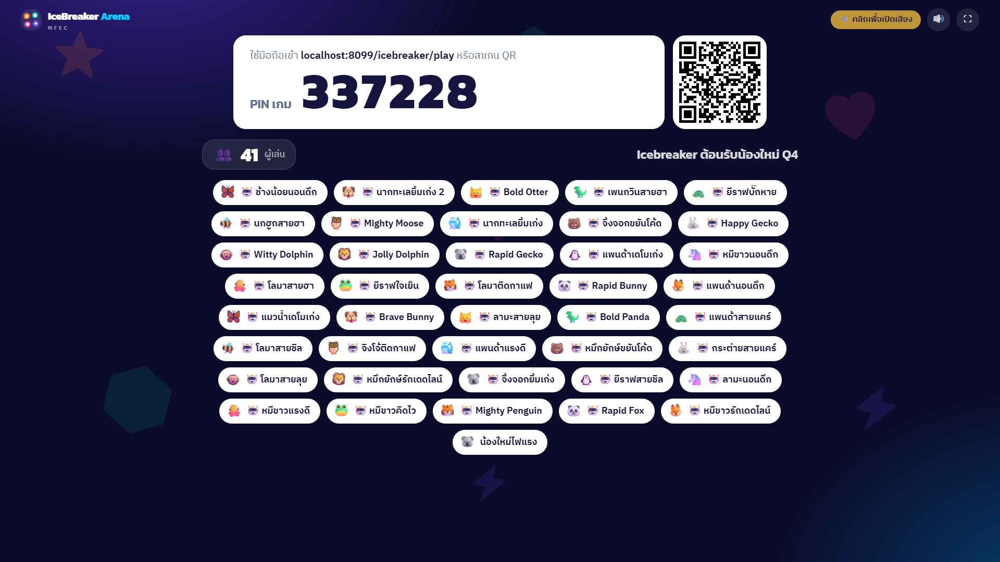
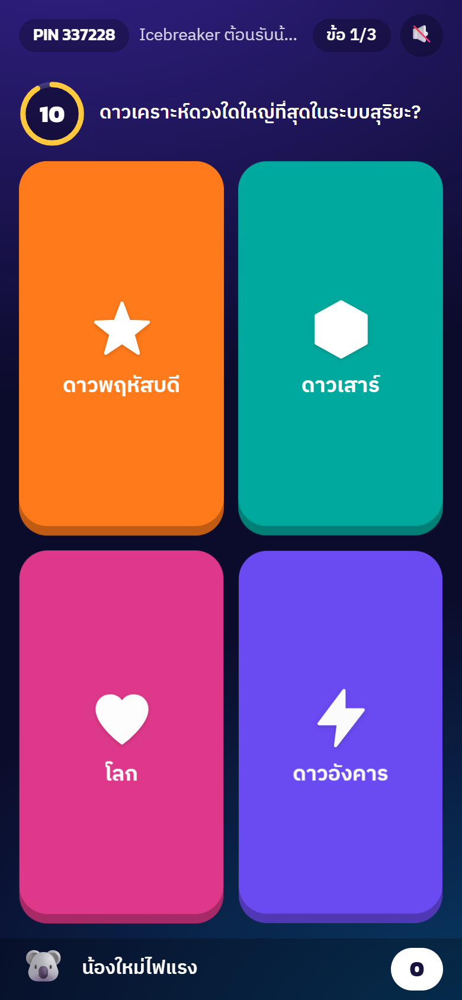
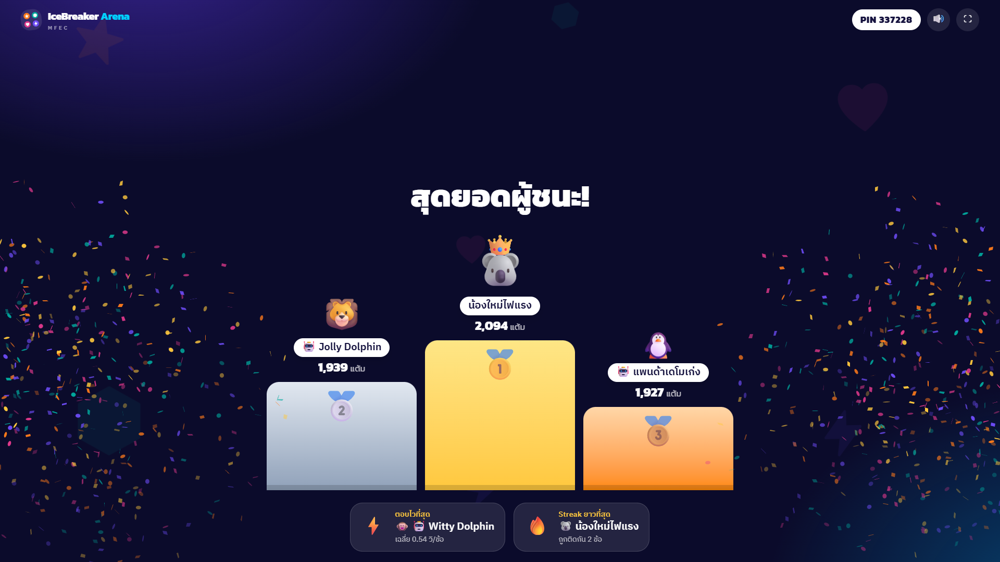

# MFEC IceBreaker Arena

เกม Icebreaker / Quiz แบบเล่นสดสำหรับทีม MFEC ผู้จัดสร้างคำถามเองแบ่งเป็นหลายด่าน เปิดห้องขึ้นจอใหญ่ ทุกคนสแกน QR แล้วตอบจากมือถือของตัวเอง แข่งเก็บแต้มแบบเรียลไทม์จนถึงโพเดียม

| จอใหญ่ (โปรเจกเตอร์) | มือถือผู้เล่น | ประกาศผล |
| --- | --- | --- |
|  |  |  |

ภาพหน้าจอครบทุกหน้า 39 ภาพ เรียงตามลำดับการเล่นจริง อยู่ใน [docs/screenshots/](docs/screenshots/)

## จัดเกมยังไง

1. **สร้างเกม** ที่ `/editor` ตั้งชื่อเกม แบ่งด่าน ใส่คำถามแบบควิซ จริงหรือเท็จ หรือโพล หรือทำสำเนาเกมตัวอย่างไปแก้ต่อ
2. **เปิดห้อง** ที่ `/host` เลือกเกมแล้วกด "▶ เริ่มห้อง" จะได้ PIN 6 หลักและ QR Code
3. **ขึ้นจอใหญ่** เอาหน้า Host ขึ้นโปรเจกเตอร์ได้เลย หรือกด "🖥️ จอแยก" เพื่อเปิดจอแสดงผลแยก (`/stage/<PIN>`) จอที่เพิ่งเปิดต้องคลิกหนึ่งครั้งก่อนถึงจะมีเสียง เพราะเบราว์เซอร์บล็อกเสียงอัตโนมัติ
4. **ผู้เล่นเข้าห้อง** สแกน QR หรือเปิดหน้าแรกแล้วใส่ PIN ตั้งชื่อเล่น ไม่ต้องล็อกอิน
5. **เล่นจนจบ** เดินเกมจากแถบควบคุมด้านล่างของหน้า Host จบแล้วเปิดรายงานและดาวน์โหลด CSV ได้

เกมที่สร้างถูกเก็บในเบราว์เซอร์เครื่องนั้นเท่านั้น ถ้าจะย้ายเครื่องหรือส่งให้เพื่อนแก้ต่อ ใช้ปุ่ม "⬇️ ส่งออก JSON" และ "⬆️ นำเข้า JSON" ในหน้า Editor

## รันบนเครื่อง (dev)

ต้องมี Node.js 20.9 ขึ้นไป (ทดสอบบน 22) และ npm

```bash
npm install
npm run dev
```

- เว็บ: http://localhost:3000
- Game server: http://localhost:4000 (ดูสถานะที่ `/health`)
- มือถือใน Wi-Fi วงเดียวกันเข้าเล่นได้เลย ถ้าเปิดหน้า Host จาก localhost QR บนจอจะชี้ไปที่ IP ของเครื่องให้เอง บน Windows ต้องอนุญาต Node.js ผ่าน Firewall (Private network) ในครั้งแรก

| คำสั่ง | ทำอะไร |
| --- | --- |
| `npm run dev` | รัน game server กับเว็บพร้อมกัน แบบ hot reload |
| `npm run typecheck` | เช็ก TypeScript ทุก package |
| `npm test` | unit test การคิดคะแนน validation และ flow ของห้อง |
| `npm run build` | build เว็บสำหรับ production |
| `npm run bots -- <PIN> [จำนวน=50] [--ramp=20]` | ปล่อยบอตเข้าห้องเพื่อทดสอบโหลดหรือเดโม บอตตอบทุกข้อ แล้วสรุปเวลาที่ server ตอบรับ (p50/p95) ตอนจบ ใส่ `--url=` ถ้า game server ไม่ได้อยู่ที่ localhost:4000 |

```
packages/shared       type, การคิดคะแนน และ validation ที่ server กับเว็บใช้ร่วมกัน
apps/server           game server (Socket.IO) ห้องทั้งหมดอยู่ในหน่วยความจำ
apps/web              Next.js: หน้าแรก, Editor, Host, จอใหญ่, มือถือผู้เล่น
ecosystem.config.js   ตั้งค่า pm2 สำหรับ production
deploy/               สคริปต์ deploy และ config nginx สำหรับวางหลัง reverse proxy
```

## Production ด้วย pm2

ต้องมี Node.js 20.9 ขึ้นไป และ pm2 (`npm install -g pm2`) วางได้สองแบบ

### แบบที่ 1: หลัง nginx ใต้ path `/icebreaker` (แนะนำ)

ผู้เล่นเข้าทาง HTTPS ของโดเมนเดิม เช่น `https://<โดเมน>/icebreaker` ไม่ต้องเปิด port เพิ่ม เว็บกับ game server ฟังแค่ `127.0.0.1` แล้ว nginx ส่งต่อให้ ทั้งหน้าเว็บและ WebSocket ของเกม

```bash
git clone <repo> && cd <repo>
bash deploy/deploy.sh                # ติดตั้ง ทดสอบ build แล้วเริ่มด้วย pm2 ใช้คำสั่งเดิมทุกครั้งที่อัปเดต
sudo bash deploy/nginx-enable.sh     # ครั้งแรกครั้งเดียว: ต่อ config เข้ากับ nginx แล้ว reload
```

`deploy.sh` ทำตามลำดับนี้ และหยุดทันทีถ้าขั้นไหนพัง

1. เช็กว่า port ว่าง หรือเป็นของ app นี้เองที่รันจากโฟลเดอร์เดียวกัน
2. เช็ก `/health` ว่าไม่มีห้องเปิดอยู่ ถ้ามีจะไม่ทำต่อ เพราะ restart แล้วเกมที่เล่นอยู่จบทันที (`FORCE=1` เพื่อข้าม)
3. `git pull --ff-only` → `npm ci` → `npm test` → `npm run build`
4. `pm2 startOrReload ecosystem.config.js` รอจนทั้งสอง process ตอบ แล้ว `pm2 save`

ระหว่าง build (ราว 1–2 นาที) เว็บที่รันอยู่ใช้งานไม่ได้ จึงควรอัปเดตช่วงที่ไม่มีกิจกรรม ถ้า build พังหรือถูกยกเลิกกลางทาง สคริปต์จะคืน build เดิมให้ และเว็บกลับมาทำงานแบบเดิมโดยไม่ต้อง restart ถ้าพังหลัง `git pull` ได้โค้ดใหม่มาแล้ว จะพิมพ์คำสั่ง `git checkout <commit เดิม> && bash deploy/deploy.sh` ไว้ให้ย้อนกลับ ส่วน `pm2 save` จะถูกข้ามพร้อมคำเตือน ถ้าตอนนั้น pm2 ไม่ได้รัน app อื่นที่เคย save ไว้ เพื่อไม่ให้ app เหล่านั้นหายจากรายการที่ pm2 เปิดคืนหลัง reboot

ค่าเริ่มต้นคือ path `/icebreaker` เว็บ port `4231` และ game server port `4232` เปลี่ยนได้ด้วย `NEXT_PUBLIC_BASE_PATH`, `WEB_PORT`, `GAME_PORT` (ดู[ตั้งค่า](#ตั้งค่า)) ถ้าเปลี่ยน port หลังจาก deploy ไปแล้ว ให้ `pm2 delete icebreaker-server icebreaker-web` ก่อน เพราะ reload ไม่อ่าน args ใหม่ และต้องแก้ port ใน `deploy/nginx-icebreaker.conf` ให้ตรงกัน

`nginx-enable.sh` เพิ่มบรรทัด `include ".../deploy/nginx-icebreaker.conf";` ต่อจากบรรทัด include `.../deploy/nginx-*.conf` ของ app อื่น (หรือท้ายไฟล์ถ้าไม่มี) ลงในไฟล์ location ที่ `server { }` ของเว็บ include อยู่ (ค่าเริ่มต้น `/etc/nginx/snippets/apps-locations.conf` ถ้าไม่ใช่ให้ใส่ path ตามหลัง) สำรองไฟล์เดิมไว้ข้างกัน แล้วรัน `nginx -t` ถ้าไม่ผ่านจะคืนไฟล์เดิมและไม่ reload รันซ้ำได้ไม่มีผล ใน config มี

- `/icebreaker/socket.io/` → game server พร้อม header สำหรับ WebSocket
- `/icebreaker` และ `/icebreaker/...` → เว็บ
- `/IceBreakerArena/...` → redirect 301 ไป `/icebreaker/...` เผื่อคนพิมพ์ชื่อเต็ม

ห้ามเปิด `/info` ของ game server ออกนอกเครื่อง เพราะบอก IP ภายในของเครื่อง config นี้ส่งต่อแค่ `/socket.io/`

### แบบที่ 2: เปิด port ตรง

```bash
npm ci                          # ต้องลง devDependencies ด้วย เพราะใช้ตอน build
npm run build
pm2 start ecosystem.config.js
pm2 save
```

ถ้าเครื่องตั้ง `NODE_ENV=production` ไว้ npm จะข้าม devDependencies ให้ใช้ `npm ci --include=dev` แทน

| Process | Port | รันด้วย |
| --- | --- | --- |
| `icebreaker-server` | 4000 | `node --import tsx src/index.ts` |
| `icebreaker-web` | 3000 | `next start` |

เปิด TCP port 3000 และ 4000 ให้เครื่องผู้เล่นเข้าถึงได้ เพราะมือถือต่อ WebSocket ตรงไปที่ port 4000 ถ้าจะใช้ port อื่น ให้ตั้ง `WEB_PORT` กับ `GAME_PORT` ไว้ทั้งตอน `npm run build` และ `pm2 start` เพราะ port ของ game server ถูกฝังลงในหน้าเว็บตอน build

> **⚠️ ข้อควรระวัง**
>
> - **game server ต้องมี 1 instance (fork mode) เท่านั้น** ห้องทั้งหมดอยู่ในหน่วยความจำของ process เดียว ถ้าเพิ่ม instance หรือใช้ cluster mode ผู้เล่นห้องเดียวกันจะกระจายไปคนละ process แล้วหาห้องไม่เจอ
> - **restart หรือ deploy `icebreaker-server` แล้วทุกเกมที่กำลังเล่นจบทันที** ให้ทำช่วงที่ไม่มีกิจกรรม เช็กก่อนได้ว่า `/health` ตอบ `"rooms":0`

### ให้ pm2 เริ่มเองตอนเปิดเครื่อง

- **Linux** รัน `pm2 startup` แล้วรันคำสั่งที่มันพิมพ์ออกมา (ต้องใช้ sudo) จากนั้น `pm2 save`
- **Windows** `pm2 startup` ใช้กับ Windows ไม่ได้ ให้ติดตั้ง pm2 เป็น Windows Service ด้วย [pm2-installer](https://github.com/jessety/pm2-installer) แล้ว `pm2 start` กับ `pm2 save` ตามปกติ

### ดูแลระบบ

```bash
pm2 status                          # สถานะ จำนวนครั้งที่ restart และ RAM
pm2 logs icebreaker-server          # log สด มี timestamp
curl http://localhost:4000/health   # {"ok":true,"rooms":<ห้องที่เปิดอยู่>,"clients":<connection>,"uptimeS":...} (แบบที่ 1 ใช้ port 4232)
pm2 install pm2-logrotate           # หมุนไฟล์ log ไม่ให้โตไม่หยุด (ทำครั้งเดียว)
```

อัปเดตเวอร์ชัน (ช่วงที่ไม่มีเกมเล่นอยู่): แบบที่ 1 รัน `bash deploy/deploy.sh` อย่างเดียว แบบที่ 2:

```bash
npm ci
npm run build
pm2 restart ecosystem.config.js
```

ถ้าแก้ `ecosystem.config.js` ให้ใช้ `pm2 delete ecosystem.config.js`, `pm2 start ecosystem.config.js` แล้ว `pm2 save` แทน เพราะ `restart` ไม่อ่าน script และ args ใหม่

### ตั้งค่า

| ตัวแปร | ตั้งที่ | ค่าเริ่มต้น | ใช้ทำอะไร |
| --- | --- | --- | --- |
| `NEXT_PUBLIC_BASE_PATH` | environment ตอน `npm run build` **และ** ตอน `pm2 start` ต้องเป็นค่าเดียวกัน | ว่าง (อยู่ที่ root) | path ที่เว็บอยู่หลัง reverse proxy เช่น `/icebreaker` เบราว์เซอร์จะต่อ game server ที่ `<path>/socket.io` บนโดเมนเดียวกัน |
| `BIND_HOST` | environment ตอน `pm2 start` | `0.0.0.0` | interface ที่ทั้งสอง process ฟัง หลัง proxy ใช้ `127.0.0.1` |
| `WEB_PORT`, `GAME_PORT` | environment ตอน `pm2 start` ถ้าไม่มี base path ต้องตั้ง `GAME_PORT` ตอน `npm run build` ด้วย | `3000`, `4000` | port ของเว็บและ game server (`ecosystem.config.js` ส่งต่อเป็น `PORT`, `HOST` ให้ game server) ถ้าไม่มี base path เบราว์เซอร์จะต่อ game server ที่ `GAME_PORT` ของตอน build |
| `NEXT_PUBLIC_GAME_SERVER_URL` | environment ตอน `npm run build` | ถ้ามี base path: โดเมนของหน้าเว็บ + base path ถ้าไม่มี: โฮสต์ของหน้าเว็บ + `:<GAME_PORT>` (`4000`) | ที่อยู่ game server ที่เบราว์เซอร์ต่อไป ใช้เมื่อ game server อยู่คนละที่กับเว็บ ถ้ามี path ใน URL จะต่อที่ `<path>/socket.io` |
| `NEXT_PUBLIC_JOIN_BASE_URL` | environment ตอน `npm run build` | ที่อยู่ของหน้าเว็บที่เปิดอยู่ (รวม base path) | ที่อยู่ที่แสดงใต้ QR ให้ผู้เล่นพิมพ์เข้ามา |

`deploy/deploy.sh` ตั้งค่าให้เองเป็น `NEXT_PUBLIC_BASE_PATH=/icebreaker`, `BIND_HOST=127.0.0.1`, `WEB_PORT=4231`, `GAME_PORT=4232` ถ้าไม่ได้ตั้งไว้ก่อน

ค่า `NEXT_PUBLIC_*` ถูกฝังลงไปตอน build ถ้าเปลี่ยนต้อง `npm run build` ใหม่ และถ้าเว็บเปิดผ่าน HTTPS game server ก็ต้องเป็น HTTPS ด้วย เพราะเบราว์เซอร์ไม่ยอมให้หน้า HTTPS ต่อ `ws://` (แบบที่ 1 ได้ HTTPS จาก nginx อยู่แล้ว)

บน Windows ถ้า build ใน Git Bash ให้ใส่ `MSYS_NO_PATHCONV=1` นำหน้า เช่น `MSYS_NO_PATHCONV=1 NEXT_PUBLIC_BASE_PATH=/icebreaker npm run build` ไม่งั้น Git Bash จะแปลง `/icebreaker` เป็น `C:/Program Files/Git/icebreaker` (`next.config.ts` จะแจ้ง error ให้)

## ข้อจำกัดตอนนี้

- ยังไม่มีล็อกอิน (Entra ID / SSO) ผู้เล่นเข้าด้วยชื่อเล่น ส่วนสิทธิ์ควบคุมห้องผูกกับเบราว์เซอร์ที่กดเริ่มห้อง
- ห้องและผลคะแนนไม่ได้บันทึกลงฐานข้อมูล ให้ดาวน์โหลด CSV จากหน้ารายงานก่อนปิดห้อง
- รับได้สูงสุด 1,000 คนต่อห้อง (`MAX_PLAYERS_PER_ROOM`)
- ถ้าเปิดจอใหญ่กับหน้า Host บนเครื่องเดียวกัน ให้ปิดเสียงไว้หนึ่งจอ ไม่งั้นเสียงจะซ้อนกัน
- ยังไม่มี Word Cloud, นำเข้าคำถามจาก Excel และ Power-ups
