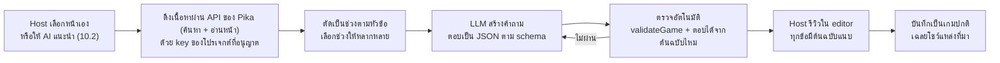
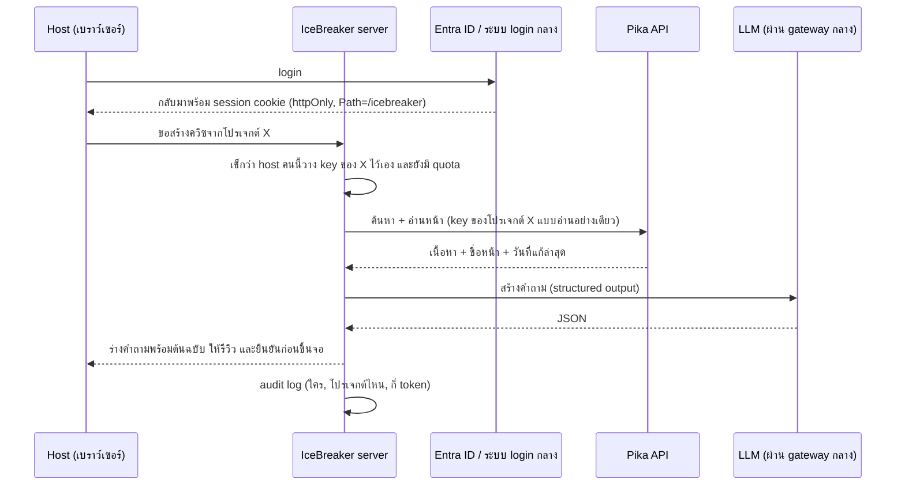
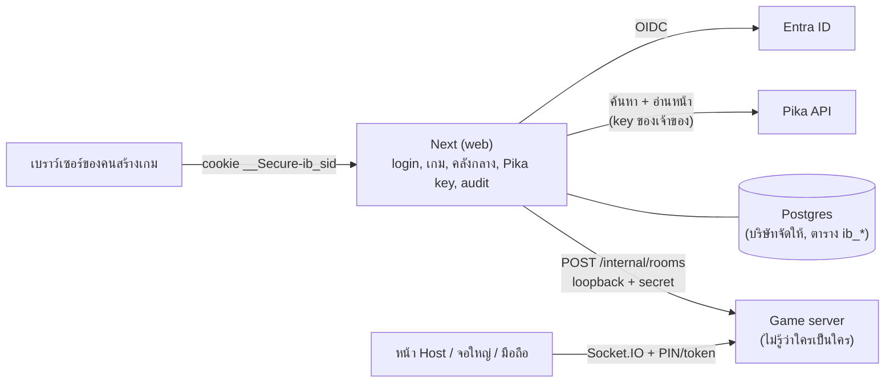

# Roadmap: MFEC IceBreaker Arena

> ร่างวันที่ 19 ต.ค. 2026 อัปเดต 20 ต.ค. 2026 (สถานะล่าสุดในหัวข้อ 3, 5, 11, 12 และ 14, หน้าใหม่ครบทั้ง 4 หน้าหลักแบบของ Kahoot ในหัวข้อ 8, แอนิเมชันแบบ Kahoot ใน 4.1, ภาพปกและรูปใน 4.2 และอัปโหลดไฟล์ให้ AI สร้างเกมใน 10.7) สำหรับให้ทีมเลือกว่าจะทำอะไรต่อ เป็นแผนให้เลือก ยังไม่ได้ตกลงว่าจะทำทั้งหมด

## 1. สรุปสั้น

- **จุดแข็งที่ต้องรักษาไว้คือ "ข้อมูลไม่ออกนอกบ้าน":** เกม คำตอบ และคะแนนอยู่บนเครื่องของเราเอง ฟีเจอร์ใหม่ทุกตัวต้องรักษาข้อนี้ไว้ ([หัวข้อ 2](#2-หลักการ-ข้อมูลอยู่ในบ้าน))
- **ถัดไปทันที: ภาพปกเกม + แอนิเมชันแบบ Kahoot:** การ์ดเกมยังไม่มีภาพปก และ Kahoot มีจังหวะแอนิเมชันมากกว่าเรา ([4.1](#41-แอนิเมชันแบบ-kahoot-ทำให้ครบทุกจังหวะ) และ [4.2](#42-ภาพปกเกมและรูปในคำถาม))
- **ทำด่านสวยก่อน:** ธีมต่อด่าน, intro แบบภาพยนตร์, แผนที่ด่าน, leaderboard แบบสนามแข่ง, โพลแบบ this-or-that ทั้งหมดใช้ engine 4 ตัวเลือกเดิมได้เลย ไม่ต้องมี infra ใหม่
- **ก่อนเพิ่มประเภทคำถามหรือโหมด ต้องปรับ engine ก่อน:** ทำ registry ของประเภทคำถามกับ hook ของโหมด ไม่งั้นการเพิ่มของใหม่แต่ละชิ้นต้องแก้ราว 20 จุด
  - ข้อยกเว้นที่ทำไปแล้ว: puzzle, type answer และ slider ทำก่อนมี registry เพื่อให้เกมมีลูกเล่นทันกับ Kahoot ตอนนี้ขึ้น production แล้ว (หัวข้อ 3) ต้องแก้กระจายทั้ง shared, server, จอใหญ่, มือถือ, editor และรายงานจริงตามที่คาด registry จึงยังเป็นงานแรกก่อนเพิ่มประเภทถัดไป
- **โหมดที่เหมาะกับงาน icebreaker ที่สุด:** Team battle, Boss battle (ทุกคนช่วยกันตี), Marble race (ใช้ดวงด้วย ทุกคนจึงมีลุ้น) และ Who's who (ทายว่าเรื่องนี้เป็นของใคร)
- **หน้าใหม่ ครบทั้ง 4 หน้าหลักแบบของ Kahoot (Discover, Learn, Present, Make) แต่ใช้ชื่อของเราเอง:** "สำรวจ" ให้ค้นและเลือกชุดเกมตามโอกาส ตามเรื่อง และตามเทศกาล, "สนามซ้อม" ให้ฝึกคนเดียว (flashcard, ทวนแบบไม่จับเวลา, ข้อสอบจำลอง), "เวทีสด" สำหรับนำเสนอ ประชุม และอบรม (สไลด์คั่น, Q&A, word cloud, ปิดคะแนนได้) และ "สร้างเกม" ที่รวมทางเริ่มสร้างเกมกับแกลเลอรี template ส่วนปุ่ม Join คือหน้าเข้าเกมที่มีอยู่แล้ว หน้าตาต้องสวยและใช้ง่ายกว่าของ Kahoot ตามกติกาใน 8.5 หน้าแรกเดิมไม่เปลี่ยน แค่เพิ่มเมนูไปหน้าใหม่ ([หัวข้อ 8](#8-หน้าใหม่-สำรวจ-สร้างเกม-สนามซ้อม-และเวทีสด))
- **นำเข้าจาก Excel:** นำเข้าคำถามทั้งเกมจากไฟล์ .xlsx หรือ .csv ได้ มีหน้าตัวอย่างก่อนนำเข้าและบอก error รายแถว ไฟล์ถูกอ่านในเบราว์เซอร์ ไม่ออกนอกเครื่อง ([หัวข้อ 9](#9-นำเข้าคำถามจาก-excel))
- **Pika → Quiz:** เริ่มจากให้ host วางข้อความเอง ระบบยังไม่ต้องต่อกับ Pika จากนั้นค่อยต่อผ่าน API ของ Pika ที่มีอยู่แล้ว (ค้นหา + อ่านหน้า ด้วย key ที่เจ้าของโปรเจกต์ออกให้) โดย**ผู้เล่นไม่ต้อง login** แต่**คนที่สั่งสร้างควิซจาก Pika ต้อง login** ([หัวข้อ 11](#11-login-pika-key-และเกมส่วนตัว))
- **Login ของคนสร้างเกม:** คนสร้างเกม login ก่อน แล้ววาง key ของโปรเจกต์ Pika เองได้ เกมเป็น**ของส่วนตัวตาม login** และกด**แชร์ไปคลังเกมกลาง**ให้ทุกคนเห็นเป็นเกมตัวอย่างได้ ส่วนเกมที่สร้างจาก Pika แชร์ไม่ได้ เพราะเนื้อหาจะหลุดออกนอกโปรเจกต์ ระหว่างรอ login ของบริษัท (SSO) ใช้บัญชี local ที่ผู้ดูแลสร้างให้ไปก่อน ซึ่งเสร็จบนเครื่อง dev แล้ว ผู้เล่นยังไม่ต้อง login เหมือนเดิม ([11.7–11.11](#117-ใส่-pika-key-หลัง-login))
- **ลำดับที่แนะนำ:** 3 ประเภทใหม่ขึ้น production แล้ว ต่อไปคือเปิดบัญชี local บน production เมื่อได้ Postgres ของบริษัท → Phase 0 งานเล็ก → 1 ด่านสวย → 2 engine → 3 ประเภทคำถาม → 4 โหมด → 5 งานที่ต้องมี login, DB หรือ storage ส่วน Pika และหน้าใหม่ (หัวข้อ 8) ทำขนานไปได้ เพราะหน้าใหม่ขั้นแรก (เมนู สำรวจ สร้างเกม และโหมดนำเสนอ) ไม่ต้องรอ DB

**ขนาดงาน** (dev 1 คนทำงานคู่กับ AI assistant):

| ขนาด | เวลา | ใช้คำนวณ |
|---|---|---|
| S | ไม่เกิน 1 วัน | 1 วัน |
| M | 2–4 วัน | 3 วัน |
| L | 1–2 สัปดาห์ | 7 วัน |
| XL | มากกว่า 2 สัปดาห์ | — |

ขนาดของประเภทคำถามและโหมดใหม่คิดโดยถือว่า engine ใน Phase 2 เสร็จแล้ว ถ้ายังไม่เสร็จ ให้บวกเพิ่มชิ้นละ 1–2 วัน

**เครื่องหมาย:**
- **(Kahoot มี)** = ตรวจกับ help center ของ Kahoot แล้วเมื่อ ต.ค. 2026 ใช้เป็นแรงบันดาลใจเท่านั้น
- **(ประเมินเอง)** = ยังไม่ได้ไล่โค้ดละเอียด

## 2. หลักการ: ข้อมูลอยู่ในบ้าน

ถ้าใช้บริการเว็บข้างนอก คำถาม เฉลย ชื่อผู้เล่น และคะแนนจะไปเก็บบน cloud ของผู้ให้บริการ แต่ของเรายังอยู่ในเครือข่ายภายในทั้งหมด จึงเหมาะกับเนื้อหาภายใน เช่น ควิซ security awareness หรือความรู้สินค้า ณ วันนี้:

| ข้อมูล | อยู่ที่ไหน | หายเมื่อไหร่ |
|---|---|---|
| เนื้อหาเกม (คำถาม เฉลย) | localStorage ของเครื่อง host และไฟล์ JSON ที่ export เอง ส่งเข้า game server ตอนเปิดห้อง แล้วเก็บไว้ใน memory (แผน: ย้ายไปเก็บใน DB บน server ของเราเองตาม login ดู 11.8) | ใน memory หายเมื่อปิดห้อง |
| ชื่อเล่น คำตอบ คะแนน | memory ของ game server | host กดปิดห้อง, ห้องว่าง 60 นาที หรือ 120 นาทีหลัง podium |
| รายงาน | ดาวน์โหลดเป็น CSV ลงเครื่อง host | ตามที่ host เก็บ |
| หน้าเว็บ (ฟอนต์ สคริปต์ เสียง) | ทั้งหมดอยู่ในแอป ไม่มี analytics และไม่มี CDN | — |

**ผลตรวจบนเครื่องจริง (ต.ค. 2026):** เปิดทุกหน้าทั้งบน desktop และมือถือแล้ว ไม่มี request ไป host อื่นเลย ส่วน WebSocket ต่อเข้า server ของเราเท่านั้น

**ช่องที่ข้อมูลอาจหลุดได้ และวิธีกัน:**

| # | ช่องทาง | เกิดอะไร | วิธีกัน |
|---|---|---|---|
| 1 | รูปที่ลิงก์จากเว็บนอก (`imageUrl`) | เครื่องที่แสดงรูปจะไปขอรูปจากเว็บนั้น เว็บนั้นจึงรู้ IP และเวลา และตัว URL เองอาจบอกเนื้อหา เกมในคลังกลางจะทำให้มือถือทุกคนที่เล่นไปขอรูปจากเว็บนั้น | ให้อัปโหลดรูปเข้าระบบเราเอง (Phase 5b) แล้วล็อก CSP `img-src 'self'` ระหว่างนี้ตอนแชร์ให้แสดงรายชื่อเว็บที่รูปมาจากให้ผู้แชร์และผู้ดูแลคลังเห็น |
| 2 | AI สร้างควิซ | เนื้อหา wiki ถูกส่งไปผู้ให้บริการ LLM | ต้องได้รับอนุมัติก่อน ส่งได้เฉพาะโปรเจกต์ที่เจ้าของอนุญาต ใช้ LLM gateway กลางของบริษัทเดียวกับที่ Pika ใช้ (ไม่เพิ่มผู้รับข้อมูลรายใหม่) มีชื่อคนกด และมี log ([หัวข้อ 10](#10-สร้าง-quiz-จาก-knowledge-base-pika)) |
| 3 | repo บน GitHub เป็น public | ถ้าใส่คำถามจริงลง `sample-games.ts` หรือ commit ไฟล์ export จะหลุดทันที | template ใน repo ใช้เนื้อหาทั่วไปเท่านั้น เกมจริงเก็บใน localStorage หรือ DB |
| 4 | origin เดียวกับแอปอื่น | ถ้าแอปอยู่โดเมนเดียวกับแอปอื่นแล้วแยกกันแค่ด้วย path สคริปต์ของแอปอื่นจะอ่าน `ib.games` และ `ib.host.*` ได้ และเมื่อมี login แล้วก็ยังเรียก API ของเราด้วย cookie ของผู้ใช้ได้ด้วย (path ไม่ใช่กำแพง) | ย้ายเกมไปเก็บใน DB ฝั่ง server ตาม login (11.8) และ**ต้องแยกแอปไปไว้ subdomain ของตัวเองก่อนเปิดรับ Pika key** (ด่าน G2 ใน 11.11) |
| 5 | จอใหญ่และมือถือ | ทุกคนในห้องเห็นและถ่ายรูปได้ | เนื้อหาลับห้ามขึ้นจอ ใช้ audience guard ([หัวข้อ 11.9](#119-กันเนื้อหาจาก-pika-หลุด)) |
| 6 | ยังไม่มี security header หรือ CSP | ถ้า dependency ตัวไหนแอบส่งข้อมูลออก เบราว์เซอร์จะไม่บล็อก | ตั้ง CSP `default-src 'self'` และ `connect-src 'self'` ใน Phase 0 |

**กติกา:** ฟีเจอร์ใหม่ทุกตัวต้องเก็บข้อมูลไว้ในบ้านเป็นค่าเริ่มต้น อะไรที่ส่งข้อมูลออกนอกต้องให้ผู้ใช้เลือกเปิดเอง (opt-in) ต้องรู้ว่าใครเป็นคนกด และต้องผ่านการอนุมัติ

## 3. ตอนนี้มีอะไรแล้ว

สถานะ ณ 20 ต.ค. 2026: ✅ = ใช้งานได้บน production แล้ว, 🚧 = เสร็จบนเครื่อง dev กำลังทดสอบ ยังไม่ขึ้น production

- ✅ ประเภทคำถาม: quiz (2–4 ตัวเลือก), true/false และ poll (ผู้ตอบ poll ได้ 100 × ตัวคูณ)
  - quiz ที่ติ๊กถูกหลายข้อแปลว่า "ตอบข้อไหนในกลุ่มนี้ก็ถูก" ยังไม่ใช่ multi-select
- ✅ ประเภทคำถามใหม่ 3 แบบ (รายละเอียดในหัวข้อ 5):
  - 🧩 **puzzle (เรียงลำดับ):** 3–4 ข้อ มือถือแตะเรียงจากอันดับแรกไปอันดับสุดท้าย แตะซ้ำเพื่อเอาออก แล้วกดส่ง ได้คะแนนเมื่อเรียงถูกทั้งชุด
  - ⌨️ **type answer (พิมพ์ตอบ):** ตั้งคำตอบที่ยอมรับได้ 1–4 แบบ ยาวไม่เกิน 40 ตัวอักษร เทียบโดยไม่สนตัวพิมพ์เล็กใหญ่ เว้นวรรค เครื่องหมาย และลำดับการพิมพ์สระกับวรรณยุกต์ไทย
  - 🎚️ **slider (ทายตัวเลข):** ตั้งสเกล (ต่ำสุด สูงสุด ช่วงละ) หน่วย และระยะที่ยอมได้ (±) คะแนน = คะแนนความเร็วตามปกติ × ความใกล้ (ตรงเป๊ะ ×1, ห่างเท่าระยะที่ยอมได้ ×0.5, เกินนั้นได้ 0) มือถือมีปุ่ม −/+ และ slider เริ่มที่กลางสเกลและต้องขยับก่อนส่ง (template ทุกชุดตั้งเฉลยไม่ให้อยู่กลางสเกล แต่ editor ยังไม่เตือนถ้าผู้สร้างเกมตั้งไว้ตรงกลาง)
  - เฉลยไม่ถูกส่งไปเครื่องผู้เล่นก่อนถึงเวลาเฉลย: puzzle สุ่มลำดับที่ server และไม่มีทางออกมาตรงกับลำดับที่ถูก ส่วน type answer และ slider ไม่ส่งตัวเลือกไปเลย
- ✅ ด่าน (round): มีชื่อและคำโปรย, ตัวคูณประจำด่าน (สูงสุด ×4) และโหมด "ไม่นับเวลา" (accuracy)
  - ตัวคูณต่อข้อเลือกได้ 0, 1 หรือ 2 รวมกับตัวคูณด่านได้สูงสุด ×8
  - ✅ ป้าย "⏱️ ไม่นับความเร็ว" ขึ้นใน editor, ตอน intro ของด่าน, บนคำถามทั้งจอใหญ่และมือถือ และบนหน้าผลของผู้เล่น คนเล่นจึงรู้ว่าตอบช้าก็ได้เต็ม
- ✅ คะแนน: ใช้สูตรเดียวกับ Kahoot คือ `1000 × (1 − (t/T)/2)` ขั้นต่ำ 500 และได้ 1000 ถ้าตอบภายใน 0.5 วินาที
  - มีโบนัส streak สูงสุด +500
  - คะแนนเท่ากันให้ตัดสินด้วยเวลารวม
- ✅ ขั้นตอนเกม: lobby → intro ของด่าน (wipe 3.5 วินาที) → 3-2-1 → คำถาม → เฉลย → leaderboard → podium พร้อมรางวัล "เร็วสุด" และ "streak ยาวสุด"
- ✅ ปิดห้อง: host กดปิดห้องได้ รวมถึงห้องที่เล่นจบแล้ว ห้องถูกลบออกจาก server ทันที ผู้เล่นและจอใหญ่ได้รับแจ้ง และสคริปต์ deploy ไม่ยอม restart ถ้ายังมีห้องที่กำลังเล่นอยู่ (เพราะการ restart ทำให้เกมที่เล่นอยู่จบ)
- ✅ เพลงและเสียงประกอบ: สังเคราะห์ด้วย WebAudio ไม่ใช้ไฟล์เสียง มือถือเริ่มแบบปิดเสียง
- ✅ ลูกเล่นภาพ: confetti, leaderboard ที่สลับอันดับให้เห็น, คำตอบที่ใช้ทั้งสีและรูปทรง และรองรับ reduced motion ของ OS
  - ✅ แอนิเมชันเฉลยของ 3 ประเภทใหม่: puzzle เฉลยลำดับทีละอัน, type answer เด้งคำตอบที่ถูกขึ้นทีละคำพร้อมจำนวนคน (คำตอบผิดไม่ขึ้นจอใหญ่), slider มีกราฟคำตอบของทุกคน แถบที่ได้คะแนนเป็นสีเขียว และเข็มที่กวาดไปหยุดที่เฉลยพร้อมค่าเฉลี่ยที่ทาย
- ✅ เข้าเกม: ใช้ PIN 6 หลักหรือ QR, มีชื่อเล่นสุ่มและ avatar, มือถือแสดงคำถามและตัวเลือก, host เตะผู้เล่นออกได้
- ✅ จัดการเกม: editor พร้อม autosave, export/import JSON และรายงานพร้อมดาวน์โหลด CSV
  - ✅ template รวม 5 ชุด: "MFEC Icebreaker: อุ่นเครื่องก่อนลุย", "Security Awareness 101", "ปาร์ตี้รวมมิตร: ครบทุกลูกเล่น" ที่ใช้ครบทั้ง 6 แบบ, "ทายจากอีโมจิ" ที่ดูอีโมจิแล้วพิมพ์ตอบ และ "ตัวเลขและลำดับ: ทายให้ใกล้ เรียงให้ถูก" ที่เน้น slider และ puzzle พร้อม Final Round ×2
- ✅ รองรับ 1,000 คนต่อห้อง มีสคริปต์ bots สำหรับ load test (ตั้งเกณฑ์ไว้ที่ 300 bots ต้องได้ p95 ≤ 300 ms ยังไม่มีผลการทดสอบ 1,000 คนจริง)
  - ✅ load test หลายห้องพร้อมกันที่ตอบครบทั้ง 6 ประเภท bot แต่ละตัวรู้ล่วงหน้าว่าจะตอบถูกหรือผิด แล้วเช็กว่าจำนวนคนตอบถูกของทุกข้อ ผลถูกผิดของทุกคน และคะแนนรวมของทุกคนตรงกับที่ควรเป็น ผ่านบน production แล้ว (3 ห้อง ห้องละ 20 คน รวม 360 คำตอบ ไม่มีผลผิดเลย เวลาตอบรับ p50 7 ms, p95 44 ms, ช้าสุด 484 ms) สคริปต์นี้ยังไม่อยู่ใน repo (หัวข้อ 12 ข้อ 5)
- 🚧 มือถือและจอใหญ่เทียบนาฬิกากับ server ใหม่ทุก 30 วินาที เวลานับถอยหลังจึงไม่เพี้ยนเมื่อเปิดค้างไว้นาน (อยู่ใน main แล้ว ขึ้น production พร้อมรอบ deploy ถัดไป)
- 🚧 บัญชี local สำหรับคนสร้างเกม (`AUTH_MODE=local`): ผู้ดูแลสร้างบัญชีให้ด้วยคำสั่ง `npm run users` ไม่มีหน้าสมัครเอง ผู้เล่นไม่ต้อง login เหมือนเดิม ใช้ระหว่างรอ login ของบริษัท และเปิดบน production ได้เมื่อได้ Postgres ของบริษัท (หัวข้อ 11.10)

## 4. ด่านสวยๆ: ธีม ฉาก แอนิเมชัน เสียง

| ไอเดีย | ทำอะไร | ขนาด | ต้องมีก่อน |
|---|---|---|---|
| ธีมประจำด่าน (Kahoot มี themes) | ด่านละฉาก: พื้นหลัง, particle, palette, ภาพ intro และเพลง โดยสีและรูปทรงของคำตอบเหมือนเดิมทุกธีม | M | palette จาก CI ของ MFEC (ตอนนี้ใช้สีชั่วคราว) |
| ธีมตามเทศกาล | สงกรานต์ ลอยกระทง ปีใหม่ วันครบรอบบริษัท พร้อม template คู่กัน | S ต่อธีม | ธีมประจำด่าน, ภาพที่มีลิขสิทธิ์ถูกต้อง |
| แผนที่ด่าน | เส้นทางของด่านแบบเกมมือถือ โชว์ตอนเปลี่ยนด่าน | S (M ถ้าแยกเป็นฉากของตัวเอง) | — |
| Intro แบบภาพยนตร์ | ฉากเปิดเกม และฉาก Final Round หรือด่านบอส เมื่อตัวคูณมากกว่า 1 ยาวไม่เกิน 4 วินาทีและกดข้ามได้ | S | — |
| ชุดฉลอง | ป้าย "ข้อสุดท้าย!", photo finish, "แซงแล้ว!", รางวัลใหม่ (พัฒนาขึ้นมากสุด, ตอบถูกหมด) และให้มือถือสั่นตอนขึ้นอันดับ | M | — |
| Leaderboard สนามแข่ง | top 10 วิ่งเป็นเลน แล้วมือถือโชว์เลนและระยะห่างของตัวเอง | M | — |
| ชุดเพลงและเสียง | เพลงต่อธีม, เพลง podium, เพลง final round | M | ต้องตัดสินใจว่าจะยอมใช้ไฟล์เสียงไหม และต้องมีลิขสิทธิ์ |
| พื้นหลังกำหนดเอง | ใส่รูปพื้นหลังต่อด่าน แสดงบนจอใหญ่เท่านั้น | S แบบ URL / L แบบอัปโหลด | อัปโหลดต้องมี asset storage |
| Emoji reaction สด (Kahoot มี) | ผู้เล่นกด emoji 6 แบบ จอใหญ่ลอยขึ้นมาเป็นยอดรวม ใช้ไม่ได้ระหว่างตอบ | M | rate limit ต่อผู้เล่น |
| โหมด Projector (Kahoot มี increase contrast) | สวิตช์ reduce motion ในแอป, contrast สูง และตัวอักษรใหญ่บนมือถือ | S | — |
| สุ่มลำดับคำถามและคำตอบ (Kahoot มี) | สุ่มฝั่ง server โดยสีและรูปทรงยังผูกกับตำแหน่งเดิม | S (ประเมินเอง) | — |
| ล็อกห้อง (Kahoot มี) | host ปิดไม่ให้คนเข้าเพิ่มหลังเริ่มเกม | S (ประเมินเอง) | — |

กติกาของทุกธีม:
- ข้อความภาษาไทยต้องมีแผ่นรองทึบ
- contrast ผ่าน AA เมื่อทดสอบกับ projector จริง
- แอนิเมชันต้องหยุดเมื่อเปิด reduced motion
- ห้ามกระพริบเกิน 3 ครั้งต่อวินาที

### 4.1 แอนิเมชันแบบ Kahoot: ทำให้ครบทุกจังหวะ

Kahoot ขยับทุกช่วงของเกม ไม่ใช่แค่ตอนเฉลย จอจึงดูมีชีวิตตลอด ของเรามีแอนิเมชันหลักแล้ว (หัวข้อ 3) แต่ยังมีช่วงที่จอนิ่งอยู่ ตารางนี้เทียบทีละจังหวะ แล้วเพิ่มส่วนที่ขาดให้ครบ และต้องดูดีกว่าของ Kahoot

| จังหวะ | Kahoot ทำอะไร | ของเรามีแล้ว | จะเพิ่ม | ขนาด |
|---|---|---|---|---|
| Lobby | ชื่อเด้งเข้าทีละคน, ตัวนับคนเด้ง, เพลง lobby, พื้นหลังรูปทรงลอยไปมา | ชื่อและ avatar เด้งเข้าพร้อมหมุนเล็กน้อย | ตัวนับคนเด้งทุกครั้งที่มีคนเข้า, เสียง pop, รูปทรงคำตอบลอยช้าๆ เป็นพื้นหลัง, ป้าย "พร้อมแล้ว!" เมื่อมีคนครบตามที่ตั้ง | S |
| เปลี่ยนจอ | ปาดทั้งจอด้วยแผ่นสีและรูปทรงระหว่าง คำถาม → เฉลย → อันดับ | การ์ดเปิดด่าน (round intro) | wipe แบบรูปทรง 4 สีระหว่างทุกช่วง ยาวไม่เกิน 0.6 วินาที | S |
| เปิดคำถาม | ป้าย "ข้อ 3 จาก 10" ลอยเข้า, คำถามขึ้นจอเดี่ยวพร้อมแถบโหลดใต้คำถาม | คำถามขึ้นจอเดี่ยวให้อ่าน แล้วนับ 3-2-1 | ป้ายเลขข้อลอยเข้าก่อน, แถบเวลาอ่านใต้คำถาม, ป้ายประเภท (puzzle, slider) หมุนเข้า | S |
| ระหว่างตอบ | ปุ่มคำตอบเลื่อนเข้าทีละปุ่ม, วงนับถอยหลังใหญ่, ตัวนับคนตอบ, เพลงเร่งช่วงท้าย | ปุ่ม 4 สี 4 รูปทรง, เวลานับถอยหลัง | ปุ่มเลื่อนเข้าทีละปุ่มพร้อมรูปทรงหมุน, ตัวนับคนตอบเด้งทุกครั้ง, 5 วินาทีสุดท้ายตัวเลขเต้นและเปลี่ยนสี, ป้าย "หมดเวลา!" หรือ "ตอบครบแล้ว!" | S |
| มือถือหลังกดตอบ | ปุ่มยุบลง, จอรอพร้อมข้อความขำๆ ("เร็วไปหรือเปล่า?") | จอรอพร้อมจุดเต้น | ปุ่มที่กดยุบและขยายเต็มจอ, ข้อความรอแบบสุ่ม (ไทย) หลายแบบ, สั่นสั้นๆ ถ้าเครื่องรองรับ | S |
| เฉลย | แท่งจำนวนคนตอบโตขึ้น, ข้อผิดจางลง, ข้อถูกมีเครื่องหมายถูกเด้ง | แท่งโตพร้อมกันแล้วข้อถูกสว่าง, puzzle บินเข้าช่อง, type answer เด้งทีละคำ, slider | ข้อผิดหดและจาง, ✓ เด้งบนข้อถูก, เสียงตามจังหวะ | S |
| ผลบนมือถือ | จอเขียวหรือแดงเต็มจอ, คะแนนนับขึ้น, ไฟ streak, "อันดับ 3 ตามหลัง X อยู่ 120" | มีครบทุกอย่างนี้แล้ว | ไฟ streak โตตามจำนวนข้อ, ป้าย "ขึ้นมา 2 อันดับ!" | S |
| อันดับ | แถวสลับที่, คะแนนนับขึ้น, ป้าย "X ตอบถูกติดกัน" | ลำดับเก่าก่อนแล้วสลับ, คะแนนนับขึ้น, 🔥 streak | ลูกศร ↑ และไฮไลต์คนที่แซงขึ้นมา, มงกุฎที่อันดับ 1, ป้าย "ข้อสุดท้าย!" ก่อนเข้าข้อท้าย (ชุดฉลองในตารางบน) | S |
| Podium | กลองรัว, ขึ้นทีละอันดับ 3 → 2 → 1, confetti | 3 → 2 → กลองรัว → ที่ 1 พร้อม confetti แล้วรางวัล | แท่นยกตัวขึ้นจากพื้น, ไฟสปอตไลต์, เหรียญหล่นลงบนชื่อ และมือถือของ 3 อันดับแรกโชว์เหรียญของตัวเอง | M |
| เสียง | เพลงต่อช่วงและเสียงตามจังหวะ | เสียงสั้นๆ ที่ปิดได้ | ผูกจังหวะแอนิเมชันกับเสียง (รอชุดเพลงในตารางบน) | S (ต่อจากชุดเพลง) |

กติกาเพิ่มจากกติกาของทุกธีม:
- เวลาเกมไม่ยาวขึ้น: แอนิเมชันอยู่ในช่วงเวลาที่ server กำหนดอยู่แล้ว ไม่เพิ่มเวลารอ และไม่บังข้อความที่ต้องอ่าน
- มือถือรุ่นเก่าต้องลื่น: ใช้แค่ transform กับ opacity ไม่ทำ blur หรือเงาที่ขยับ
- ทดสอบกับห้องหลายสิบคนบนจอใหญ่ 1080p และมือถือจริงก่อนขึ้น production
- ทุกชิ้นหยุดเมื่อเปิด reduced motion (ตามกติกาข้างบน)

### 4.2 ภาพปกเกมและรูปในคำถาม

ตอนนี้การ์ดเกมในหน้าเลือกเกมไม่มีภาพปก และรูปในคำถามใส่ได้แค่ลิงก์จากเว็บนอก (`imageUrl`) ซึ่งทำให้เว็บนั้นรู้ว่าใครเปิด (หัวข้อ 2 ข้อ 1) Kahoot มีภาพปกบนการ์ดทุกใบ และมีรูปในคำถามและคำตอบ

| ขั้น | ได้อะไร | ขนาด | ต้องมีก่อน |
|---|---|---|---|
| **C1 ปกอัตโนมัติ (ทำถัดไป)** | SVG ที่สร้างจากชื่อเกม รูปทรงคำตอบ และสีที่เลือก ได้ลายเดิมทุกครั้งสำหรับเกมเดิม คนสร้างเลือกสีและอีโมจิประจำเกมได้ใน editor template ที่มากับแอปได้ปกที่วาดเฉพาะ ขึ้นบนการ์ดหน้าเลือกเกม, หน้า editor, lobby ของจอใหญ่ และหน้าสำรวจ (8.3) | M | — |
| **C2 คลังภาพในแอป** | ชุดภาพประกอบ SVG ที่ทำเองหรือมีลิขสิทธิ์ถูกต้อง อยู่ใน repo เลือกเป็นปกหรือรูปในคำถามได้ ไม่โหลดอะไรจากเว็บนอก | M + ภาพ | ภาพที่มีลิขสิทธิ์ถูกต้อง (หัวข้อ 15 ข้อ 1) |
| **C3 อัปโหลดรูปเอง** | อัปโหลดรูปปกและรูปในคำถาม เก็บบนเครื่องของเราเท่านั้น (Postgres ใน schema ของเราหรือดิสก์ของแอป) ย่อเป็น WebP ไม่เกิน 1600 px, ลบ EXIF และพิกัด, ไฟล์ไม่เกิน 2 MB, เฉพาะคนสร้างเกมที่ login และลบพร้อมเกม จากนั้นจึงทำรูปในตัวเลือก, image reveal และพื้นหลังต่อด่านได้ | L | asset storage (หัวข้อ 12 ข้อ 10) + ตัดสินใจเรื่องอัปโหลด (หัวข้อ 15 ข้อ 5) |

กติกา:
- ไม่โหลดรูปจากเว็บนอก เมื่อมี C3 แล้วให้แปลง `imageUrl` เดิมเป็นรูปที่เก็บเอง หรือเลิกใช้
- ข้อความไทยบนรูปมีแผ่นรองทึบเสมอ และทุกรูปมีคำอธิบาย (alt)
- มือถือไม่โหลดรูปที่ไม่จำเป็นต่อการตอบ (เหมือนตอนนี้)
- รูปคนต้องมีความยินยอมตาม PDPA (หัวข้อ 7)

## 5. ประเภทคำถามใหม่

| ชื่อ | เล่นยังไง | จอใหญ่ | มือถือ | ขนาด | ต้องมีก่อน |
|---|---|---|---|---|---|
| Multi-select (Kahoot มี) | เลือกทุกข้อที่ถูก แล้วกดส่ง | กราฟเดิม | toggle + ปุ่มส่ง | M | engine |
| This-or-that | โพล 2 ทางแบบแบ่งจอครึ่ง | % สองฝั่ง | ปุ่มใหญ่ 2 ฝั่ง | S | — |
| Majority wins | ข้อที่คนเลือกมากที่สุดเป็นข้อถูก | กราฟ + ป้ายกติกา | ปุ่มเดิม | S | — |
| Emoji riddle ✅ | ทายคำจาก emoji | emoji ตัวใหญ่ | ปุ่มเดิม หรือพิมพ์ตอบ | S (ขึ้น production แล้วเป็น template "ทายจากอีโมจิ" ที่ใช้ type answer) | — |
| Info slide (Kahoot มี slides) | สไลด์คั่น ไม่มีคำตอบ | หัวข้อ + เนื้อหา + รูป | "ดูที่จอใหญ่" | S | engine (ห้ามตัด streak และห้ามนับเป็นข้อ) |
| Scale / NPS (Kahoot มี) | ให้คะแนน 1–5 หรือ 0–10 | การกระจาย + ค่าเฉลี่ย | ดาวหรือตัวเลข | S | engine |
| Slider ✅ (Kahoot มี) | ทายตัวเลข ใกล้คำตอบมากยิ่งได้มาก ของเรา: คะแนนความเร็ว × ความใกล้ (ตรงเป๊ะ ×1, ห่างเท่าระยะที่ยอมได้ ×0.5, เกินนั้น 0) ส่วน Kahoot คิดจากความแม่น 80% และความเร็ว 20% | กราฟคำตอบสูงสุด 10 แท่ง แถบที่ได้คะแนนเป็นสีเขียว + เข็มชี้เฉลย + ค่าเฉลี่ย | slider พร้อมปุ่ม −/+ เริ่มที่กลางสเกล | ขึ้น production แล้ว (เดิมประเมิน M) | ทำก่อนมี engine |
| Puzzle / เรียงลำดับ ✅ (Kahoot มี) | เรียง 3–4 ข้อให้ถูก ต้องถูกทั้งชุดถึงได้คะแนน (แผนเดิม 3–6 ข้อ ลดเหลือ 4 ให้เข้ากับสีและรูปทรง 4 แบบ) | เฉลยลำดับทีละอัน + จำนวนคนที่เรียงถูก | แตะเรียงทีละข้อ แตะซ้ำเพื่อเอาออก แล้วกดส่ง | ขึ้น production แล้ว (เดิมประเมิน M) | ทำก่อนมี engine |
| Type answer ✅ (Kahoot มี) | พิมพ์คำตอบ ตั้งคำตอบที่ยอมรับได้ 1–4 แบบ ยาวไม่เกิน 40 ตัวอักษร | คำตอบที่ถูกเด้งขึ้นทีละคำพร้อมจำนวนคน คำตอบผิดไม่ขึ้นจอ | ช่องพิมพ์ | ขึ้น production แล้ว (เดิมประเมิน M) | ทำก่อนมี engine การเทียบภาษาไทยทำแล้ว (ดูข้อควรระวัง) |
| Word cloud (Kahoot มี) | พิมพ์คำสั้นๆ | เมฆคำ top 50 แบบสด | ช่องพิมพ์ | M | engine + moderation |
| Brainstorm + โหวต (Kahoot มี) | ส่งไอเดีย → host คัด → ทุกคนโหวต | กำแพงไอเดีย | ส่งไอเดีย แล้วโหวต | L | engine + flow + moderation |
| Image reveal (Kahoot มี) | รูปค่อยๆ เปิดตามเวลา | รูปแบบ tile ที่ค่อยๆ เปิด | ปุ่มเดิม (ไม่ส่งรูปไปมือถือ) | S | แยก payload ระหว่างจอใหญ่กับมือถือ |
| คำถามเสียง (Kahoot มี) | เปิดเสียงแล้วทาย | เล่นเสียง + ปุ่มเล่นซ้ำ | ปุ่มเดิม | S | ไฟล์เสียงที่มีลิขสิทธิ์ |
| ตัวเลือกเป็นรูป (Kahoot มี) | ตอบด้วยรูป | รูป + รูปทรง | รูปทรง (ไม่โหลดรูปบนมือถือ) | M | asset storage (แนะนำ) |
| Pin on image (Kahoot มี pin answer) | ปักหมุดบนรูป | heatmap + จุดเฉลย | แตะปักหมุด | L | asset storage |
| Drop pin แบบความเห็น (Kahoot มี) | ปักหมุดโดยไม่มีข้อถูก | heatmap | แตะปักหมุด | M ถ้ามี pin แล้ว (ประเมินเอง) | Pin on image |

ข้อควรระวัง:
- **ภาษาไทย:** `น้ำ` ที่พิมพ์ด้วย `ำ` กับ `ํ+า` เป็นคนละ string กัน, สระกับวรรณยุกต์พิมพ์สลับลำดับกันได้ และ `เเ` ไม่เท่ากับ `แ` จึงต้องจัดรูปก่อนเทียบคำตอบ
  - ✅ ทำแล้วใน `normalizeTyped()` (`packages/shared/src/answers.ts`) พร้อม test: ไม่สนตัวพิมพ์เล็กใหญ่ เว้นวรรค เครื่องหมายวรรคตอน ตัวอักษรเต็มความกว้าง zero-width และ `ฯ`, แปลงเลขไทยเป็นเลขอารบิก แต่ยังนับวรรณยุกต์และไม้ยมก (`ข้าว` ≠ `ขาว`) และสัญลักษณ์ที่มีความหมาย (`C++` ≠ `C`)
  - ส่วนที่ยังไม่มี: ตัดอักขระ bidi และ moderation สำหรับข้อความที่จะขึ้นจอ (งานพื้นฐานข้อ 6 ในหัวข้อ 12)
- **การนับความยาว:** ตอนนี้นับเป็นหน่วย UTF-16 ไม่ใช่ตัวอักษรที่เห็น
- **การพิมพ์บนมือถือ:** พิมพ์ไทยบนมือถือช้า คำถามแบบพิมพ์ควรตั้งเวลาอย่างน้อย 30 วินาที หรือใช้แบบไม่นับเวลา

## 6. โหมดเกม

| โหมด | เล่นยังไง | คะแนน | ขนาด | ต้องมีก่อน |
|---|---|---|---|---|
| Classic ✅ (Kahoot มี) | ทุกคนแข่งกันเอง | เร็วและถูก 500–1000 × ตัวคูณ + streak | มีแล้ว | — |
| Accuracy ✅ (Kahoot มี) | ไม่นับเวลา | ตอบถูกได้ 1000 คงที่ | มีแล้วระดับด่าน, S ถ้าจะตั้งทั้งเกม | — |
| Lightning round | เวลาสั้น ไปข้อถัดไปเอง ไม่มี leaderboard คั่น | เหมือน classic | S | ปุ่ม pause สำหรับ host |
| Confidence (Kahoot มี) | ก่อนส่งคำตอบ เลือกว่า "มั่นใจ" หรือไม่ | มั่นใจแล้วถูกได้โบนัส ผิดเสียแต้ม (ไม่ต่ำกว่า 0) | M | engine (payload ใหม่) + mode hooks |
| Team battle (Kahoot มี team) | แบ่งทีมอัตโนมัติหรือเลือกเอง (2–8 ทีม) | เฉลี่ยของสมาชิกต่อข้อ ยุติธรรมแม้ทีมไม่เท่ากัน | L | flow + mode hooks (ทีมตามแผนกต้องมี SSO) |
| Survival | มี 1–3 ชีวิต ผิดหรือไม่ตอบเสีย 1 ชีวิต | ผู้รอดได้อันดับก่อน คนที่ตกรอบยังตอบเล่นต่อได้ | M | mode hooks |
| Boss battle | ทุกคนช่วยกันตีบอส HP ลดตามคะแนนรวมของทั้งห้อง | ดาเมจ + คะแนนส่วนตัว | M | mode hooks + ภาพบอส |
| Marble race (Kahoot มี) | ทุกคนเริ่มที่ลูกแก้ว 1 ลูก ตอบถูกได้เพิ่มทีละลูก แล้วแข่งกันตอนจบ | มีดวงผสม ทำให้คนที่ตอบผิดก็ยังมีลุ้น | M–L (ประเมินเอง) | flow (ฉากแข่งตอนจบ) |
| ยึดพื้นที่ 2 ทีม (Kahoot มี Color Kingdoms) | ตอบถูกได้ยึดช่องบนแผนที่ | ทีมที่มีช่องมากกว่าชนะ | L (ประเมินเอง) | Team battle |
| Hot seat (วงล้อ) | สุ่มคนที่สมัครใจมาตอบ คนที่เหลือทายว่าเขาจะตอบถูกไหม | คนตอบได้คะแนนจากคำถาม คนดูได้คะแนนจากการทาย | M | flow (interlude) + opt-in |
| Power-ups | double, 50:50, เพิ่มเวลา, โล่ | ปรับคะแนนรายคน | L (XL ถ้ามีระบบสะสมแต้มมาแลก) | engine + flow + mode hooks |
| Practice | ลองเล่นคนเดียวในเบราว์เซอร์ (อยู่ในหน้าสนามซ้อม หัวข้อ 8.1) | ไม่บันทึก | M | engine |
| Playlist (Kahoot มี) | เล่นหลายเกมต่อกันโดยไม่ต้อง join ใหม่ | แยกต่อเกมและรวมทั้งหมด | M (ประเมินเอง) | — |
| Rematch กับ ghost (Kahoot มี) | แข่งกับผลของรอบก่อน | ghost ปนอยู่ใน leaderboard | L | DB |
| Self-paced (Kahoot มี self-study) | เล่นเมื่อไหร่ก็ได้ก่อน deadline (เป็น assignment ในหน้าสนามซ้อม หัวข้อ 8.1) | เก็บรายคน | XL | DB + SSO |

โหมดแต่ละแบบแค่ใส่ "hook" เข้าไปใน engine กลาง เช่น การแบ่งทีม การตัดออก การปรับคะแนน และการจัดอันดับ จึงไม่ต้องเขียนเกมใหม่ทั้งเกม เกมหนึ่งเลือกได้หนึ่งโหมด และใส่ตัวแต่งระดับด่านซ้อนได้ เช่น lightning ไม่นับเวลา หรือธีม

## 7. ด่าน Icebreaker ที่เน้นทำความรู้จักกัน

| ด่าน | เล่นยังไง | ขนาด | ต้องมีก่อน |
|---|---|---|---|
| Would you rather | โพล this-or-that พร้อมชุดคำถามสำเร็จรูป | S | — |
| Two truths and a lie | host เขียน 3 ข้อของอาสาสมัครหนึ่งคน แล้วให้ทายข้อที่โกหก | S (แบบ host เขียน) / L (แบบผู้เล่นส่งเองสดๆ) | อาสาสมัครยินยอม |
| Who's who | ใน lobby ผู้เล่นส่งเรื่องเล็กๆ ของตัวเอง → host อนุมัติ → ระบบสร้างคำถาม "เรื่องนี้ของใคร?" | L | flow (สร้างคำถามสด) + moderation + opt-in |
| Predictions | ทาย "ห้องนี้กี่ % จะเลือก A?" หรือ "ใครจะชนะด่านหน้า?" | M | engine (คะแนนคิดจากผลของคำถามอื่น) |
| Brainstorm + โหวต | ส่งไอเดียแล้วโหวต ได้ผลงานกลับไปจริง | L | ดูหัวข้อ 5 |
| Q&A ถามผู้พูด (Kahoot มี) | ผู้ฟังส่งคำถามและโหวตคำถามที่อยากรู้ (อยู่ในหน้าเวทีสด หัวข้อ 8.2) | M (ประเมินเอง) | moderation |
| ทายเพื่อนจากรูป | ภาพค่อยๆ เปิด แล้วทายชื่อ | L | asset storage + การยินยอมตาม PDPA + รายชื่อจริง (SSO) |

กติกา:
- ทุกอย่างที่เกี่ยวกับตัวคนต้องให้สมัครใจ (opt-in) และ host ต้องอนุมัติก่อนขึ้นจอ
- หลีกเลี่ยงเรื่องการเมือง ศาสนา สถาบัน และเรื่องส่วนตัว
- รูปคนเป็นข้อมูลส่วนบุคคล ต้องมีความยินยอม ระบุวัตถุประสงค์ และกำหนดเวลาลบ

## 8. หน้าใหม่: สำรวจ สร้างเกม สนามซ้อม และเวทีสด

เว็บของ Kahoot แบ่งเป็น 4 หน้าหลัก (Discover, Learn, Present, Make) กับปุ่ม Join ทุกหน้าใช้โครงเดียวกัน คือแถวเครื่องมือเริ่มเร็วด้านบน (สร้างเอง, ใช้ AI, สร้างจาก PDF หรือสไลด์) แล้วตามด้วยแถวชุดเกมที่คัดไว้ตามเรื่อง หัวข้อนี้วางแผนให้เรามีครบทั้ง 4 หน้าในส่วนที่เหมาะกับงานในบริษัท แต่ใช้ชื่อหน้าของเราเอง ทุกฟีเจอร์ยังต้องเก็บข้อมูลไว้ในบ้านตามหัวข้อ 2 และหน้าตาต้องดีกว่าของเขาตามกติกาใน 8.5 หน้าแรกเดิมไม่เปลี่ยน แค่เพิ่มเมนูไปหน้าใหม่ (8.6) ชื่อหน้าทั้งหมดเป็นชื่อที่เสนอไว้ก่อน รอตัดสินในหัวข้อ 15

| หน้า | path | เทียบกับ Kahoot | ใช้ทำอะไร | หัวข้อ |
|---|---|---|---|---|
| 🧭 สำรวจ | `/discover` | Discover | ค้นและเลือกชุดเกมตามโอกาส ตามเรื่อง และตามเทศกาล แล้วเปิดห้อง ทำสำเนาไปแก้ หรือฝึกได้จากการ์ดเลย | 8.3 |
| 🏋️ สนามซ้อม | `/practice` | Learn (study modes และ self-study) | ฝึกและทบทวนคนเดียว ก่อนหรือหลังงาน | 8.1 |
| 🎤 เวทีสด | `/live` | Present (Professional, Lecture, Story, Slides) | นำเสนอ ประชุม และอบรม ให้คนฟังตอบและถามจากมือถือ | 8.2 |
| 🛠️ สร้างเกม | `/create` | Make | จุดเริ่มก่อนเข้า editor: เริ่มจากศูนย์ นำเข้าไฟล์ สร้างจากเอกสาร หรือเลือก template | 8.4 |
| 🎮 เข้าเกม | `/play` | Join | ✅ มีแล้ว: ใส่ PIN หรือสแกน QR ผู้เล่นไม่ต้อง login | — |

หน้า "ใช้ในงานไหนดี" (`/ideas`) ในร่างก่อนย้ายไปเป็นแถว "ตามโอกาส" ในหน้าสำรวจ จะได้ไม่มีสองหน้าที่ทำเรื่องเดียวกัน

### 8.1 สนามซ้อม (เทียบกับ Learn ของ Kahoot)

| ฟีเจอร์ของ Kahoot | ของเรา | ขนาด | ต้องมีก่อน |
|---|---|---|---|
| หน้ารวม (quick tools และชุดที่คัดไว้) | ปุ่มเริ่มเร็ว 2–4 ปุ่มแบบแผงคำตอบ (8.5) เช่น ฝึกจาก template, ฝึกเกมของฉัน, ทำการ์ดจากโน้ต และทำชุดฝึกจากเอกสาร ปุ่มที่ยังไม่พร้อมไม่แสดง ข้างล่างเป็นแถวชุดฝึกที่คัดไว้ เช่น onboarding, security และติว certificate | S | การ์ดและแถวชุดเดียวกับหน้าสำรวจ (8.3) |
| Flashcards | พลิกการ์ดดูคำถามและเฉลย กด "จำได้แล้ว" หรือ "ขอดูอีก" การ์ดที่ยังจำไม่ได้วนกลับมาจนครบ ความคืบหน้าเก็บในเครื่อง | M | — |
| From study notes | วางโน้ตเป็นบรรทัด "คำ : ความหมาย" หรือคัดลอก 2 คอลัมน์จาก Excel แล้วได้ flashcards ทันทีโดยไม่ใช้ AI ส่วนแบบให้ AI สรุปจากโน้ตยาวๆ อยู่ในแถว AI study sets | S | — |
| Learn | ทวนแบบไม่จับเวลา ไม่มีคะแนนและโพเดียม ข้อที่ตอบผิดวนกลับมาถามใหม่ และมีคำอธิบายหลังตอบ | M | engine + ช่องคำอธิบาย (explanation ในเฟส 1) |
| Test | ข้อสอบจำลองแบบจับเวลา จบแล้วสรุปว่าข้อไหนพลาดและควรทวนเรื่องไหน | M | engine |
| Single-player | เล่นคนเดียวในเบราว์เซอร์ ตรวจคำตอบด้วยโค้ดชุดเดียวกับเกมสด | M | engine (คือ Practice ในหัวข้อ 6) |
| Assignments / student-paced | ส่งลิงก์ให้เล่นเองก่อนกำหนดส่ง เก็บผลรายคน | XL | DB + SSO (คือ Self-paced ในหัวข้อ 6) |
| Study groups (ท้าเพื่อน) | ส่งลิงก์ท้าเพื่อนเล่นชุดเดียวกัน แล้วเทียบคะแนนบน leaderboard | L | DB |
| Weekly goals และ streaks | ตั้งเป้าว่าสัปดาห์นี้จะฝึกกี่ชุด และนับสัปดาห์ที่ฝึกต่อเนื่อง | M | DB + login |
| Study path / courses | ชุดเกมเรียงเป็นเส้นทาง เช่น onboarding พนักงานใหม่ทีละบท พร้อมแถบความคืบหน้า | L | ไม่ต้องมีอะไรก่อนถ้าเก็บในเครื่อง ถ้า HR ต้องดูผลต้องมี DB + login |
| AI study sets และ practice tests | สร้างชุดฝึกจากเอกสาร ผ่าน pipeline ในหัวข้อ 10 และ LLM gateway ที่อนุมัติแล้วเท่านั้น | L | หัวข้อ 10 + ได้รับอนุมัติ |
| Offline | ติดตั้งเป็น PWA แล้วฝึกได้แม้ไม่มีเน็ต | M | single-player |
| Ready-made study sets | ใช้ template ของเรา และเกมในคลังกลาง (11.8) | S | — |
| Certificates | ใบประกาศเมื่อฝึกครบเส้นทาง | M | DB + login |

ขั้นแรก flashcards ใช้กับ template และเกมของตัวเองได้เลย ส่วนการแชร์ลิงก์ฝึกให้คนอื่นต้องรอคลังกลางหรือ DB

กติกา:
- ความคืบหน้าเก็บในเครื่องของผู้ฝึกเป็นค่าเริ่มต้น ไม่ส่งขึ้น server
- การเล่นคนเดียวต้องส่งเฉลยไปไว้ในเครื่องผู้เล่น จึงใช้ฝึกได้อย่างเดียว ถ้าต้องวัดผลจริงให้ใช้ assignment ที่ตรวจคำตอบบน server
- เกมที่มีเนื้อหาจาก Pika ใช้ในลิงก์ฝึก ลิงก์ท้าเพื่อน และ assignment ไม่ได้ใน v1 (11.9)

### 8.2 เวทีสด (เทียบกับ Present ของ Kahoot)

| ฟีเจอร์ของ Kahoot | ของเรา | ขนาด | ต้องมีก่อน |
|---|---|---|---|
| หน้ารวม (quick tools: from scratch, import presentations, Presentation Mode, Lecture Mode) | ปุ่มเริ่มเร็วแบบแผงคำตอบ: เปิดเวทีจากศูนย์, นำเข้าสไลด์ PDF, โหมดนำเสนอ และโหมดบรรยาย ข้างล่างเป็นแถว template สำหรับงานบริษัท (ตารางใน 8.4) | S | การ์ดและแถวชุดเดียวกับหน้าสำรวจ (8.3) |
| Slides | สไลด์คั่นระหว่างคำถาม มือถือขึ้นว่า "ดูที่จอใหญ่" | S | engine (คือ info slide ในหัวข้อ 5) |
| Professional (คุมเสียง คะแนน และ leaderboard) | ✅ มีแล้ว: ตัวคูณ ×0 รายข้อ และ host กดไปข้อถัดไปหรือข้ามเองได้ ที่ต้องเพิ่ม: สวิตช์ทั้งเกมสำหรับปิดคะแนน ปิด leaderboard และปิดเพลง | S–M | — |
| Polls, scale และ NPS | ✅ poll มีแล้ว ที่ต้องเพิ่ม: scale และ NPS | S | engine (หัวข้อ 5) |
| Word clouds | เมฆคำสด top 50 | M | moderation (หัวข้อ 12 ข้อ 6) |
| Brainstorms | ส่งไอเดีย → host คัด → ทุกคนโหวต | L | engine + flow + moderation |
| Open-ended questions | คำตอบอิสระ host เลือกว่าจะโชว์อันไหนบนจอ | M | moderation |
| Q&A, upvote และ Ask Host | ผู้ฟังส่งคำถามและโหวตคำถามที่อยากรู้ host เลือกตอบทีละคำถาม (คือ Q&A ในหัวข้อ 7) | M | moderation |
| NPS & Surveys | แบบสอบถามท้ายงาน ไม่มีคะแนน ส่งออก CSV | S | scale และ NPS |
| Reactions | emoji reaction สด (หัวข้อ 4) | M | rate limit ต่อผู้เล่น |
| Lecture (sync สไลด์), PDF-to-kahoot และ import presentations | อัปโหลด PDF เป็นสไลด์ แล้วแทรกคำถามระหว่างหน้า ไฟล์ PowerPoint และ Google Slides ให้ save เป็น PDF ก่อน แปลงหน้าเป็นรูปในเบราว์เซอร์ ไม่ส่งไฟล์ไปบริการนอก | L | asset storage (หัวข้อ 12 ข้อ 10) |
| PowerPoint add-in | ใส่ QR และลิงก์ห้องลงในสไลด์ + ใช้มือถือของ host เป็นรีโมต (M) ส่วน add-in จริงเป็น XL | M / XL | add-in ต้องให้ IT อนุมัติ |
| Story | หน้าเลื่อนอ่านที่มีคำถามแทรก กด "นำเสนอ" แล้วแชร์จอพาทุกคนอ่านไปด้วยกัน | L | — |
| Zoom และ Teams | ✅ แชร์จอใช้ได้แล้ววันนี้ ส่วนแอปใน Teams เป็น XL | XL | IT |
| AI-generated questions จากสไลด์ | สร้างคำถามจากสไลด์ ผ่าน pipeline ในหัวข้อ 10 | L | หัวข้อ 10 + ได้รับอนุมัติ |
| Assignments ก่อนงาน | ให้เล่นเองก่อนวันงาน | XL | DB + SSO (เหมือน 8.1) |
| Tournament leaderboards | รวมคะแนนหลายเกมเป็น league | M | DB |
| Player identifier | ผูกชื่อเล่นกับตัวตนจริง แบบให้ผู้เล่นเลือกเปิดเอง | M | SSO + PDPA |
| Reports and insights | ✅ มีแล้ว: ตอบถูกเฉลี่ย, ข้อที่ยากที่สุด, ผลรายข้อและรายคน, CSV ที่ต้องเพิ่ม: สรุปการมีส่วนร่วม (ตอบครบกี่คน หลุดกลางทางกี่คน) | S | — |
| Premium themes และ custom branding | ธีมประจำด่าน (หัวข้อ 4) | M | palette จาก CI |

กติกา:
- ข้อความอิสระทุกช่อง (Q&A, word cloud, open-ended) ผ่าน moderation และ host อนุมัติก่อนขึ้นจอ
- ไม่โหลดรูป ฟอนต์ หรือสคริปต์จากเว็บนอก
- ผู้ฟังไม่ต้อง login เหมือนเดิม
- player identifier เป็นแบบเลือกเปิด บอกก่อนว่าจะเก็บอะไรและลบเมื่อไหร่

### 8.3 สำรวจ (เทียบกับ Discover ของ Kahoot)

หน้าหาเกมที่จะเล่น ของ Kahoot มีช่องค้นหา เมนูย่อย (Top picks, Special occasions, Topics, Studio channels) หน้าย่อยตามกลุ่มคน (ครู นักเรียน ธุรกิจ) แถว "Featured kahoots" เรียงเลข 1–9 พร้อมยอดเล่น banner ตามฤดูกาล และชุดของพาร์ตเนอร์ ของเราใช้ template ที่มากับแอปและเกมในคลังกลาง (11.8) เป็นเนื้อหา

| ฟีเจอร์ของ Kahoot | ของเรา | ขนาด | ต้องมีก่อน |
|---|---|---|---|
| Search | ค้นจากชื่อ คำโปรย และคำถาม พิมพ์ไทยไม่เว้นวรรคก็เจอ (จัดรูปข้อความแบบเดียวกับ type answer) | S (template) / M (รวมคลังกลาง) | คลังกลาง (11.8) สำหรับแบบรวม |
| ตัวกรอง | ประเภทคำถาม, ความยาว (จำนวนข้อและนาที), ขนาดกลุ่มที่เหมาะ, ภาษา (ไทย / อังกฤษ) และไม่นับเวลา | S | — |
| Special occasions และหน้าย่อยตามกลุ่มคน | แถว "ใช้ในงานไหนดี" 4 การ์ด (ตารางด้านล่าง) แทนหน้าย่อยตามกลุ่มคน เพราะคนใช้ของเราเป็นพนักงานทั้งหมด | S | — |
| Banner ตามฤดูกาล (Halloween, Family Night) | banner ตามเทศกาลไทย: ปีใหม่, สงกรานต์, ลอยกระทง, วันครบรอบบริษัท ขึ้นเองตามช่วงวันที่ เลื่อนเองแต่หยุดเมื่อชี้หรือแตะ และไม่เลื่อนเองเมื่อเปิด reduced motion | S + template ชุดละ S | ธีมเทศกาล (หัวข้อ 4) ถ้าอยากให้ฉากในเกมเปลี่ยนตามด้วย |
| Featured kahoots (อันดับและยอดเล่น) | แถว "เล่นบ่อยในบริษัท" อันดับ 1–9 นับจากจำนวนครั้งที่เปิดห้องด้วยเกมนั้น | M | DB + เปิดห้องผ่าน Next (S4 ใน 11.11) |
| การ์ด (ยอดเล่น, จำนวนข้อ, ผู้สร้าง, ป้าย New) | จำนวนข้อ, เวลาโดยประมาณ, ไอคอนประเภทคำถามที่มี, ขนาดกลุ่มที่เหมาะ, ผู้แชร์, ป้าย "ทีมงานคัด" หรือ "ใหม่" และปุ่มเปิดห้องบนการ์ด | S | — |
| Topics | แท็กเรื่อง เช่น security, onboarding, ความรู้ทั่วไป, ภาษา ใส่ตอนแชร์ไปคลังกลาง | S | ช่อง tag ในไฟล์เกม (`schemaVersion` หัวข้อ 12 ข้อ 3) |
| หน้า preview | ดูคำถามตัวอย่าง ประเภทที่ใช้ และเวลาโดยประมาณ (เฉลยซ่อนไว้ก่อน) แล้วกด "เปิดห้องเลย", "ทำสำเนาไปแก้" หรือ "ฝึกคนเดียว" | S | สนามซ้อม (8.1) สำหรับปุ่มฝึก |
| Favorites | กดดาวเก็บเกมที่ชอบ ขั้นแรกเก็บในเครื่อง แล้วค่อยตามไปทุกเครื่องเมื่อ login | S + S | DB + login สำหรับแบบตามไปทุกเครื่อง |
| Studio channels และหน้าผู้สร้าง | หน้าของทีมหรือของผู้แชร์ รวมเกมที่คนนั้นแชร์ไว้ | M | คลังกลาง + login |
| Partner collections, เนื้อหาเสียเงิน, เลือกภาษาของเว็บ | ไม่ทำ: ไม่มีพาร์ตเนอร์ ไม่ขายของ และตัวแอปเป็นภาษาไทย (เกมภาษาอังกฤษหาได้ด้วยตัวกรองภาษา) | — | — |

แถว "ใช้ในงานไหนดี" (เทียบกับ "Kahoot! for every occasion") แต่ละการ์ดบอกว่าเหมาะกับงานไหน ใช้เกมชุดไหน และควรตั้งค่าอะไร แล้วมีปุ่ม "เริ่มเลย" ที่เปิด editor หรือหน้าจัดเกมพร้อมชุดนั้น:

| การ์ด | ใช้ในงาน | เกมที่แนะนำ | ค่าที่แนะนำ |
|---|---|---|---|
| 🏢 งานและการอบรม | onboarding, security awareness, ความรู้สินค้า, kickoff, town hall | ✅ "Security Awareness 101", ✅ "MFEC Icebreaker: อุ่นเครื่องก่อนลุย" + ชุดใหม่สำหรับ onboarding และความรู้สินค้า | ด่านเนื้อหาไม่นับเวลา, นำเข้าคำถามจาก Excel (หัวข้อ 9), ให้ฝึกในสนามซ้อมก่อนวันงาน |
| 🎓 สอนและติว | อบรมภายใน, mentoring, น้องฝึกงาน, CSR | ชุดใหม่สำหรับติวสอบ certificate | สนามซ้อม (flashcards, Learn, Test), puzzle สำหรับเรียงขั้นตอน |
| 🎤 นำเสนอและประชุม | all-hands, webinar, ประชุมทีม | ชุดใหม่สำหรับเปิดประชุมและแบบสอบถามปิดท้าย | เวทีสด: สไลด์คั่น, poll, Q&A, ปิดคะแนน |
| 🎉 ปาร์ตี้ เพื่อน และครอบครัว | ปีใหม่, family day, outing | ✅ "ปาร์ตี้รวมมิตร: ครบทุกลูกเล่น", ✅ "ทายจากอีโมจิ", ✅ "ตัวเลขและลำดับ: ทายให้ใกล้ เรียงให้ถูก" | โบนัส streak, Final Round ×2, ธีมเทศกาล (หัวข้อ 4) |

กติกาของหน้าสำรวจ:
- คนที่ยังไม่ login เห็นเฉพาะ template ที่มากับแอป ส่วนเกมในคลังกลางต้อง login ก่อน (11.8)
- ภาพปกเป็น SVG ที่สร้างจากชื่อเกมและรูปทรงคำตอบ ไม่โหลดรูปจากเว็บนอก
- เกมที่มีป้าย "มาจาก Pika" ไม่ขึ้นในหน้านี้เลย (11.9)
- ยอด "เล่นบ่อย" เก็บแค่จำนวนครั้งต่อเกม ไม่เก็บว่าใครเล่น
- template ใหม่ชุดละ S และใช้เนื้อหาทั่วไปเท่านั้น เพราะ repo เป็น public (หัวข้อ 2 ข้อ 3)

ขั้นแรก (ขั้น A ใน 8.7) ใช้แค่ template จึงไม่ต้องรอ DB ส่วนเกมในคลังกลาง เล่นบ่อยในบริษัท แท็กเรื่อง หน้าของทีม และดาวที่ตามไปทุกเครื่องอยู่ในขั้น D

### 8.4 สร้างเกม (เทียบกับ Make ของ Kahoot)

หน้า Make ของ Kahoot มีปุ่มเริ่มเร็ว 4 ปุ่ม (สร้างเอง, ใช้ AI, สร้างจาก PDF, นำเข้าสไลด์) แล้วตามด้วยแถว template ตามงาน ของเราเป็นหน้าก่อนเข้า editor และแถว template ในหน้านี้คือแกลเลอรี template ของเฟส 1 (หัวข้อ 14) ใช้การ์ดชุดเดียวกับหน้าสำรวจ หน้านี้ขนาด S

**ปุ่มเริ่มเร็ว** (วางเป็นแผงแบบปุ่มตอบตาม 8.5 ปุ่มที่ยังไม่พร้อมไม่แสดง):

| ปุ่ม | ทำอะไร | ขนาด | ต้องมีก่อน |
|---|---|---|---|
| ✏️ เริ่มจากศูนย์ | ✅ editor ที่มีอยู่: 6 ประเภทคำถาม, ด่าน, autosave และ import JSON | มีแล้ว | — |
| 📊 นำเข้าจาก Excel หรือ CSV | หัวข้อ 9 | ตามหัวข้อ 9 | — |
| 📝 จากข้อความหรือ Pika | วางข้อความเองแล้วได้คำถามร่าง แล้วค่อยต่อ Pika (หัวข้อ 10) | ตามหัวข้อ 10 | login (ส่วน Pika) |
| 📄 จากไฟล์ (PowerPoint, Word, txt, PDF) | อัปโหลดไฟล์เข้าโปรเจกต์ Pika ของตัวเอง Pika สรุปข้อเท็จจริง แล้ว AI ของเราจัดเป็นเกมร่างให้คนตรวจ (10.7) ส่วนการเอาหน้า PDF มาเป็นสไลด์คั่นอยู่ในขั้น E | ตาม 10.7 | key ระดับองค์กรของ Pika + LLM ฝั่งเรา (ส่วน AI) + asset storage (ส่วนสไลด์) |

**template ของ Kahoot เทียบกับของเรา** (ชื่อจากหน้า Make และ Present ของ Kahoot):

| template ของ Kahoot | ของเรา | ต้องมีก่อน |
|---|---|---|
| Icebreaker quiz, Icebreaker kick-off | ✅ "MFEC Icebreaker: อุ่นเครื่องก่อนลุย" | — |
| Friday fun quiz, Event energizer, Family fun quiz | ✅ "ปาร์ตี้รวมมิตร: ครบทุกลูกเล่น", ✅ "ทายจากอีโมจิ", ✅ "ตัวเลขและลำดับ: ทายให้ใกล้ เรียงให้ถูก" + ชุดใหม่ "อุ่นเครื่องก่อนประชุม 5 นาที" | — |
| Product knowledge, New hire และ Compliance training | ✅ "Security Awareness 101" + ชุดใหม่สำหรับ onboarding และความรู้สินค้าแบบเนื้อหาทั่วไป (เนื้อหาจริงสร้างใน editor หรือนำเข้าจาก Excel) | — |
| Training energizer | ชุดอุ่นเครื่องระหว่างอบรม ด่านละ 3 ข้อ ไม่นับเวลา | — |
| Your first kahoot for work | template "เกมแรกของฉัน" ที่บอกในตัวว่าช่องไหนใช้ทำอะไร | — |
| Spark discussions with polls | ✅ poll ที่มีแล้ว + ชุดใหม่ "เปิดวงคุย" | this-or-that (เฟส 1) ถ้าอยากได้แบบแบ่งจอ |
| Team awards ceremony, End-of-year event | ชุดโพล "รางวัลประจำปีของทีม" ให้ทุกคนโหวต | — |
| Birthday party quiz | ชุด "วันเกิดบริษัท" คู่กับ banner วันครบรอบ (8.3) | — |
| Mythbusters quiz | ชุดจริง/เท็จ "จริงหรือมั่ว" | — |
| Puzzle spelling, vocabulary, Learn a language | ✅ ใช้ puzzle และ type answer ที่มีแล้ว + ชุดคำศัพท์ | — |
| Guess who?, Onboarding selfie | Who's who (หัวข้อ 7) ใช้เรื่องเล่าแทนรูป ส่วนแบบใช้รูปรอ asset storage | flow + moderation, ส่วนรูปต้องมี asset storage + PDPA |
| Town hall, Team meeting, Year planning kick-off | ชุดสไลด์คั่น + scale และ NPS + Q&A | info slide, scale และ NPS (ขั้น B), Q&A (ขั้น C) |
| Interactive presentation, Teach with slides | เวทีสด (8.2): สไลด์คั่นแทรกคำถาม | info slide (ขั้น B) |
| Brainstorm meeting | Brainstorm + โหวต (หัวข้อ 5) | engine + flow + moderation |
| Surveys (pre-event, event feedback, engagement, eNPS) | ชุดแบบสอบถาม ไม่มีคะแนน ส่งออก CSV | scale และ NPS (ขั้น B) |
| Formative assessment, Chapter review | Learn และข้อสอบจำลองในสนามซ้อม (8.1) + รายงานรายข้อที่มีแล้ว | engine (ขั้น B) |
| "Blind" kahoot, Reinforce knowledge | สอนก่อนแล้วค่อยถาม: คำอธิบายหลังเฉลย + Learn ในสนามซ้อม | explanation (เฟส 1) + 8.1 |
| Sports night prediction game | Predictions (หัวข้อ 7) | engine |
| Sales training (self-paced), Peer-to-peer learning | assignment และท้าเพื่อน (ขั้น D) | DB + SSO |

template ใหม่ทุกชุดใช้เนื้อหาทั่วไปเท่านั้น (หัวข้อ 2 ข้อ 3) ไม่ทำ template งานส่วนตัว เช่นงานแต่งงาน (host สร้างเองได้)

### 8.5 หน้าตา: สวยและใช้ง่ายกว่าของ Kahoot

ดูจากหน้าจริงของ Kahoot แบบไม่ login (20 ต.ค. 2026) แล้วตั้งกติกาให้ทุกหน้าใหม่:

| เรื่อง | ที่เห็นในหน้าของ Kahoot | ของเรา |
|---|---|---|
| ภาษาภาพ | การ์ดเป็นภาพถ่ายจากหลายแหล่ง พื้นการ์ดหลายสีสลับกัน | ใช้รูปทรงและสีของคำตอบ 4 แบบ (สามเหลี่ยม ข้าวหลามตัด วงกลม สี่เหลี่ยม) เป็นภาษาภาพทั้งเว็บ เห็นแล้วรู้ว่าเป็นเกมเดียวกับที่เล่นบนจอใหญ่ |
| ปุ่มเริ่มเร็ว | การ์ด 4 สีเรียงเป็นแถว | แผงแบบปุ่มตอบบนมือถือ 2–4 ปุ่ม แต่ละปุ่มมีสีและรูปทรงของตัวเอง |
| ภาพปก | ภาพถ่ายบนการ์ดทุกใบ | SVG ที่สร้างจากชื่อเกมและรูปทรง คมทุกขนาด ไม่โหลดอะไรจากเว็บนอก และไม่ต้องหาภาพที่มีลิขสิทธิ์ |
| การเลื่อนหน้า | เนื้อหาอยู่ใน iframe ที่เลื่อนในกรอบของตัวเอง | เลื่อนทั้งหน้าตามปกติ แถวการ์ดเลื่อนแนวนอนแบบ snap มีปุ่มลูกศรสำหรับเมาส์ และใช้คีย์บอร์ดได้ |
| สิ่งที่บังหรือกวนตา | กล่อง cookie บังทั้งหน้าตอนเข้าครั้งแรก, ปุ่ม "Sign up FREE" และป้าย "Free" บนการ์ด | ไม่มี cookie banner เพราะไม่มี tracking ไม่มีโฆษณาหรือของขาย ปุ่มหลักมีปุ่มเดียวคือ "จัดเกม" |
| ข้อมูลบนการ์ด | ยอดเล่น จำนวนข้อ และผู้สร้าง | จำนวนข้อ เวลาโดยประมาณ ประเภทคำถาม และขนาดกลุ่มที่เหมาะ กดเปิดห้องได้จากการ์ดเลย |
| โทน | พื้นขาว แถบด้านบนสีม่วง | โทนสนามแข่งกลางคืนแบบเดียวกับจอใหญ่ ใช้สีทองกับของเด่นเท่านั้น |

กติกาเพิ่มเติม:
- ตัวอักษร Kanit กับ IBM Plex Sans Thai ที่มากับแอป ไม่โหลดจากเว็บนอก
- ออกแบบจากจอมือถือก่อน เมนูเป็นแผ่นจากด้านล่าง ปุ่มใหญ่พอกดด้วยนิ้วโป้ง
- contrast ผ่าน AA, ใช้คีย์บอร์ดได้ทุกปุ่ม, screen reader อ่านการ์ดได้ครบ และแอนิเมชันหยุดเมื่อเปิด reduced motion
- template มากับแอป หน้าสำรวจและหน้าสร้างเกมจึงขึ้นได้ทันทีโดยไม่ต้องรอ DB
- ทดสอบทุกหน้าที่ความกว้าง 360, 768 และ 1366 px บนมือถือจริงและบน projector

### 8.6 เมนู

- หน้าแรกเดิมไม่เปลี่ยน ช่องใส่ PIN ยังอยู่ตรงกลางสำหรับผู้เล่น
- แถบด้านบน: โลโก้ · สำรวจ · สนามซ้อม · เวทีสด · สร้างเกม ด้านขวาเป็นช่องค้นหา · ปุ่มหลัก "จัดเกม" · บัญชี (ของ Kahoot คือ Discover · Learn · Present · Make · Join)
- ผู้เล่นไม่ต้องใช้เมนูนี้ หน้าเล่นเกมกับจอใหญ่ไม่มีแถบนี้ ส่วนหน้าอื่นมีลิงก์ "เข้าเกม" สำหรับคนที่หลงมา
- จอแคบกว่า `sm` (ตอนนี้ "สร้างเกม" ซ่อนอยู่) เพิ่มปุ่ม "เมนู" ที่เปิดแผ่นเมนูจากด้านล่าง
- หน้าใหม่ทุกหน้าใช้แถบเดียวกัน และกดโลโก้เพื่อกลับหน้าแรก ขนาด S

### 8.7 ลำดับที่แนะนำ

| ขั้น | งาน | ประมาณ | ต้องมีก่อน |
|---|---|---|---|
| **A ทันที** | เมนู, สำรวจ v1 (template เท่านั้น: ค้นหา ตัวกรอง แถวตามโอกาส banner เทศกาล การ์ด หน้า preview และดาวในเครื่อง), สร้างเกม v1 (ปุ่มเริ่มเร็วที่พร้อมแล้ว + แกลเลอรี template), โหมดนำเสนอ (สวิตช์ปิดคะแนนทั้งเกม), flashcards ในเครื่องและการ์ดจากโน้ต, สรุปการมีส่วนร่วมในรายงาน, QR และลิงก์สำหรับใส่ในสไลด์ | ~17 วัน + 1 วันต่อ template ใหม่ | — |
| **B หลังเฟส 2** | info slide, เล่นคนเดียว, Learn, ข้อสอบจำลอง, scale และ NPS, แบบสอบถาม, มือถือเป็นรีโมต, story, PWA | ~25 วัน | เฟส 2 (engine) |
| **C หลัง moderation** | Q&A, word cloud, open-ended, emoji reaction | ~12 วัน | งานพื้นฐานข้อ 6 (หัวข้อ 12) |
| **D หลังเฟส 5a** | สำรวจ v2 (เกมในคลังกลาง, เล่นบ่อยในบริษัท, แท็กเรื่อง, หน้าของทีม, ดาวที่ตามไปทุกเครื่อง), assignment, ท้าเพื่อน, streak, study path, league, player identifier, ใบประกาศ | มากกว่า 50 วัน | DB + login (สำรวจ v2 ใช้บัญชีที่ผู้ดูแลสร้างให้ได้ระหว่างรอ SSO ส่วน assignment ต้องมี SSO) |
| **E หลังได้รับอนุมัติ** | AI สร้างชุดฝึกและคำถามจากสไลด์, สไลด์จาก PDF, PowerPoint add-in, แอปใน Teams | ตามที่อนุมัติ | IT, security และ asset storage |

กติกาที่ใช้กับทุกหน้าใหม่:
- ข้อมูลอยู่ในบ้าน (หัวข้อ 2): ไม่มี analytics และไม่โหลดอะไรจากเว็บนอก
- หน้าตาตามกติกาใน 8.5
- ความคืบหน้าเก็บในเครื่องเป็นค่าเริ่มต้น
- AI ใช้ผ่าน LLM gateway ที่อนุมัติแล้วเท่านั้น
- ตัวตนผู้เล่นเป็นแบบเลือกเปิด และลบตามกำหนดของ PDPA
- กติกาเนื้อหาจาก Pika (11.9) ใช้กับทุกหน้า

## 9. นำเข้าคำถามจาก Excel

เป้าหมาย: ถ้ามีคำถามอยู่ใน Excel หรือ Google Sheets แล้ว ให้นำเข้าได้ทั้งเกมในครั้งเดียว ไม่ต้องพิมพ์ทีละข้อ

Kahoot ก็มี spreadsheet import (Kahoot มี) แต่รับเฉพาะคำถามแบบ quiz และต้องใช้ template ของ Kahoot เท่านั้น

**ขั้นตอนของ host:**

1. ใน editor กด "ดาวน์โหลด template" จะได้ไฟล์ .xlsx ที่มีหัวคอลัมน์ภาษาไทย ตัวอย่าง 3 แถว และคำอธิบาย
2. กรอกใน Excel หรือ Google Sheets แล้วดาวน์โหลดเป็น .xlsx หรือ .csv
3. กด "นำเข้า" แล้วเลือกไฟล์
4. ดูตัวอย่างก่อนนำเข้า
   - แถวที่ถูกเป็นสีเขียว
   - แถวที่ผิดเป็นสีแดงพร้อมเหตุผล เช่น "แถว 7: ตัวเลือกที่ 3 ยาวเกิน 75 ตัวอักษร"
5. เลือก "แก้ไฟล์แล้วนำเข้าใหม่" หรือ "นำเข้าเฉพาะแถวที่ถูก" แล้วจะได้เกมใหม่ใน editor

**คอลัมน์ใน template:**

| คอลัมน์ | ตัวอย่าง | หมายเหตุ |
|---|---|---|
| ด่าน | ด่าน 1: รู้จักกัน | แถวที่ชื่อด่านเหมือนกันอยู่ด่านเดียวกัน ถ้าว่างจะใช้ด่านของแถวก่อนหน้า |
| ประเภท | quiz / จริงเท็จ / โพล | ถ้าว่างจะเป็น quiz |
| คำถาม | ออฟฟิศเราเปิดปีไหน | ไม่เกิน 200 ตัวอักษร |
| ตัวเลือก 1–4 | 1989 / 1995 / … | 2–4 ข้อ ข้อละไม่เกิน 75 ตัวอักษร ถ้าเป็นจริงเท็จเว้นว่างได้ |
| คำตอบที่ถูก | 2 หรือ 1,3 | ใส่เลขข้อ ถ้ามีหลายข้อคั่นด้วย comma ถ้าเป็นโพลเว้นว่าง |
| เวลา (วินาที) | 20 | 5–240 ถ้าว่างจะเป็น 20 |
| ตัวคูณ | 0 / 1 / 2 | ถ้าว่างจะเป็น 1 |
| ลิงก์รูป | https://… | ไม่บังคับ |

การตั้งค่าระดับด่าน (ตัวคูณด่าน, นับเวลาหรือไม่, คำโปรย) ทำได้ 2 ทาง
- แก้ใน editor หลังนำเข้า
- ใส่ใน sheet ที่ 2 ชื่อ "ด่าน" ใน template (ไม่บังคับ)

**ข้อควรระวัง:**

- **อ่านไฟล์ในเบราว์เซอร์เท่านั้น** ไฟล์ไม่ถูกอัปโหลดไปที่ไหน ตรงกับหลักการในหัวข้อ 2
- **ภาษาไทยใน CSV:** Excel บน Windows ภาษาไทยมักบันทึก CSV แบบธรรมดาเป็น Windows-874 (TIS-620) ไม่ใช่ UTF-8 ต้องลองกับไฟล์จริงก่อน ลำดับการอ่าน:
  1. ดู BOM ก่อน
  2. ถ้าไม่มี BOM ให้ลองอ่านเป็น UTF-8 แบบเข้มงวด
  3. ถ้าไม่ผ่าน ค่อยอ่านเป็น windows-874
- **ไลบรารีอ่าน .xlsx:** แพ็กเกจ `xlsx` บน npm ค้างอยู่ที่ 0.18.5 ซึ่งมีช่องโหว่ที่รู้แล้ว เวอร์ชันที่แก้แล้ว SheetJS แจกจากเว็บของตัวเองเท่านั้น ทางเลือกคือ:
  - vendor SheetJS เวอร์ชันใหม่เข้า repo
  - หรือใช้ไลบรารีที่เล็กกว่า เช่น `read-excel-file`

  ไม่ว่าจะเลือกทางไหน ให้โหลดไลบรารีเฉพาะตอนกดนำเข้า หน้าอื่นจะได้ไม่ช้าลง
- **เซลล์แปลกๆ:**
  - เซลล์ที่เป็นสูตรให้ใช้ค่าที่คำนวณแล้ว
  - ข้ามแถวว่าง
  - ตัวเลขที่ Excel แปลงเป็นวันที่หรือเป็น 1.0 ต้องแปลงกลับ
  - ตัด `'` ที่ใส่ไว้กัน formula injection ออก
- **เพดานขนาด:**
  - ไฟล์ไม่เกิน 1 MB
  - ผลลัพธ์ต้องผ่าน `validateGame`
  - ขนาดต้องไม่เกินที่ส่งเข้าห้องได้ (ใช้ตัวเช็กเดียวกับงานเฟส 0)
- **รับไฟล์ของ Kahoot:** อ่าน template ของ Kahoot (Question, Answer 1–4, Time limit, Correct answer) ได้ด้วย คนที่มีควิซเดิมใน Kahoot จะย้ายมาได้ง่าย ต้องลองกับไฟล์จริง
- **ส่งออกเป็น Excel:** editor ส่งออกเกมเป็น .xlsx ในรูปแบบเดียวกับ template ได้ จึงแก้หลายข้อพร้อมกันใน Excel แล้วนำเข้ากลับได้
- **ใช้ร่วมกับ AI:** ไฟล์ที่เครื่องมือ AI ที่บริษัทอนุมัติสร้างจากเนื้อหา Pika ก็นำเข้าทางนี้ได้ (Pika เฟส P0 ในหัวข้อ 10.6)

| งาน | ขนาด |
|---|---|
| CSV + template + หน้าตัวอย่างก่อนนำเข้า + error รายแถว | M |
| เพิ่ม .xlsx ทั้งนำเข้าและส่งออก | S–M (ต่อจาก CSV) |
| รับไฟล์ของ Kahoot | S |

งานนี้อยู่ในเฟส 1 เพราะไม่ต้องรอ engine ใหม่ ส่วนประเภทคำถามใหม่ในอนาคตค่อยเพิ่มคอลัมน์ทีหลัง

## 10. สร้าง Quiz จาก Knowledge Base (Pika)

เป้าหมายคือ host เลือกโปรเจกต์หรือหน้าใน Pika (wiki ภายในของ MFEC) แล้วได้ร่างควิซที่ตรวจแล้ว จากนั้นรีวิวแล้วเล่นได้ทันที

### 10.1 ทางเลือกในการเชื่อม

| ทางเลือก | ทำยังไง | ข้อดี | ข้อเสีย | ต้องขอจากทีม Pika |
|---|---|---|---|---|
| A. วางข้อความเอง | host ก๊อปเนื้อหาจาก Pika มาวาง แล้วให้ server ของเราส่ง LLM | ไม่ต้องรอใคร คนก๊อปผ่านสิทธิ์ของ Pika มาแล้ว | ทำมือ ไม่มีลิงก์ต้นฉบับอัตโนมัติ | ไม่ต้องขอ |
| B. เป็น MCP client ของ Pika | game server ใช้ `@modelcontextprotocol/sdk` (Streamable HTTP) เรียก tool ของ Pika ซึ่งมีแบบอ่านอย่างเดียวอยู่แล้ว (ค้นหา, อ่านหน้า, ถาม, ข้อมูลโปรเจกต์, list โปรเจกต์) | ใช้ของที่มีอยู่แล้ว | ออกแบบมาให้ AI client ใช้ สำหรับ server ของเรา REST ง่ายกว่า และแต่ละโปรเจกต์ต้องเปิด "อนุญาต MCP" เองซึ่งส่วนใหญ่ยังไม่เปิด | ให้เจ้าของโปรเจกต์เปิด MCP |
| C. REST + key ของโปรเจกต์ | เรียก API ที่ Pika มีอยู่แล้ว: ค้นหาในโปรเจกต์ (hybrid), อ่านหน้าเต็ม, ถามแบบ RAG พร้อมแหล่งอ้างอิง ใช้ bearer key ที่ผูกกับโปรเจกต์เดียว มี scope วันหมดอายุ และเพิกถอนได้ | มีอยู่แล้ว ง่าย คุมได้ และเจ้าของโปรเจกต์เป็นคนตัดสินใจเองว่าจะให้ใช้ไหม | ยังไม่มี API list หน้าพร้อม filter (ดู 10.2) | key แบบอ่านอย่างเดียวจากเจ้าของโปรเจกต์ และ API list หน้า |
| D. Pika สร้างควิซให้ | Pika มีปุ่ม "ทำควิซจากหน้านี้" แล้วส่ง JSON เกมมาให้ | เนื้อหาไม่ผ่านมือเรา ถ้า Pika มีช่อง LLM ที่อนุมัติแล้วจะใช้ช่องนั้น | งานไปตกที่ทีม Pika | ทีม Pika ต้องสร้างฟีเจอร์นี้ |

**แนะนำ:** เริ่มจาก A ก่อน แล้วต่อด้วย C (ดูของจริงแบบอ่านอย่างเดียวเมื่อ ต.ค. 2026 แล้ว Pika มี REST API สำหรับค้นหาและอ่านหน้าอยู่แล้ว) ส่วน B เก็บไว้เป็นทางเลือก ถ้าทีม Pika มีช่องทาง LLM ที่ได้รับอนุมัติอยู่แล้ว ให้คุยเรื่อง D ควบคู่ไป เพราะ D ทำให้ข้อมูลออกนอกน้อยที่สุด

### 10.2 เลือกเนื้อหาจาก Pika ยังไง

**ดึงอะไร:** เนื้อหาข้อความของหน้า wiki (หัวข้อและเนื้อหา) พร้อมชื่อหน้า ลิงก์ และวันที่แก้ไขล่าสุด ช่วงแรกยังไม่ดึง comment ไฟล์แนบ และรูป

**Pika จัดเนื้อหายังไง** (ดูของจริงแบบอ่านอย่างเดียวเมื่อ ต.ค. 2026):
- เนื้อหาแบ่งเป็น**โปรเจกต์** ซึ่งเป็นหน่วยของสิทธิ์ (owner / editor / contributor / viewer) และเกือบทั้งหมดเป็นโปรเจกต์ส่วนตัว ไม่มี space ที่เปิดให้ทั้งบริษัทอ่าน
- ในโปรเจกต์มี**หน้า wiki** ที่ AI เรียบเรียงจากเอกสารต้นฉบับ แบ่งตามชนิด เช่น ลูกค้า โซลูชัน proposal ประชุม คน โน้ต
- หน้าไม่มีลำดับแม่-ลูก แต่เชื่อมกันเป็น knowledge graph
- แต่ละหน้ามี metadata: ชื่อ ชนิด tag บทคัดย่อ วันที่แก้ล่าสุด และแหล่งที่มา
- ค้นหาได้แบบ hybrid (keyword + vector + graph) ภายในโปรเจกต์ ผลค้นหาได้ชื่อหน้า ข้อความสั้นๆ และคะแนน
- ยังไม่มี API สำหรับ list หน้าพร้อม filter

**เลือกได้ 4 แบบ** host เลือกได้ในหน้าต่าง "สร้างจาก Pika"

| วิธี | ตัวอย่าง | เหมาะกับ | ทำได้กับ Pika ตอนนี้ไหม |
|---|---|---|---|
| ตามโปรเจกต์ | เลือกโปรเจกต์ X แล้วระบบค้นหน้าที่เหมาะในนั้นให้ | ควิซประจำโปรเจกต์ ปิดโปรเจกต์ หรือรับคนใหม่เข้าทีม | ได้ ด้วย key ของโปรเจกต์ (หยิบผ่านการค้นหา ยังไล่ทุกหน้าไม่ได้) |
| เลือกหน้าเอง | ค้นแล้วติ๊ก 1–10 หน้าจากผลค้นหา | รู้อยู่แล้วว่าอยากถามเรื่องไหน | ได้ ผ่านการค้นหา (ยังไม่มีสารบัญให้ไล่) |
| ตามหัวข้อ | พิมพ์ "security awareness" แล้วเลือกจากผลค้นหา | หัวข้อที่กระจายอยู่หลายหน้า | ได้ ใช้ hybrid search ของ Pika ถ้าหลายโปรเจกต์ต้องค้นทีละโปรเจกต์ |
| ตาม tag หรือช่วงเวลา | หน้าที่ติด tag "policy" หรือแก้ไขใน 30 วันล่าสุด | ควิซ "มีอะไรใหม่เดือนนี้" | ยังไม่ได้ ต้องรอ API list หน้าพร้อม filter |

เลือกตามโปรเจกต์ได้จริง เพราะโปรเจกต์คือหน่วยของสิทธิ์ใน Pika ส่วนการเลือกตาม tag หรือช่วงเวลาต้องขอ API list หน้าจากทีม Pika ก่อน (ดูหัวข้อ 11.6)

**AI ช่วยเลือก** มี 2 ชั้น AI เป็นคนแนะนำ แต่ host เป็นคนตัดสิน:

1. **แนะนำหน้า**
   - host พิมพ์เป้าหมาย เช่น "ควิซ 10 ข้อ เรื่อง onboarding ทีม X"
   - AI แปลงเป็นคำค้นแล้วค้นใน Pika
   - AI ให้คะแนนแต่ละหน้าว่าตรงเรื่องไหม และออกข้อสอบได้ไหม เช่น หน้าที่มีข้อเท็จจริง ตัวเลข หรือขั้นตอน ใช้ได้ดีกว่าบันทึกการประชุม
   - ระบบแสดงรายการพร้อมเหตุผลสั้นๆ และวันที่อัปเดต แล้ว host ติ๊กเลือก
2. **เลือกช่วงในหน้า:** หลังเลือกหน้าแล้ว AI หยิบย่อหน้าที่มีข้อเท็จจริงชัด กระจายคำถามให้ทั่วทุกหน้าและหัวข้อ ไม่ซ้ำกัน และคละความยาก

กติกา:
- ขั้นแนะนำหน้าส่งให้ AI แค่ชื่อหน้าและบทคัดย่อ ข้อมูลจึงออกนอกน้อยกว่าการส่งทั้งหน้า
- ใช้ hybrid search ของ Pika ไม่ต้องทำ index ซ้ำ
- ควิซหนึ่งชุดใช้ได้ไม่เกิน 10 หน้า และจำกัดความยาวที่อ่านต่อหน้า เพื่อคุมค่าใช้จ่าย
- เลือกได้เฉพาะโปรเจกต์ที่ผู้สร้างเกมคนนั้นวาง key ไว้เอง (key ที่เจ้าของโปรเจกต์ออกให้ ดู [11.7](#117-ใส่-pika-key-หลัง-login))
- ไม่ใช้หน้าชนิด "คน" และตัดข้อมูลติดต่อ (อีเมล เบอร์โทร) ออกก่อนส่งให้ AI
- หน้าที่ไม่ได้อัปเดตเกิน 1 ปีจะมีป้ายเตือน (ดูจากวันที่แก้ล่าสุดใน metadata ของหน้า)

### 10.3 Pipeline



ระบบตรวจอัตโนมัติจะดูว่า:
- คำตอบหาได้จากข้อความต้นฉบับ
- มีข้อถูกชัดเจนเพียงข้อเดียว (ยกเว้นข้อแบบ multi-select)
- ตัวลวงฟังน่าเชื่อ
- ภาษาไทยเป็นธรรมชาติ
- ความยาวไม่เกินที่จอใหญ่และมือถือแสดงได้
- ไม่มีข้อซ้ำ
- ความยากคละกัน
- ไม่มีข้อมูลลับ

### 10.4 Schema ที่ให้ LLM ตอบ (โครง)

```json
{
  "questions": [{
    "type": "quiz | truefalse",
    "prompt": "≤ 200 หน่วย UTF-16",
    "options": ["2–4 ข้อ, ข้อละ ≤ 75"],
    "correct": [0],
    "timeLimitS": 20,
    "explanation": "≤ 200 ตัว อธิบายสั้นๆ ตอนเฉลย",
    "source": { "pageId": "…", "title": "…", "url": "…", "excerpt": "ประโยคที่ใช้อ้างอิง", "updatedAt": "…" },
    "difficulty": "easy | medium | hard"
  }]
}
```

- ต้องเพิ่มฟิลด์ `explanation` และ `source` ลงใน `Question` และใน `validateGame` ก่อน เพราะตอนนี้ฟิลด์ที่ไม่รู้จักจะถูกทิ้ง
- ใช้ structured output หรือ tool use เพื่อบังคับ schema แล้วผ่าน `validateGame` อีกชั้น

### 10.5 กันพลาด

- **อ้างอิงทุกข้อ:** ทุกคำถามต้องมีหน้าต้นฉบับและประโยคที่ใช้ ถ้าไม่มีให้ทิ้ง
- **คนต้องรีวิวทุกครั้ง:** ร่างจาก AI ขึ้นจอไม่ได้จนกว่า host จะกดยอมรับทีละข้อ
- **Prompt injection:** เนื้อหาใน wiki เป็น "ข้อมูล" ไม่ใช่ "คำสั่ง"
  - คั่นเนื้อหาให้ชัด
  - ไม่ให้ model ใช้ tool
  - รับเฉพาะ output ตาม schema
  - ตัดลิงก์ที่แปลกออก
- **ข้อมูลลับ:**
  - ใช้ได้เฉพาะโปรเจกต์ที่เจ้าของออก key ให้ และผู้สร้างเกมวาง key นั้นไว้เอง (11.7)
  - เกมที่มีคำถามจาก Pika แชร์ไปคลังกลางไม่ได้ และ source ไม่ถูกส่งเข้าห้อง (11.9)
  - ไม่ใช้หน้าชนิด "คน" และตัดข้อมูลติดต่อออก
  - ก่อนขึ้นจอ host ต้องยืนยันว่าเนื้อหาจากโปรเจกต์นี้ให้ทุกคนในห้องเห็นได้
  - ถ้ามีป้ายชั้นความลับ (ตอนที่ดูยังไม่เห็นใน Pika) ให้ใช้ป้ายนั้นคัดเนื้อหาออก
  - มี log ว่าใครสร้างอะไรจากโปรเจกต์ไหน
- **ค่าใช้จ่าย:** มี quota ต่อคนต่อวันและ rate limit ส่วน API key อยู่ใน env ฝั่ง server เท่านั้น (ห้ามใช้ `NEXT_PUBLIC_*`)
- **Model:**
  - ถ้าบริษัทกำหนดให้เรียก LLM ผ่าน gateway กลาง (แบบที่ Pika ใช้) ให้เรียกผ่าน gateway นั้น
  - สร้างคำถามด้วย `claude-opus-5-5`
  - ถ้าต้องตรวจจำนวนมาก ค่อยลองใช้ `claude-haiku-5-5`
  - ควิซ 10 ข้อจากราว 5 หน้า น่าจะใช้ input ราว 15–30k token และ output ราว 3–5k token (ประมาณการ)
  - ราคาจริงให้เช็กที่หน้า pricing ของ Anthropic

### 10.6 เฟสของ Pika → Quiz

| เฟส | ได้อะไร | ขนาด | ต้องมีก่อน |
|---|---|---|---|
| P0 ทำได้วันนี้ | ใช้เครื่องมือ AI ที่บริษัทอนุมัติสร้าง JSON ตาม schema แล้ว import เข้า editor | ไม่ต้องเขียนโค้ด (ทำ prompt template ให้ = S) | — |
| P1 วางข้อความ | ปุ่ม "สร้างจากข้อความ" ใน editor, หน้ารีวิวร่าง AI, ฟิลด์ explanation และ source, AI gate | M–L | อนุมัติผู้ให้บริการ LLM, API key ฝั่ง server, AI gate |
| P2 ต่อ Pika | เลือกโปรเจกต์หรือหน้าจาก Pika ผ่าน REST API (ค้นหา + อ่านหน้า), AI แนะนำหน้า (10.2), ได้ต้นฉบับแนบอัตโนมัติ, audit log | L | เฟส 5a (login + DB) + ด่าน G2 (11.11) + key สิทธิ์ ask อย่างเดียวที่เจ้าของโปรเจกต์ออกให้ ผู้สร้างเกมวางเองหลัง login (11.7) |
| P3 สิทธิ์รายคน | ดึงด้วยสิทธิ์ของ host เอง (personal token หรือ OAuth), เก็บร่างใน DB, ใช้สถิติจากรายงาน (ข้อที่ยากหรือง่ายเกินไป) มาปรับคุณภาพ | L | L2 ในหัวข้อ 11 + DB + ทีม Pika อนุญาต |

### 10.7 อัปโหลดไฟล์ → ย่อย → เก็บเป็น knowledge หรือไม่ → AI สร้างเกม → คนตรวจ

คนสร้างเกมอัปโหลดไฟล์ที่มีอยู่แล้ว (สไลด์อบรม, คู่มือ, policy) แล้วได้เกมร่างโดยไม่ต้องพิมพ์คำถามเอง Kahoot มี "ใช้ AI" และ "สร้างจาก PDF" ในหน้า Make ของเราต่างตรงที่ Pika เป็นคนย่อยและเก็บเนื้อหาเป็น knowledge ส่วนตัวของคนสร้างเกม แล้วคนต้องตรวจทุกข้อก่อนเล่น

**แนวทางที่เลือก (20 ต.ค. 2026):** ใช้ API ที่ Pika มีอยู่แล้ว ไม่ต้องรอ Pika ทำฟีเจอร์ใหม่
- คนสร้างเกมแต่ละคนมีโปรเจกต์ Pika ของตัวเองชื่อ `IceBreaking_<ชื่อผู้ใช้>` server ของเราสร้างให้ตอนอัปโหลดครั้งแรก
- ไฟล์ส่งตรงเข้าโปรเจกต์นั้น Pika แกะไฟล์ (pptx, docx, xlsx, pdf, txt, md, csv) และย่อยเป็นหน้า wiki เอง ฝั่งเราไม่ต้องเขียนตัวแกะไฟล์
- จากนั้นถาม Pika ในโปรเจกต์นั้นเป็นภาษาคน เช่น "สรุปข้อเท็จจริงสำคัญ 15 ข้อจากไฟล์นี้ พร้อมแหล่งอ้างอิง" Pika ตอบเป็นข้อความพร้อม citation ซึ่งเป็นสิ่งที่ Pika ทำได้ดีอยู่แล้ว
- **AI ฝั่งเราจัดรูปแบบเป็น Quiz:** เอาคำตอบและ citation จาก Pika ส่งให้ LLM ของเราแปลงเป็นเกมตาม schema (10.4): ตั้งคำถาม แต่งตัวเลือกผิดที่ฟังดูเป็นไปได้ เลือกประเภทคำถาม คุมความยากและความยาวข้อความ บังคับรูปแบบด้วย structured output (JSON schema) จึงได้ JSON ที่ถูกรูปแบบแน่นอน AI ฝั่งเราเห็นแค่ข้อเท็จจริงที่ Pika สรุป ไม่เห็นไฟล์ทั้งไฟล์
- แบ่งงานชัด: Pika ตอบว่า "อะไรจริง" (มีแหล่งอ้างอิง) AI ของเราตอบว่า "ทำเป็นคำถามยังไงให้สนุก" ปรับ prompt ของเกมได้เองโดยไม่ต้องรอทีม Pika
- เนื้อหาสะสมในโปรเจกต์ของคนนั้น ครั้งต่อไปสร้างเกมจากหลายไฟล์ที่เคยอัปโหลดรวมกันได้ ถ้าไม่อยากเก็บไฟล์ไหน ใช้คำสั่งลบความรู้ของ Pika (unlearn) ลบทีละไฟล์

```mermaid
flowchart LR
  A["คนสร้างเกม (login แล้ว)<br/>อัปโหลดไฟล์"] --> B["server ของเราหาหรือสร้างโปรเจกต์<br/>IceBreaking_ชื่อผู้ใช้ ใน Pika"]
  B --> C["ส่งไฟล์เข้าโปรเจกต์ (ingest)<br/>Pika ย่อยเป็นหน้า wiki"]
  C --> D["ถาม Pika ในโปรเจกต์นั้น<br/>ข้อเท็จจริงสำคัญ + แหล่งอ้างอิง"]
  D --> D2["AI ฝั่งเราจัดรูปแบบเป็น Quiz<br/>structured output ตาม schema"]
  D2 --> E["ตรวจอัตโนมัติ<br/>validateGame + คำตอบอยู่ในข้อเท็จจริงไหม"]
  E -- "ไม่ผ่าน" --> D2
  E --> F["คนตรวจทุกข้อใน editor<br/>ป้าย 'ร่างจาก AI'"]
  F --> G["บันทึกเป็นเกมปกติ"]
```



| ขั้น | ได้อะไร | ขนาด | ต้องมีก่อน |
|---|---|---|---|
| U0 ทำได้วันนี้ | ใช้เครื่องมือ AI ที่บริษัทอนุมัติอ่านไฟล์แล้วสร้าง JSON ตาม schema (10.4) แล้ว import เข้า editor | ไม่ต้องเขียนโค้ด (เหมือน P0) | — |
| U1 อัปโหลดแล้วได้เกมร่าง | ปุ่ม "📄 จากไฟล์" ในหน้าสร้างเกม, สร้างโปรเจกต์ Pika ของคนสร้างเกมให้เอง, ส่งไฟล์แล้วโชว์ความคืบหน้าระหว่าง Pika ย่อย, ตั้งจำนวนข้อ ประเภทคำถาม และความยาก, หน้ารีวิวร่างที่เห็นต้นฉบับข้างคำถาม, รายการไฟล์ที่เคยอัปโหลดพร้อมปุ่มลบออกจาก Pika | L | key ระดับองค์กรของ Pika ที่สร้างโปรเจกต์ได้, ชื่อผู้ใช้ Pika ของคนสร้างเกม, LLM ฝั่งเราที่อนุมัติแล้ว, ฟิลด์ explanation และ source (10.4) |
| U2 สร้างจากของที่เก็บไว้ | เลือกหลายไฟล์หรือพิมพ์หัวข้อ แล้วสร้างเกมจาก knowledge ที่สะสมในโปรเจกต์ | M | U1 |
| U3 ไฟล์ยาก | PDF ที่เป็นภาพสแกน (ขึ้นกับว่า Pika เปิด OCR ไหม), รูปในสไลด์มาเป็นรูปในคำถาม, เอาหน้าสไลด์มาเป็นสไลด์คั่น (8.2) | L | asset storage (4.2 ขั้น C3) |

ต้องเตรียมก่อนเริ่ม U1:
- **key ระดับองค์กรของ Pika** ที่สร้างโปรเจกต์ขึ้นต้นด้วย `IceBreaking_` ได้ (ชื่อโปรเจกต์ต้องขึ้นต้นตามที่ key กำหนด) และโควตาจำนวนโปรเจกต์พอสำหรับคนสร้างเกมทุกคน เก็บเป็นไฟล์ลับบน server เท่านั้น
- **ชื่อผู้ใช้ Pika ของคนสร้างเกม:** Pika ต้องมีเจ้าของโปรเจกต์ที่เป็นผู้ใช้จริงของ Pika ระหว่างใช้บัญชี local ผู้ดูแลผูกชื่อผู้ใช้ Pika ให้แต่ละบัญชี เมื่อมี login ของบริษัทแล้วใช้ชื่อเดียวกันได้เลย บัญชีที่ยังไม่ผูกจะไม่เห็นปุ่มนี้
- **key ของแต่ละโปรเจกต์:** Pika ให้ key อายุ 90 วันตอนสร้างโปรเจกต์ เก็บแบบเข้ารหัสใน DB ของเรา และต่ออายุเองด้วย key ระดับองค์กรก่อนหมด
- **LLM ฝั่งเรา:** key ของ LLM gateway ของบริษัท (ตัวเดียวกับที่ Pika ใช้) หรือ LLM อื่นที่ฝ่ายความปลอดภัยอนุมัติให้รับเนื้อหาภายในได้ ต้องรองรับ structured output เก็บ key เป็นไฟล์ลับบน server เท่านั้น

กติกา:
- **คนตรวจก่อนเล่นเสมอ:** เกมจาก AI เปิดห้องไม่ได้จนกว่าคนสร้างจะกดยอมรับทุกข้อ (เหมือน 10.5) แต่ละข้อแสดงหน้าหรือย่อหน้าที่ใช้ แก้หรือลบได้ทีละข้อ
- **ไฟล์ไม่ค้างบนเครื่องเรา:** ส่งต่อให้ Pika ทันทีแล้วทิ้ง เก็บแค่ประโยคอ้างอิงของแต่ละข้อไว้ในเกม
- **โปรเจกต์เป็นของคนนั้นคนเดียว:** เนื้อหาไม่ไปอยู่ในโปรเจกต์ของคนอื่น บอกชัดก่อนอัปโหลดว่าไฟล์จะถูกเก็บใน Pika ของตัวเอง และลบทีหลังได้
- **ข้อมูลลับ:** ก่อนอัปโหลดคนสร้างติ๊กยืนยันว่าไฟล์นี้ส่งเข้า Pika ได้ ถ้า Pika ส่งป้ายข้อมูลอ่อนไหวมา ให้เตือนก่อนขึ้นจอใหญ่ และมี log ว่าใครอัปโหลดไฟล์ชื่ออะไร (ไม่เก็บเนื้อหา)
- **ป้าย "มาจากไฟล์ภายใน":** เกมจากไฟล์ที่อัปโหลดติดป้ายแบบเดียวกับเกมจาก Pika (11.9) จึงแชร์ไปคลังกลางไม่ได้ จนกว่าคนสร้างจะยืนยันว่าเนื้อหาเปิดได้ทั้งบริษัท
- **AI ฝั่งเราห้ามแต่งข้อเท็จจริงเพิ่ม:** prompt สั่งให้ใช้เฉพาะข้อเท็จจริงจาก Pika ทุกข้อต้องชี้ citation ที่มาได้ ข้อที่คำตอบถูกไม่อยู่ในข้อความของ Pika ทิ้งไป (ตัวเลือกผิดแต่งได้ แต่ต้องผิดจริงตามต้นฉบับ) แล้วผ่าน `validateGame` ทุกครั้ง ไม่ผ่านให้จัดรูปใหม่ (ไม่เกิน 2 ครั้ง)
- **Prompt injection:** ข้อความในไฟล์เป็น "ข้อมูล" ไม่ใช่ "คำสั่ง" ใช้กติกาเดียวกับ 10.5
- **Quota:** เคารพ rate limit ของ Pika (ingest ต่อชั่วโมง ถามต่อนาที) และจำกัดจำนวนครั้งต่อคนต่อวัน

## 11. Login, Pika key และเกมส่วนตัว

> **คำตอบสั้น:**
> - **ผู้เล่นไม่ต้อง login** เข้าด้วย PIN และชื่อเล่นเหมือนเดิม จอใหญ่ก็ไม่ต้อง
> - **คนสร้างเกมต้อง login** เกมที่สร้างเป็นของส่วนตัวตาม login คนอื่นมองไม่เห็น
> - **หลัง login วาง key ของโปรเจกต์ Pika ได้เอง** key นั้นใช้ได้เฉพาะคนที่วาง (11.7)
> - **แชร์เกมไป "คลังเกมกลาง" ได้** ทุกคนที่ login เห็นเป็นเกมตัวอย่าง เปิดเล่นหรือทำสำเนาไปแก้ได้ แต่แก้ต้นฉบับไม่ได้ (11.8)
> - **เกมที่มีคำถามจาก Pika แชร์ไม่ได้** และเปิดห้องได้หลังยืนยันว่าคนในห้องมีสิทธิ์เห็น (11.9)

### 11.1 ใครต้อง login

| บทบาท | ต้อง login? | เหตุผล |
|---|---|---|
| ผู้เล่น | ไม่ต้อง | ความง่ายในการเข้าเกมคือหัวใจของ icebreaker |
| จอใหญ่ (stage) | ไม่ต้อง | ตอนนี้จอใหญ่เข้าด้วย PIN อย่างเดียว ยังไม่ได้ผูกกับ host token และยังไม่มี rate limit จึงต้องเพิ่ม `stageToken` ที่ออกตอนสร้างห้อง และจำกัดจำนวนครั้งต่อ IP (เฟส 0) |
| คนสร้างหรือแก้เกม | **ต้อง login** | เกมเป็นของส่วนตัวตาม login (11.8) |
| Host ที่เปิดห้องจากเกมของตัวเองหรือจากคลังกลาง | **ต้อง login** | server เช็กว่าเป็นเจ้าของเกม หรือเกมนั้นอยู่ในคลังกลาง และรู้ว่าใครเปิดห้อง ห้องที่เปิดแล้วไม่ขึ้นกับ session ถ้า session หมดอายุกลางเกม เกมเล่นต่อได้ |
| Host ที่เปิด template ที่มากับแอป | ไม่ต้อง (เจ้าของโปรเจกต์ตัดสิน) | template ไม่มีข้อมูลภายใน |
| คนที่สั่งสร้างควิซจาก Pika หรือ AI | **ต้อง login** | ดู 10.2 และ 11.7 |

**วิธี login ที่แนะนำ:** Entra ID ตรงๆ ผ่าน OIDC (authorization code + PKCE, confidential client, single-tenant) เขียนเป็น OIDC client ทั่วไปที่ตั้งค่าด้วย issuer URL ถ้าภายหลังต้องเปลี่ยนไปใช้ระบบ login กลาง และระบบนั้นเป็น OIDC มาตรฐาน ก็แค่เปลี่ยนค่า ไม่ต้องเขียนใหม่ เหตุผล:
- พนักงาน login Microsoft 365 อยู่แล้ว ส่วนใหญ่จึงกดครั้งเดียวไม่ต้องใส่รหัส
- ได้ตัวตนที่ไม่เปลี่ยน คือ tenant ID + object ID (`tid` + `oid`) ไม่ใช้อีเมลซึ่งเปลี่ยนได้
- ใช้ Entra group กำหนดผู้ดูแลคลังกลาง หรือจำกัดคนที่สร้างเกมได้
- ระดับ L2 (On-Behalf-Of) ในอนาคตต้องมี app registration ของเราเองอยู่แล้ว

ห้ามใช้ระบบ login ที่ตั้ง cookie ให้ทั้งโดเมน เพราะแอปอื่นบนโดเมนเดียวกันจะเห็น cookie นั้น และให้ปฏิเสธบัญชี guest (B2B)

### 11.2 ทำไมต้อง login

1. **สิทธิ์ของ Pika (confused deputy):** ถ้า server ของเราใช้ key ตัวเดียวดึงข้อมูล ใครก็ตามที่เปิดหน้า editor ได้จะดึงได้ทุกอย่างที่ key นั้นเห็น เท่ากับทะลุสิทธิ์ที่ Pika ตั้งไว้
2. **คนดูไม่ใช่คนเดียวกับคนที่มีสิทธิ์:** host อาจมีสิทธิ์อ่านหน้าลับ แต่เนื้อหาจะไปขึ้นจอให้ทุกคนในห้องเห็น และโปรเจกต์ใน Pika เกือบทั้งหมดเป็นแบบส่วนตัว ไม่มี space ที่ทั้งบริษัทอ่านได้ให้พึ่ง จึงต้องให้เจ้าของโปรเจกต์ยินยอมก่อน (ออก key ให้) และให้ host ยืนยันก่อนเนื้อหาขึ้นจอทุกครั้ง
3. **ค่าใช้จ่ายและ audit:** LLM มีค่าใช้จ่าย ต้องรู้ว่าใครใช้ ใช้เท่าไหร่ และจำกัด quota ได้
4. **ข้อมูลออกนอก:** ถ้าใช้ LLM ภายนอก ต้องมีชื่อคนที่สั่งส่งข้อมูลออก

### 11.3 สามระดับ

| ระดับ | Login ยังไง | Pika รู้ไหมว่าใครดึง | ข้อดี | ข้อเสีย | ใช้กับ |
|---|---|---|---|---|---|
| **L0 ยังไม่ต่อ Pika** | ไม่มี login แต่ฟีเจอร์ AI ปิดไว้เป็นค่าเริ่มต้น และเปิดด้วย AI gate (passcode หรือ allowlist + quota) | ไม่เกี่ยว เพราะคนก๊อปเนื้อหาผ่านสิทธิ์ของตัวเองใน Pika มาแล้ว | ทำได้ทันที | ยังไม่รู้ตัวตนจริง passcode อาจหลุด | P0–P1 |
| **L1 Host login + key ของโปรเจกต์** | host login ด้วย Entra ID (SSO) หรือระบบ login กลางที่ทีมใช้กับแอปอื่นอยู่แล้ว ส่วน server เรียก Pika ด้วย key สิทธิ์ ask อย่างเดียวที่เจ้าของโปรเจกต์ออกให้ และผู้สร้างเกมวางเองหลัง login (11.7) key ใช้ได้เฉพาะคนที่วางและเฉพาะโปรเจกต์นั้น | รู้ว่าเป็น key ของโปรเจกต์ไหน แต่ไม่รู้รายคน ส่วนเรามี audit log ที่ระบุชื่อ host | ใช้ API ที่ Pika มีอยู่แล้ว เจ้าของโปรเจกต์เป็นคนอนุญาตเองและเพิกถอน key ได้ทุกเมื่อ | ต้องขอ key ทีละโปรเจกต์ | **P2 (แนะนำเป็นขั้นถัดไป)** |
| **L2 สิทธิ์รายคน (delegated)** | host ใช้สิทธิ์ของตัวเองใน Pika ระยะสั้นใช้ personal token ที่ host วางเอง (server เก็บไว้ใน memory เฉพาะ session นั้น ไม่บันทึกลงดิสก์) ระยะยาวใช้ "เชื่อมบัญชี Pika" ตาม MCP Authorization spec หรือ token exchange / On-Behalf-Of ของ Entra ID | รู้ เพราะ Pika บังคับสิทธิ์ของ host คนนั้นเอง | ถูกต้องตามสิทธิ์ที่สุด | personal token เห็นทุกโปรเจกต์ของ host ถ้ารั่วจะเสียหายมาก ต้องให้ทีม Pika อนุญาตให้แอปอื่นใช้ ส่วน OAuth ยังไม่มี และยังต้องมี audience guard อยู่ดี | P3 |

**L1 ทำงานแบบนี้:**



**L2 ระยะยาวควรทำตาม MCP Authorization spec:**
- ใช้ OAuth 2.1 แบบ authorization code + PKCE
- Pika ประกาศ Protected Resource Metadata (RFC 9728) เพื่อบอกว่าต้องไปขอ token ที่ไหน
- ขอ token ด้วย resource indicator (RFC 8707) ให้ token ใช้ได้กับ Pika เท่านั้น
- **ห้ามส่ง token ของผู้ใช้ต่อไปยังระบบอื่น (no token passthrough)**
- ถ้าองค์กรใช้ Entra ID อยู่แล้ว อาจใช้ token exchange (RFC 8693) หรือ On-Behalf-Of แทนการให้ host กดเชื่อมเอง
- spec ของ MCP ยังพัฒนาอยู่ ต้องเช็กเวอร์ชันล่าสุดก่อนลงมือ

### 11.4 กฎการเก็บ token และ session

- token ของ Pika และ LLM API key อยู่ฝั่ง server เท่านั้น ห้ามส่งให้เบราว์เซอร์
- **session เก็บฝั่ง server** (ตาราง `sessions` เก็บแค่ hash ของ id) cookie มีตัวเดียวคือ `__Secure-ib_sid` แบบ `HttpOnly`, `Secure`, `SameSite=Lax`, `Path=/icebreaker` และไม่ใส่ `Domain`
  - ใน Next 16 `cookies().set` ใช้ path `/` ถ้าไม่ได้บอก ถ้าพลาด cookie จะถูกส่งไปทุกแอปบนโดเมน จึงตั้ง cookie ผ่าน helper ตัวเดียวที่ใส่ path ให้เสมอ
  - หมดอายุเมื่อไม่ใช้งาน 8 ชั่วโมง หรือครบ 7 วัน เปลี่ยน id ใหม่ทุกครั้งที่ login และ logout ลบแถวทิ้ง
  - ถ้ามี cookie `ib_sid` ส่งมามากกว่า 1 ตัว ให้ถือว่ายังไม่ login และล้าง cookie ทิ้ง (กันแอปอื่นยัด cookie ปลอม)
  - ข้อมูลระหว่าง login (state, nonce, PKCE verifier, หน้าที่จะกลับไป) อยู่ใน cookie `__Secure-ib_oidc` อายุ 10 นาที ใช้ `response_mode=query` และหน้าที่จะกลับไปต้องเป็น path ใต้ `/icebreaker/` เท่านั้น
- **การกระทำที่อ่อนไหว** (วาง Pika key, แชร์เกม, ปิดโหมดห้องลับ) ต้อง login ซ้ำแบบผูกกับงานนั้น: server สร้างแถว `pending_actions` (ใคร, ทำอะไร, hash ของข้อมูล, หมดอายุ 5 นาที) แล้วใส่ id ไว้ใน OIDC state งานจะเกิดก็ต่อเมื่อ callback ได้ `oid` ตรงกัน ไม่ใช้แบบ "login ซ้ำแล้วทำอะไรก็ได้ภายใน X นาที"
- ทุก route handler เช็ก session กับ DB เอง ส่วน `proxy.ts` มีหน้าที่แค่ redirect ไปหน้า login และใส่ nonce ของ CSP
- **ห้ามเก็บ token ใน localStorage** เพราะถ้าแอปใช้โดเมนร่วมกับแอปอื่น สคริปต์ของแอปอื่นจะอ่านได้ (ดูหัวข้อ 2 ข้อ 4)
- refresh token (ระดับ L2) ต้องเข้ารหัสก่อนเก็บ และห้าม log token เด็ดขาด เราไม่เก็บ token ของ Entra เลย (ขอแค่ `openid profile email`)
- ห้ามใช้ secret ใน `NEXT_PUBLIC_*` เพราะจะถูกฝังลงไปใน bundle ของเบราว์เซอร์
- **ห้ามส่ง secret ผ่าน env ของ pm2** เพราะ `pm2 jlist` และไฟล์ dump ของ pm2 แสดง env ทั้งหมด ให้อ่าน secret จากไฟล์ใน `var/secrets/` (สิทธิ์ 600) ตอนเริ่ม process

**ข้อจำกัดที่ต้องรู้: path ไม่ใช่กำแพง** ถ้าแอปอยู่ใต้ path บนโดเมนที่ใช้ร่วมกับแอปอื่น สคริปต์ของแอปอื่นถือเป็น origin เดียวกับเรา จึงเรียก `/icebreaker/api` ด้วย cookie ของผู้ใช้ได้ อ่านผลลัพธ์ได้ และยัด cookie ที่มี `Path=/icebreaker` ได้ การเช็ก Origin หรือ header พิเศษกันไม่ได้ ข้อกำหนดข้างบนช่วยลดความเสียหาย แต่วิธีแก้จริงคือ**ย้ายแอปไปอยู่ subdomain ของตัวเอง** (ใช้ cookie `__Host-` ได้) ซึ่งเป็นเงื่อนไขก่อนเปิดรับ Pika key บน production (ด่าน G2 ใน 11.11)

### 11.5 ไม่แนะนำ

**ใช้ session ของ Pika ในเบราว์เซอร์ตรงๆ:** ถ้าแอปอยู่โดเมนเดียวกัน เบราว์เซอร์ของ host จะยิงไปที่ API ภายในของ Pika ได้ด้วย login ของ Pika เอง วิธีนี้ทำได้ทางเทคนิคและเคารพสิทธิ์รายคนด้วย แต่ไม่ควรทำ เพราะ:
- ไปผูกกับรายละเอียดภายในของ Pika ที่ไม่ได้สัญญาว่าจะคงเดิม
- ทำให้ปัญหาโดเมนร่วมกันหนักขึ้น
- ข้ามข้อตกลงกับทีม Pika

ใช้ได้ก็ต่อเมื่อทีม Pika ประกาศให้เป็น API ทางการ

### 11.6 คำถามถึงทีม Pika

ดูของจริงแบบอ่านอย่างเดียวเมื่อ ต.ค. 2026 แล้ว คำถามชุดแรกได้คำตอบแล้ว:

| เรื่อง | สิ่งที่พบ |
|---|---|
| Auth | มี key ระดับโปรเจกต์ (bearer, มี scope, มีวันหมดอายุ, เพิกถอนได้) และ personal token ของแต่ละคน ส่วนการ login ใช้ Entra ID หรือระบบ login กลาง |
| API / tool | REST มีค้นหา (hybrid), อ่านหน้าเต็ม, ถามแบบ RAG พร้อมแหล่งอ้างอิง ส่วน MCP มี tool แบบอ่านอย่างเดียว แต่ต้องเปิดเป็นรายโปรเจกต์ |
| สิทธิ์ | ระดับโปรเจกต์ (owner / editor / contributor / viewer) |
| การจัดเนื้อหา | โปรเจกต์ → หน้า wiki แบ่งตามชนิด + tag + knowledge graph ไม่มีหน้าแม่-ลูก (ดู 10.2) |
| วันที่แก้ล่าสุด | มีใน metadata ของหน้า ใช้เตือนว่าคำถามอาจล้าสมัยได้ |
| LLM | Pika เรียก model ผ่าน LLM gateway กลางของบริษัท |

คำถามที่ยังต้องคุยกับทีม Pika:

1. ขอ API list หน้าในโปรเจกต์พร้อม filter (ชนิด, tag, วันที่แก้) ได้ไหม
2. ผลค้นหาใส่ลิงก์ของหน้าและวันที่แก้ล่าสุดมาด้วยได้ไหม
3. key แบบอ่านอย่างเดียว (ไม่มีสิทธิ์ ingest หรือจัดการ) ใช้ค้นหาและอ่านหน้าได้ครบไหม และมี rate limit เท่าไหร่
4. personal token ให้แอปอื่นใช้ได้ไหม ถ้าได้ ออกแบบอ่านอย่างเดียวและอายุสั้นได้ไหม หรือมีแผนรองรับ OAuth
5. มีหรือจะมีป้ายชั้นความลับของหน้าหรือโปรเจกต์ไหม
6. ใช้ LLM gateway กลางเดียวกับ Pika ได้ไหม และเนื้อหาจาก Pika ส่งให้ model ไหนได้บ้าง
7. ตกลงร่วมกันว่าจะไม่ใช้หน้าชนิด "คน" และข้อมูลติดต่อ
8. ถ้าหน้าใน wiki ถูกแก้ มี webhook หรือ event ให้ไหม หรือให้เทียบวันที่แก้ล่าสุดเอาเอง
9. **ขอ endpoint ตรวจ key (introspection)** ที่บอกชนิด token, โปรเจกต์, scope และวันหมดอายุ ตอนนี้เราแยกไม่ออกว่า key ที่วางมาเป็น project key ที่มีแค่ ask หรือมี ingest/manage ด้วย หรือเป็น personal token ที่เห็นทุกโปรเจกต์ **ถ้ายังไม่มี endpoint นี้ จะยังไม่เปิดรับ Pika key บน production** (ปุ่มให้ผู้ใช้ติ๊กยืนยันชนิด key เองไม่นับเป็นการป้องกัน)

### 11.7 ใส่ Pika key หลัง login

**ที่ไหน:** เมนูบัญชี → "เชื่อมต่อ Pika" หรือใน editor ถ้ากด "สร้างจาก Pika" แล้วยังไม่ได้เชื่อม ช่องวาง key จะเปิดตรงนั้นเลย ไม่ต้องออกจากเกมที่แก้อยู่

**หน้าจอ:**
1. หน้าว่างบอก 3 ขั้น: "ขอ Project key จากเจ้าของโปรเจกต์ใน Pika (สิทธิ์ ask อย่างเดียว ตั้งวันหมดอายุ)" → "วาง key ที่ช่องด้านล่าง" → "เลือกโปรเจกต์ตอนสร้างควิซ" พร้อมปุ่ม "คัดลอกข้อความขอ key" ไว้ส่งให้เจ้าของโปรเจกต์
2. ช่องวาง key แบบซ่อนตัวอักษร (ปิด autocomplete และ spellcheck) วางแล้วตรวจกับ Pika ทันที
3. ผลตรวจ:
   - ✓ แสดงชื่อโปรเจกต์ สิทธิ์ และวันหมดอายุ แล้วกด "เชื่อมต่อ" (ต้อง login ซ้ำแบบผูกกับงานนี้ ดู 11.4)
   - ✗ personal token: "นี่คือ Personal token ซึ่งเห็นทุกโปรเจกต์ของคุณ ระบบไม่รับ ใช้ Project key แทน"
   - ✗ มี scope ingest หรือ manage: "key นี้มีสิทธิ์เขียน/จัดการเกินกว่าที่ IceBreaker ใช้ ขอ key ที่มีแค่ ask"
   - ✗ ไม่มีวันหมดอายุ หรือหมดอายุแล้ว
   - key ที่ไม่ผ่านไม่ถูกเก็บเลย แม้แต่ hash
4. หลังบันทึก หน้าจอแสดงแค่ชื่อโปรเจกต์ 4 ตัวท้ายของ key วันหมดอายุ และวันที่เพิ่ม **ไม่แสดง key อีกเลย** เปลี่ยน key = ลบแล้วเพิ่มใหม่ เตือนล่วงหน้า 14 วันก่อนหมดอายุ
5. ปุ่ม "ยกเลิกการเชื่อมต่อ" ลบ key ทันที และบอกว่าวิธีตัดสิทธิ์จริงคือเพิกถอน key ใน Pika

**กฎการเก็บ key:**
- เข้ารหัสด้วย AES-256-GCM ทีละแถว (nonce สุ่ม 96 บิต, AAD = id ของ key + เจ้าของ + โปรเจกต์ + เวอร์ชันของกุญแจหลัก)
- กุญแจหลัก (KEK) เป็นไฟล์ 32 ไบต์ใน `var/secrets/` สิทธิ์ 600 ไม่อยู่ใน env ของ pm2, ไม่อยู่ใน config และไม่อยู่ใน repo
- เก็บ HMAC ของ key ไว้เช็กว่าวางซ้ำโดยไม่ต้องถอดรหัส เก็บตัวอักษรจริงแค่ 4 ตัวท้าย
- ไม่มี API ไหนส่ง key กลับออกไป error และ log ผ่านตัวกรอง secret ทุกครั้ง
- เปลี่ยนกุญแจหลักด้วยการเพิ่มเวอร์ชันแล้วเข้ารหัสใหม่ทุกแถว ถ้ามีแถวที่อ้างถึงกุญแจที่ไฟล์หาย ระบบและ `deploy.sh` จะไม่ยอมเริ่ม และจะสร้างกุญแจใหม่ให้อัตโนมัติก็ต่อเมื่อยังไม่มีแถวที่เข้ารหัสไว้เลย (กันข้อมูลเดิมถอดรหัสไม่ได้แบบเงียบๆ)
- backup ของ DB มีแค่ข้อมูลที่เข้ารหัสแล้ว ส่วนกุญแจหลัก backup แยกแบบ offline

**กฎการใช้ key:**
- ถอดรหัสเฉพาะใน route ฝั่ง server ของ Next เฉพาะ session ของเจ้าของ key และเฉพาะตอนสร้างร่างคำถามใน editor (ค้นหา, อ่านหน้า, ถาม)
- key ไม่ไปถึงเบราว์เซอร์ game server ข้อมูลเกม หรือคลังกลางเลย
- key เป็นของคนที่วางเท่านั้น คนอื่นในทีมใช้ไม่ได้ แม้อยู่โปรเจกต์เดียวกัน (เจ้าของโปรเจกต์ตัดสินได้ว่าจะยอมให้ทีมใช้ key ร่วมกันไหม)
- กฎใน 10.2 และ 10.5 ใช้ตามเดิม: ไม่เกิน 10 หน้าต่อควิซ ตัดหน้าชนิด "คน" และข้อมูลติดต่อ ทุกข้อเป็นร่างที่ต้องกดยอมรับทีละข้อ
- มี rate limit และ quota ต่อวันต่อคน ทุกครั้งที่ใช้เขียน audit log (ใคร, โปรเจกต์, หน้าไหน, กี่ข้อ, ผลลัพธ์) โดยไม่เก็บเนื้อหา
- ฟีเจอร์นี้ปิดไว้ด้วย `PIKA_KEYS=off` จนกว่าจะผ่านด่าน G2

### 11.8 เกมส่วนตัว และคลังเกมกลาง

**เกมส่วนตัว:**
- เกมเป็นของคนที่ login สร้าง ทุก query กรองด้วยเจ้าของ เกมของคนอื่นตอบ 404 (ไม่ใช่ 403 เพื่อไม่บอกว่ามีอยู่)
- id ของเกมสุ่ม 128 บิตที่ server (id เดิมในเครื่องเดาได้ เพราะใช้เวลา + สุ่ม 4 ตัว)
- v1 ยังไม่มีการแชร์ให้เพื่อนร่วมทีมแก้ด้วยกัน
- template ที่มากับแอปยังอยู่ในโค้ดเหมือนเดิม ทุกคนเห็น

**แชร์ไปคลังเกมกลาง:**
- ปุ่ม "แชร์ไปคลังกลาง" ใช้ได้กับเกมที่ผ่าน `validateGame` ครบ และไม่มีคำถามจาก Pika server เป็นคนเช็กทั้งสองข้อ
- ก่อนแชร์ ผู้แชร์ติ๊ก checklist สั้นๆ (ไม่มีชื่อลูกค้า ตัวเลขภายใน หรือข้อมูลส่วนบุคคล) เห็นรายชื่อเว็บที่รูปมาจาก แล้วยืนยันด้วยการ login ซ้ำ (11.4)
- สิ่งที่แชร์คือ**สำเนาที่แช่แข็งไว้ (snapshot)** แก้เกมส่วนตัวต่อก็ไม่กระทบสิ่งที่คนอื่นเห็น ถ้าอยากอัปเดตให้กดแชร์ใหม่ เวอร์ชันใหม่จะแทนของเดิม
- คนที่ login เปิดดูคลังกลางได้ กด "เปิดห้อง" เล่นได้เลย หรือ "ทำสำเนาไปแก้" เข้าเกมส่วนตัวของตัวเอง (บันทึกว่ามาจากเกมไหน) แต่แก้ของในคลังไม่ได้
- คลังกลางแสดง template ที่มากับแอปรวมกับเกมที่คนแชร์ แสดงชื่อผู้แชร์เป็นค่าเริ่มต้น (เจ้าของโปรเจกต์ตัดสินว่าให้ซ่อนชื่อได้ไหม)
- ผู้แชร์ถอนเกมออกจากคลังได้ทุกเมื่อ มีผลทันที

**ดูแลคลังกลาง (แนะนำแบบตรวจหลังเผยแพร่):**
- แชร์แล้วขึ้นคลังทันที ทุกเกมมีปุ่ม "แจ้งปัญหา" พร้อมเหตุผล
- ถ้าถูกแจ้งว่า "ข้อมูลลับ/ข้อมูลส่วนบุคคล" แม้แค่ครั้งเดียว เกมจะถูกซ่อนอัตโนมัติจนกว่าผู้ดูแลจะตรวจ เหตุผลอื่นเข้าคิวรอตรวจ
- ผู้ดูแลคลังกำหนดด้วย Entra group หรือรายชื่อที่ตั้งไว้ ซ่อน คืน หรือลบเกมได้พร้อมเหตุผล และทุกครั้งมี audit log
- นับการแจ้งตามจำนวนคนที่แจ้ง (คนละครั้ง) รวมทุกเวอร์ชันที่แชร์จากเกมเดียวกัน แชร์ใหม่จึงไม่ล้างยอดแจ้ง
- เกมที่ถูกซ่อนแล้ว ผู้แชร์ถอนเองหรือแชร์ใหม่ไม่ได้ (ไม่อย่างนั้นจะใช้ถอนแล้วแชร์ใหม่เพื่อหลบการตรวจได้) ต้องรอผู้ดูแลตัดสิน

**การซ่อนตามไปถึงทุกสำเนา (hold):**
- ทุกเกมจำสายที่มา (`ancestors`) คือ id ของเกมที่ถูกทำสำเนาต่อกันมา ทั้งการทำสำเนาเกมตัวเองและทำสำเนาจากคลัง ลบเกมตรงกลางสายไปแล้วสายก็ไม่ขาด
- พอรายการถูกซ่อน ระบบบันทึก hold คือเกมต้นทางของรายการนั้น และเกมในสายที่มาย้อนขึ้นไปจนถึงสำเนาจากคลังครั้งล่าสุด (เนื้อหาก่อนหน้านั้นเป็นของคนอื่นที่ยังไม่ถูกแจ้ง จึงไม่โดนด้วย)
- เกมไหนมี id หรือสายที่มาตรงกับ hold ถือว่า "รอตรวจ": แชร์เข้าคลังไม่ได้ และสำเนาที่ทำต่อจากนั้นก็รอตรวจไปด้วย รวมถึงสำเนาที่คนอื่นทำไว้ก่อนถูกแจ้ง
- รายการอื่นในคลังที่มาจากเนื้อหาเดียวกัน (เช่นคนอื่นทำสำเนาไปแล้วแชร์ต่อ) ถูกซ่อนตามด้วยเหตุผล `copy_of_hidden`
- ข้อจำกัดที่รู้แล้ว: export เป็น JSON แล้ว import กลับ หรือพิมพ์เนื้อหาใหม่เอง จะไม่มีสายที่มาติดไป ต้องพึ่งการแจ้งรอบใหม่
- ยังไม่มีหน้าผู้ดูแลสำหรับปลด hold หรือคืนรายการ

### 11.9 กันเนื้อหาจาก Pika หลุด

เกมที่สร้างจากโปรเจกต์ส่วนตัวใน Pika ถ้าถูกแชร์ไปคลังกลาง หรือขึ้นจอใหญ่ต่อหน้าคนที่ไม่มีสิทธิ์ เนื้อหาจะหลุดออกนอกโปรเจกต์ทันที จึงมีด่านกันดังนี้:

- **ป้าย "มาจาก Pika" (taint):** server เป็นคนติดป้ายเองเมื่อเกมได้คำถามจาก Pika (เก็บ `tainted` และรายชื่อโปรเจกต์ต้นทาง) ค่าที่เบราว์เซอร์ส่งมาไม่นับ ป้ายติดไปกับสำเนาด้วย และลบด้วยการแก้เกมไม่ได้ วิธีเดียวคือลบเกมทิ้ง
- **แชร์ไม่ได้และ export ไม่ได้ (v1):** เกมที่มีป้ายแชร์ไปคลังกลางไม่ได้ และ export เป็น JSON ไม่ได้ เพราะไฟล์ที่ติดป้ายไว้ก็ลบป้ายออกได้ง่าย
- **ยืนยันผู้ชมทุกห้อง:** ก่อนเปิดห้องด้วยเกมที่มีป้าย host ต้องกดยืนยันว่า "ผู้ชมทุกคนมีสิทธิ์เห็นข้อมูลในโปรเจกต์ …" และระบบบันทึกไว้
- **source ไม่เข้าห้อง:** ฟังก์ชันเดียว (`toRoomGame()`) ตัดฟิลด์ source (และ explanation ของข้อที่มาจาก Pika) ออกก่อนส่งเกมให้ game server หน้า host, จอใหญ่ และมือถือจึงไม่ได้รับเลย source เห็นได้เฉพาะตอนรีวิวร่างใน editor เท่านั้น (สำคัญ เพราะ README แนะนำให้เอาหน้า Host ขึ้นจอได้ และหน้า Host มีจอใหญ่ซ้อนอยู่)
- **ห้องที่มีป้ายเป็น "ห้องลับ" เสมอ:**
  - จอใหญ่ต้องใช้ `stageToken`
  - หน้า room check, จอใหญ่ และมือถือแสดงชื่อเกมกลางๆ ("IceBreaker") แทนชื่อจริง
  - ล็อกห้องอัตโนมัติเมื่อเริ่มเกม (การล็อกห้องยังไม่มี ต้องสร้างใหม่ ดูหัวข้อ 4)
  - CSV รายงานมีป้าย "ลับ"
- จำกัดจำนวนครั้งต่อ IP สำหรับ room check, เข้าห้อง และเปิดจอใหญ่ (ตอนนี้จำกัดแค่ต่อ connection ต่อใหม่ก็นับใหม่)
- วิธีแก้เต็มๆ ของปัญหาสคริปต์จากแอปอื่นบนโดเมนเดียวกันคือ subdomain ของตัวเอง (ด่าน G2)

### 11.10 โครงสร้างระบบและข้อมูล



- **Next เป็นส่วนเดียวที่รู้ตัวตนผู้ใช้** โค้ดฝั่ง server อยู่ใน `apps/web/src/server/*` (มีแล้ว: config, db, auth, session, games, catalog, audit และ local-users ส่วน crypto, pika และ rooms-client ตามมาทีหลัง) และ route อยู่ใน `apps/web/src/app/api/*`
- **Game server ไม่รู้ว่าใครเป็นใคร** และยังรันแค่ 1 instance เพิ่ม `POST /internal/rooms`:
  - รับเฉพาะจากเครื่องตัวเอง และต้องมี secret ที่อ่านจากไฟล์ เทียบด้วย `sameSecret()` ที่มีอยู่แล้ว
  - ถ้ามี header `X-Forwarded-For` หรือ `X-Real-IP` ปฏิเสธทันที (แปลว่ามาผ่าน nginx) และไม่ส่ง header CORS
  - คืน `pin`, `hostToken` และ `stageToken` ซึ่ง Next ส่งให้เบราว์เซอร์ครั้งเดียว ไม่มี endpoint ให้ขอซ้ำ
- **socket `host:create` แบบเดิม** ปิดบน production แต่เปิดไว้ใน test และโหมด `AUTH_MODE=off` (ใช้แบบไม่มี login บนเครื่องเดียว ถ้าเจ้าของโปรเจกต์อยากเก็บไว้)
- **หน้าเว็บผูกกับบัญชีที่เปิดไว้:** ทุก request จากหน้าเว็บส่ง header `X-IB-User` (id ของผู้ใช้ตอนเปิดหน้า) ถ้าแท็บอื่นในเบราว์เซอร์เดียวกัน login เป็นอีกคนไปแล้ว server ตอบ 409 `wrong_user` แทนที่จะบันทึกลงบัญชีคนใหม่ หน้าเดิมขึ้นแถบเตือนให้โหลดใหม่ งานที่ยังไม่บันทึกยังอยู่ในหน้า และบันทึกต่อเองเมื่อ login กลับเป็นคนเดิม แท็บต่างๆ บอกกันผ่าน `BroadcastChannel` และเช็กใหม่ทุกครั้งที่กลับมาที่แท็บ
- **ข้อความที่เก็บ:** server ลบอักขระ NUL และแทนครึ่งอีโมจิที่ขาด (lone surrogate) ด้วย � ก่อนเก็บ ฟิลด์ที่ยาวเกินที่เก็บได้ตอบ 400 `too_long` ไม่ตัดเงียบๆ ส่วนการตัดข้อความ (เช่นชื่อสำเนา) ตัดตามตัวอักษรที่เห็น ไม่ตัดกลางอีโมจิหรือสระไทย
- **โหมด login จำลอง** `AUTH_MODE=mock` สำหรับ dev และ test (ใส่ชื่ออย่างเดียว ไม่มีรหัสผ่าน) ถ้า `NODE_ENV=production` จะไม่ยอมใช้ เขียน log เตือน แล้วรันเป็น `AUTH_MODE=off` แทน
- **บัญชี local** `AUTH_MODE=local` ใช้ระหว่างรอ login ของบริษัท และใช้บน production ได้:
  - ผู้ดูแลสร้างบัญชีที่ terminal ของ server ด้วย `npm run users -- add <username> "<ชื่อที่แสดง>" [--admin]` ระบบสุ่มรหัสผ่าน 16 ตัวและแสดงครั้งเดียว ไม่มีหน้าสมัครเอง มีคำสั่ง `list`, `reset` (ตั้งรหัสใหม่และ logout ทุกเครื่อง), `disable` (logout ทุกเครื่องด้วย) และ `enable`
  - `npm run users -- demo <username> [--share]` ใส่เกมเดโม 3 เกม (ครบ 6 แบบคำถามทุกเกม) ไว้ในบัญชีสำหรับสาธิต ถ้ามีเกมชื่อเดียวกันอยู่แล้วจะข้าม จึงรันซ้ำได้ `--share` แชร์เกมเดโม 1 เกมขึ้นคลังเกม
  - รหัสผ่านเก็บเป็น scrypt (N = 2^15) พร้อม salt ในตาราง `ib_passwords` ไม่เก็บรหัสจริง คำนวณพร้อมกันได้ 2 ครั้ง ถ้าคิวเกิน 100 ตอบ 503 แทนการรอไปเรื่อยๆ
  - ใส่ผิด 5 ครั้งภายใน 15 นาทีต่อ username ต้องรอ (429) ส่วน username ที่ไม่มีอยู่ได้คำตอบเดียวกับรหัสผิดและใช้เวลาเท่ากัน จึงใช้หน้า login หาว่าใครมีบัญชีไม่ได้ request login ต้องมี header `X-IB-Req` และมาจาก origin เดียวกัน
  - บัญชีเป็นแถวปกติใน `ib_users` (issuer `local`) เมื่อมี login ของบริษัทแล้วจึงเพิ่มเป็นอีกทางเข้า ส่วนการย้ายเกมจากบัญชี local ไปบัญชีบริษัทเป็นงานเพิ่มตอนนั้น (S)
- **ที่เก็บข้อมูล:** Postgres ที่บริษัทจัดให้ (ใช้ `pg` pool ขนาด 5)
  - connection string อ่านจากไฟล์ `var/secrets/database-url` (สิทธิ์ 600) ไม่ใส่ใน env ของ pm2 และไม่อยู่ใน repo
  - ทุกตารางขึ้นต้นด้วย `ib_` จึงใช้ database หรือ schema ร่วมกับระบบอื่นได้โดยชื่อไม่ชนกัน
  - migration รันเองตอนเริ่ม process เก็บเวอร์ชันไว้ใน `ib_schema` และใช้ advisory lock กันสอง process migrate พร้อมกัน (v2 เติมสายที่มาและ hold ให้ข้อมูลเดิมด้วย)
  - งานเขียนที่ต้องเช็กกฎข้ามแถว (โควตาเกมต่อคน, แชร์, แจ้ง, ทำสำเนา) ล็อกด้วย advisory lock ตัวเดียวภายใน transaction จึงส่งสอง request พร้อมกันเพื่อหลบโควตาหรือ hold ไม่ได้
  - เครื่อง dev ใช้ PGlite (Postgres ที่คอมไพล์เป็น WASM รันในตัว ไม่ต้องลงอะไรเพิ่ม) เก็บใน `var/pglite` ส่วน test ใช้ PGlite ใน memory บน production ถ้าไม่มี connection string จะไม่ยอมใช้ PGlite แต่ตอบ 503
  - `var/` อยู่ใน `.gitignore` แล้ว และให้ `deploy.sh` หยุดถ้า git track ไฟล์ใน `var/` หรือสิทธิ์ไม่ถูก (repo เป็น public)
- **ตาราง** (✅ = มีแล้วบนเครื่อง dev):

| ตาราง | เก็บอะไร |
|---|---|
| `ib_users` ✅ | ผู้ออก token + subject (`oid` ของ Entra), ชื่อที่แสดง, อีเมล, login ล่าสุด, เป็นผู้ดูแลคลังไหม, ถูกปิดไหม |
| `ib_sessions` ✅ | hash ของ id (ไม่เก็บ id จริง), ผู้ใช้, เวลาใช้ล่าสุด, เวลาหมดอายุ |
| `ib_passwords` ✅ | รหัสผ่านของบัญชี local เก็บเป็น scrypt พร้อม salt (ไม่เก็บรหัสจริง) และเวลาที่เปลี่ยนล่าสุด |
| `ib_games` ✅ | เจ้าของ, ชื่อ, เนื้อเกม JSONB, `version` (กันบันทึกทับกัน ตอบ 409), `tainted`, ที่มา (ใหม่ / ตัวอย่าง / คลังกลาง / สำเนา / เบราว์เซอร์ / import), id ต้นทาง และสายที่มา `ancestors` |
| `ib_catalog_entries` ✅ | snapshot ของเกมที่แชร์, ผู้แชร์และชื่อที่แสดง, สถานะ (listed / hidden / withdrawn), เหตุผลที่ซ่อน, เกมต้นทาง (`source_game`), สายที่มา, และ `hold` เมื่อถูกซ่อน |
| `ib_catalog_reports` ✅ | การแจ้งปัญหา (ข้อมูลลับ / ไม่เหมาะสม / อื่นๆ) หนึ่งคนแจ้งได้ครั้งเดียวต่อรายการ |
| `ib_audit_log` ✅ | ใคร ทำอะไร กับอะไร เมื่อไหร่ (ยังไม่ต่อกันด้วย hash) |
| `ib_pending_actions` | งานที่รอ login ซ้ำ (11.4) |
| `ib_pika_keys` | เจ้าของ, โปรเจกต์, ข้อมูลที่เข้ารหัส, nonce, เวอร์ชันกุญแจ, HMAC, 4 ตัวท้าย, วันหมดอายุ |

- ที่ยังไม่มีใน `ib_games`: `schemaVersion` และเวลาลบ (ตอนนี้ลบจริงทันที) ส่วนใน `ib_catalog_entries` ยังไม่มีตัวเลือกซ่อนชื่อผู้แชร์ เว็บที่รูปมาจาก และใครเป็นคนตรวจ

- type `Game` ใน `packages/shared` เพิ่ม `schemaVersion` (หัวข้อ 12 ข้อ 3) ส่วน source และ explanation ของคำถามจาก Pika อยู่ใน type ฝั่ง editor เท่านั้น ไม่อยู่ใน `Game` ที่ส่งเข้าห้อง
- nginx include ของเราเพิ่ม `client_max_body_size 2m` ให้ `/icebreaker/api/` (ตอนนี้ใช้ค่า default 1 MB)
- backup เป็นงานของเจ้าของ Postgres (dump ทุกคืน หรือ point-in-time recovery) ตกลงกันว่าเก็บไว้นานเท่าไหร่และกู้ได้เร็วแค่ไหน (ดูรายการที่ต้องขอใน 11.12)

**ย้ายเกมเดิมจากเบราว์เซอร์:**
- login ครั้งแรกแล้วถ้าใน localStorage มีเกม editor จะขึ้นแถบ "พบเกม X เกมในเบราว์เซอร์นี้" พร้อมรายการให้ติ๊ก (ค่าเริ่มต้นไม่ติ๊ก)
- ส่งทีละเกม (ไม่ชนขนาดสูงสุดของ request) ส่งซ้ำได้ไม่เกิดเกมซ้ำ (unique ตามเจ้าของ + id เดิม)
- เกมที่ยังทำไม่เสร็จก็ย้ายได้ ผ่านการตรวจแบบผ่อนปรน (เช็กแค่โครงสร้างและขนาด) และติดป้าย "ยังไม่พร้อม" ตอนนี้ export ร่างได้แต่ import กลับไม่ได้ เพราะ import บังคับ `validateGame` เต็ม ต้องแก้ให้ import ใช้การตรวจแบบผ่อนปรนด้วย
- ที่ทำแล้ว: ปุ่มเดียวย้ายทุกเกม และลบออกจากเบราว์เซอร์เฉพาะเกมที่ server รับแล้ว เกมที่ server ปฏิเสธ (ยาวหรือใหญ่เกิน) ข้ามไปและยังอยู่ในเบราว์เซอร์ โดยขึ้นรายการพร้อมลิงก์ไปแก้ใน editor ถ้าเกมในเบราว์เซอร์ถูกแก้ต่อหลังย้ายไปแล้ว (เช่นแท็บเก่ายังบันทึกอยู่) server ไม่ทิ้งงานนั้น แต่เก็บเป็นอีกเกมชื่อลงท้าย "(จากเบราว์เซอร์)" และส่งซ้ำก็ไม่สร้างเพิ่ม ถ้าหลุด login หรือเน็ตหลุดกลางทาง หยุดแล้วกดต่อได้ ลิงก์ editor เดิม (`?id=g-…`) ยังเปิดเกมที่ย้ายแล้วได้ (ยังไม่มีรายการให้ติ๊กเลือกตามแผนข้างบน)
- ระหว่าง login editor บันทึกลง server อย่างเดียว ส่วน `ib.host.*`, `ib.player.*`, `ib.profile` และ `ib.sound.*` ยังอยู่ใน localStorage เหมือนเดิม
- autosave ตอนปิดแท็บ (`pagehide`) ส่งได้ไม่เกิน 64 KiB เกมใหญ่จึงอาจหายเงียบๆ ให้เตือน `beforeunload` เมื่อมีงานที่ยังไม่บันทึก

### 11.11 ลำดับงานและด่านอนุมัติ

| ขั้น | งาน | ต้องมีก่อน |
|---|---|---|
| **S0 ปิดช่อง** (ไม่เพิ่ม dependency) | `.gitignore` `var/` (ทำแล้ว), `stageToken` + rate limit ต่อ IP, ล็อกห้อง, `schemaVersion`, import แบบผ่อนปรน, body size ของ nginx, วางแผนอัปเกรด Node 22 | — |
| **S1 ฐานข้อมูล** | Postgres ที่บริษัทจัดให้ + PGlite สำหรับ dev และ test, migration, `AUTH_MODE=mock` | S0 (ทำบนเครื่อง dev ก่อนได้) |
| **ด่าน G1** | IT ลงทะเบียนแอปใน Entra (single-tenant, redirect URI, group ที่ให้สร้างเกมได้, certificate) | การตัดสินใจข้อ 3 ในหัวข้อ 15 |
| **S2 Login** | บัญชี local ไปก่อน (`AUTH_MODE=local` เสร็จบนเครื่อง dev แล้ว) แล้วจึง OIDC, session, helper ของ cookie, CSP ผ่าน `proxy.ts` (เริ่มจาก report-only) | S1 (บัญชี local และ login จำลองทำได้ก่อน G1) |
| **S3 เกมส่วนตัว** | API เกม, editor และหน้า host ใช้ server, ย้ายเกมจากเบราว์เซอร์ | S2 |
| **S4 เปิดห้องผ่าน Next** | `/internal/rooms`, ปิด `host:create` บน production, โหมดห้องลับ | S3 |
| **S5 คลังเกมกลาง** | snapshot, แจ้งปัญหา, ผู้ดูแลคลัง | S3 |
| **S6 Pika (ยังปิดไว้)** | ตาราง key, การเข้ารหัส, ป้าย taint, `toRoomGame()`, ยืนยันผู้ชม, test กับ Pika จำลอง, `PIKA_KEYS=off` | S4 |
| **ด่าน G2** | subdomain ของตัวเองใช้งานได้แล้ว, Pika มี endpoint ตรวจ key (11.6 ข้อ 9), OS user แยกหรือยอมรับความเสี่ยงเป็นลายลักษณ์อักษร, เลือก LLM (หัวข้อ 15 ข้อ 2), อนุมัติระยะเวลาเก็บข้อมูลตาม PDPA | — |
| **S7 เปิด Pika key** | เปิดให้กลุ่มนำร่องก่อน แล้วค่อยขยาย | G2 |

ทุกอย่างยกเว้น login ของบริษัทกับ Pika จริงทำได้ตั้งแต่วันนี้ โดยใช้บัญชี local หรือ login จำลอง กับ Pika จำลอง

**สถานะ (20 ต.ค. 2026):** S1, S3 และ S5 ส่วนผู้ใช้เสร็จแล้ว ทดสอบผ่านทั้ง API และหน้าจอ โค้ดขึ้น production แล้วแต่ยังปิดอยู่ (`AUTH_MODE=off`) ส่วน S2 แบบบัญชี local เสร็จบนเครื่อง dev แล้ว (ทดสอบ login พร้อมกันหลายคนแล้ว) รอ Postgres ของบริษัทก่อนเปิดบน production
- มีแล้ว: login จำลอง, บัญชี local (บนเครื่อง dev), เกมส่วนตัวตาม login (คนอื่นเปิดไม่ได้ ตอบ 404), บันทึกอัตโนมัติพร้อมกันบันทึกทับ (409 → โหลดฉบับล่าสุด หรือบันทึกเป็นเกมใหม่), ย้ายเกมจากเบราว์เซอร์เข้าบัญชี, แชร์เข้าคลังกลางแบบ snapshot, ทำสำเนาจากคลัง, แจ้งปัญหา (ข้อมูลลับซ่อนทันที), การซ่อนตามไปถึงทุกสำเนา (hold), ผูกหน้าเว็บกับบัญชี (`wrong_user`), audit log
- ยังไม่มี: login ของบริษัท (OIDC ใน S2, รอด่าน G1), หน้าของผู้ดูแลคลัง (ตรวจ คืน ปลด hold), เปิดห้องผ่าน Next (S4), Pika key (S6), งานใน S0
- ตอนนี้ production ยังเป็น `AUTH_MODE=off` ทุกอย่างทำงานเหมือนเดิม เมื่อไฟล์ connection string พร้อมจะเปลี่ยนเป็น `AUTH_MODE=local` แล้วสร้างบัญชีผู้ดูแล 1 บัญชีไว้ทดสอบ

### 11.12 สิ่งที่ต้องขอจากเจ้าของ Postgres

**สถานะ (20 ต.ค. 2026):** ได้ที่อยู่ของ Postgres และ user ของแอปแล้ว รอไฟล์ connection string บนเครื่อง production (ข้อสุดท้าย) ข้ออื่นยังต้องยืนยันกับเจ้าของ Postgres

- [ ] Postgres เวอร์ชัน 14 ขึ้นไป
- [ ] database ของเราเอง หรือ schema ของเราเองใน database ที่ใช้ร่วมกัน (ตารางทุกตัวขึ้นต้นด้วย `ib_`)
- [ ] user ของแอป 1 ตัว มีสิทธิ์สร้างตารางและ index ใน schema นั้น (migration รันเองตอนเริ่ม) และไม่มีสิทธิ์ใน schema อื่น
- [ ] เครื่อง production ต่อเข้า port ของ Postgres ได้ บอกด้วยว่าต้องใช้ TLS ไหม (ถ้าต้องใช้ ขอ CA ด้วย)
- [ ] จำนวน connection: แอปเปิดไม่เกิน 5 connection
- [ ] backup: ทำบ่อยแค่ไหน เก็บนานเท่าไหร่ ใครกู้ให้ได้ และกู้ได้เร็วแค่ไหน
- [ ] ส่งรหัสผ่านโดยไม่ผ่านแชต: ใส่ connection string เป็นไฟล์ `var/secrets/database-url` (สิทธิ์ 600) บนเครื่องเอง

## 12. งานพื้นฐานที่ต้องมีก่อน

| # | งาน | ทำไม | ขนาด | ปลดล็อก |
|---|---|---|---|---|
| 1 | Registry ของประเภทคำถาม + answer payload แบบทั่วไป | คำตอบมีหลายแบบแล้ว (`choice`, `order`, `text`, `value`) แต่การเพิ่มประเภทใหม่ยังต้องแก้กระจาย (puzzle, type answer และ slider ต้องแก้ราว 30 ไฟล์ ทั้ง shared, server, จอใหญ่, มือถือ, editor และรายงาน) | M | ประเภทคำถามใหม่ทุกตัว, confidence, power-ups |
| 2 | Flow engine แบบ step list + mode hooks + แยก `room.ts` | ตอนนี้ลำดับเกมเป็น switch ตายตัว และจอใหญ่กับมือถือได้ข้อมูลคำถามชุดเดียวกัน | M | ทุกโหมด, brainstorm, hot seat, who's who, image reveal |
| 3 | Schema version + migration | `validateGame` ทิ้งฟิลด์ที่ไม่รู้จัก ทำให้ฟิลด์ใหม่หายเงียบๆ | S | ทุกฟีเจอร์ที่เพิ่มฟิลด์ |
| 4 | รวมค่าเวลาไว้ที่เดียว | ค่าเวลา intro และ podium ถูกเขียนซ้ำทั้ง server และ web | S | intro, lightning, แผนที่ด่าน |
| 5 | Bots ที่ตอบได้ทุกประเภท + งบขนาด payload + load test 1,000 คน | bots ตอบได้ทั้ง 6 ประเภทแล้ว (แบบสุ่ม) และ load test หลายห้องที่เช็กคะแนนทุกข้อผ่านบน production แล้ว (หัวข้อ 3) ที่ยังขาด: เอาสคริปต์ load test เข้า repo, bot ที่ตอบช้า หลุดแล้วต่อใหม่ และตอบหลังหมดเวลา, งบขนาด payload และผลทดสอบ 1,000 คนจริง | S | ความมั่นใจก่อนจัดงานใหญ่ |
| 6 | ชุดจัดการข้อความไทย + moderation | ทำแล้ว (ขึ้น production พร้อม type answer): จัดรูปภาษาไทยและตัด zero-width สำหรับเทียบคำตอบ (`normalizeTyped()`) ที่ยังต้องทำ: ตัด bidi, blocklist, ให้ host ซ่อนหรืออนุมัติ, rate limit ต่อผู้เล่น | M | word cloud, brainstorm, who's who, reactions, Q&A และ open-ended ในหน้าเวทีสด (หัวข้อ 8) |
| 7 | Security headers + CSP | ยังไม่มีเลย และเป็นตัวบังคับหลัก "ข้อมูลอยู่ในบ้าน" | S (ประเมินเอง) | หัวข้อ 2 |
| 8 | อัปเกรด Node บน production | Node 20 หมดอายุ (EOL) แล้วตั้งแต่ 30 เม.ย. 2026 | S | ความปลอดภัย |
| 9 | ความจุ nginx | WebSocket หนึ่งคนใช้ 2 connection (ฝั่งผู้เล่นและฝั่ง upstream) ถ้า nginx ยังใช้ `worker_connections 768` ตามค่า default ของ Ubuntu เครื่อง 2 core จะรับ WebSocket ได้ราว 700 คนรวมทุกแอป | ขอเจ้าของ nginx ปรับ | งานที่มีมากกว่า 700 คน |
| 10 | Asset storage (อัปโหลดรูปและเสียง) | ตอนนี้ใส่รูปได้แค่ลิงก์จากเว็บนอก | L | รูปในตัวเลือก, pin, พื้นหลัง, ล็อก CSP รูป |
| 11 | Database (Postgres ที่บริษัทจัดให้, PGlite บนเครื่อง dev) | เกมอยู่ใน localStorage และรายงานหายเมื่อปิดห้อง (11.10) | L (เกมและคลังกลางทำแล้ว โค้ดอยู่บน production แต่ยังปิดไว้ รอ Postgres ของบริษัท) | เกมส่วนตัว, คลังเกมกลาง, เก็บ Pika key, ghost, self-paced, เก็บร่าง AI |
| 12 | SSO (Entra ID ผ่าน OIDC) สำหรับคนสร้างเกมและ host | เพื่อรู้ว่าใครสร้าง แชร์ หรืออัปโหลดอะไร และใช้ AI ไปเท่าไหร่ (11.1, 11.4) ระหว่างรอใช้บัญชี local ที่ผู้ดูแลสร้างให้ (เสร็จบนเครื่อง dev) | L | เกมส่วนตัว, คลังกลาง, Pika key, uploads |
| 13 | Browser smoke test | ฝั่ง web ยังไม่มี test เลย | S–M | ป้องกันฉากพังเมื่อเพิ่มของใหม่ |
| 14 | `stageToken` + rate limit ต่อ IP | จอใหญ่เข้าด้วย PIN อย่างเดียว และ rate limit ตอนนี้นับต่อ connection ต่อใหม่ก็นับใหม่ (11.1) | S | ห้องลับ, เกมจาก Pika |
| 15 | Subdomain ของตัวเอง | path บนโดเมนที่ใช้ร่วมกับแอปอื่นไม่ใช่กำแพง (11.4) | ขอ IT และเจ้าของ nginx | เปิดรับ Pika key บน production (ด่าน G2) |

## 13. Definition of done (ทุกประเภทคำถามและทุกโหมดใหม่)

- [ ] type ใน `packages/shared`, `validateGame` เก็บฟิลด์ใหม่ (มี round-trip test) และมี test ของการคิดคะแนน
- [ ] flow ฝั่ง server + socket test แบบ `flow.test.ts`
- [ ] จอใหญ่: อ่านจาก projector ได้ และสร้างฉากใหม่จาก snapshot ได้ (เมื่อ reconnect)
- [ ] มือถือ: ใช้มือเดียวได้ พิมพ์ภาษาไทยได้ (ไม่กด Enter ระหว่าง IME composing)
- [ ] editor: มีฟอร์ม, คำอธิบาย, error ภาษาไทยที่ชี้ถึงด่านและข้อ
- [ ] รายงานและ CSV มีคอลัมน์ของประเภทนั้น
- [ ] bots ตอบประเภทนั้นได้ และขนาด payload ผ่านงบที่ตั้งไว้ โดยจอใหญ่ได้แค่ข้อมูลรวม ส่วนมือถือได้เฉพาะข้อมูลของตัวเอง
- [ ] ทดสอบ 1,000 คน ไม่ให้ช้ากว่าเดิม
- [ ] reduced motion, contrast และ screen reader ใช้ได้
- [ ] ไม่ส่งข้อมูลออกนอก (หัวข้อ 2) และข้อความอิสระทุกช่องผ่าน moderation
- [ ] ทดสอบหลายคนหลายห้องพร้อมกันด้วย load test ที่เช็กคะแนนทุกข้อ แล้วขึ้น production และทดสอบซ้ำบน production

## 14. แผนเป็นเฟส

ตัวเลข "วัน" ใช้ S = 1, M = 3, L = 7 วัน เป็นการประมาณคร่าวๆ สำหรับ dev 1 คน

| เฟส | เป้าหมาย | งาน | ประมาณ | ต้องมีก่อน |
|---|---|---|---|---|
| **เสร็จแล้ว** | เอา 3 ประเภทใหม่ขึ้น production | puzzle, type answer, slider + template 3 ชุด + แอนิเมชันเฉลย: load test หลายห้อง, e2e จอใหญ่และมือถือ, ขึ้น production แล้วทดสอบซ้ำ | ✅ 20 ต.ค. 2026 | — |
| **ตอนนี้** | คนสร้างเกม login ด้วยบัญชี local | `AUTH_MODE=local`, คำสั่ง `npm run users`, บัญชีผู้ดูแลไว้ทดสอบ และเกม demo: ทดสอบ login พร้อมกันหลายคน แล้วขึ้น production และทดสอบซ้ำ | 🚧 เสร็จบนเครื่อง dev | Postgres ของบริษัท (11.12) |
| **ถัดไป** | การ์ดเกมมีภาพปก และจอขยับแบบ Kahoot ทุกจังหวะ | ภาพปกอัตโนมัติ (4.2 ขั้น C1) แล้วชุดแอนิเมชัน (4.1): wipe เปลี่ยนจอ, ป้ายเลขข้อ, ปุ่มเลื่อนเข้า, 5 วินาทีสุดท้าย, "หมดเวลา!", ลูกศรแซง, มงกุฎ และ podium แบบแท่นยก | ~12 วัน | — |
| **0 งานเล็ก** | ปิดช่องเล็กๆ ที่มีอยู่ | ให้ขนาด import ตรงกับขนาดที่ socket รับได้ (1 MB กับ 512 KiB) และแจ้ง error ให้ชัด, จำกัดความยาว `imageUrl`, ตัด zero-width ออกจากชื่อเล่น, ให้ `avgMs` ของผู้เล่นกับของคำถามมีความหมายเดียวกัน, รวมค่าเวลาไว้ที่เดียว, security headers + CSP, อัปเกรด Node, ขอเจ้าของ nginx ปรับความจุ, `stageToken` + rate limit ต่อ IP, `.gitignore` `var/` | ~6 วัน | — |
| **1 ด่านสวย** | เห็นผลทันทีบน engine เดิม | ธีมประจำด่าน + 3–4 ธีมแรก, ธีมเทศกาล, intro, แผนที่ด่าน, ชุดฉลอง, leaderboard สนามแข่ง, this-or-that + would you rather, majority wins, emoji riddle (✅ ทำแล้วเป็น template) + two truths, lightning round, explanation ตอนเฉลย (source จาก Pika ไม่ขึ้นจอ ดู 11.9), โหมด projector, สุ่มลำดับ + ล็อกห้อง, นำเข้า Excel/CSV + ส่งออก Excel (หัวข้อ 9), แกลเลอรี template (แถว template ในหน้าสร้างเกม 8.4) | ~24 วัน | palette CI (สำหรับธีม) |
| **2 Engine** | เพิ่มของใหม่ได้โดยไม่ต้องแก้ทั่วทั้งโค้ด | งานพื้นฐานข้อ 1–6 | ~11 วัน | เฟส 0 |
| **3 ประเภทคำถาม** | วิธีตอบแบบใหม่ | ✅ slider, puzzle และ type answer ขึ้น production แล้ว ที่เหลือ: multi-select, scale, info slide, word cloud, image reveal, คำถามเสียง, emoji reaction | ~13 วันที่เหลือ (เดิม ~22 วัน) | เฟส 2 |
| **4 โหมด + icebreaker** | เล่นได้หลายแบบ | confidence, survival, boss, marble race, hot seat, practice, playlist, team battle, who's who, brainstorm + โหวต, predictions | ~47 วัน (เลือกทำ 3–4 โหมดแรกก่อน) | เฟส 2 (บางโหมดต้องมีของจากเฟส 3) |
| **5a Login + เกมส่วนตัว + คลังกลาง** | คนสร้างเกม login เกมเป็นของส่วนตัว แชร์ไปคลังกลางได้ | S1–S6 ในหัวข้อ 11.11 (DB, login, เกมส่วนตัว, เปิดห้องผ่าน Next, คลังกลาง, ท่อ Pika ที่ยังปิดไว้) | ~25 วัน | ด่าน G1 (IT ลงทะเบียนแอปใน Entra) แต่เริ่มทำกับบัญชี local และ login จำลองได้ก่อน |
| **5b ต้องมี storage** | ฟีเจอร์ที่ต้องได้รับอนุมัติ | asset storage → รูปในตัวเลือก, pin / drop pin, อัปโหลดพื้นหลัง, ทายเพื่อนจากรูป, ghost, self-paced, power-ups, ยึดพื้นที่ | มากกว่า 60 วัน (เลือกตามที่ต้องใช้จริง) | เฟส 5a + อนุมัติจาก IT, security และ HR |
| **Pika (ขนาน)** | สร้างควิซจาก KB | P0 ทันที → P1 หลังเฟส 0 → P2 หลังเฟส 5a + ด่าน G2 → P3 หลังทีม Pika อนุญาต | ดูหัวข้อ 10.6 | หัวข้อ 11 |
| **ไฟล์ → เกม (ขนาน)** | อัปโหลด PowerPoint, Word, txt แล้วได้เกมร่างให้คนตรวจ | U0 ทันที → U1 เมื่อได้ key ระดับองค์กรของ Pika + LLM ฝั่งเรา → U2 → U3 หลัง asset storage | ดูหัวข้อ 10.7 | หัวข้อ 15 ข้อ 18 |
| **หน้าใหม่ (ขนาน)** | สำรวจ สร้างเกม สนามซ้อม และเวทีสด | ขั้น A ทันที → B หลังเฟส 2 → C หลัง moderation → D หลังเฟส 5a → E หลังได้รับอนุมัติ | ดูหัวข้อ 8.7 | ขั้น A ไม่ต้องรอ |

**แนะนำให้ทำต่อจากนี้ทันที:** 3 ประเภทใหม่ขึ้น production แล้ว ต่อไปเปิดบัญชี local บน production ทันทีที่ได้ไฟล์ connection string ของ Postgres (แล้วทดสอบซ้ำบน production) แล้วทำภาพปกอัตโนมัติกับชุดแอนิเมชันแบบ Kahoot (แถว "ถัดไป") ต่อด้วยเฟส 0 + ธีมประจำด่าน + intro + leaderboard สนามแข่ง + this-or-that เพื่อให้งานครั้งถัดไปดู "ว้าว" ขึ้นทันที ทำคู่กับหน้าใหม่ขั้น A (เมนู, หน้าสำรวจ, หน้าสร้างเกม และโหมดนำเสนอ) ส่วนเรื่อง Pika ให้ส่งคำถามในหัวข้อ 11.6 ไปหาทีม Pika ได้เลยตั้งแต่วันนี้

## 15. เรื่องที่เจ้าของโปรเจกต์ต้องตัดสินใจ

1. palette จาก CI ของ MFEC และภาพที่ใช้ทำธีมได้ (ต้องได้ลิขสิทธิ์ถูกต้อง)
2. ส่งเนื้อหา Pika ให้ LLM ภายนอกได้ไหม ใช้ผู้ให้บริการไหน และข้อมูลชั้นไหนส่งได้ (ต้องดูเงื่อนไขการเก็บข้อมูลของผู้ให้บริการกับฝ่าย security ด้วย)
3. login ของคนสร้างเกมจะใช้ Entra ID ตรงๆ (แนะนำ) หรือระบบ login กลางที่ทีมมีอยู่ ใครเป็นคนดูแล app registration และต่ออายุ certificate หรือ secret และใครสร้างเกมได้ ทั้งบริษัท หรือเฉพาะ Entra group ระหว่างรอใช้บัญชี local: ใครเป็นคนสร้างและปิดบัญชี และใครควรได้บัญชีบ้าง
4. DB: ตัดสินแล้วว่าใช้ Postgres ที่บริษัทจัดให้ (ดูรายการที่ต้องขอใน 11.12) ที่ยังต้องตกลงคือเก็บ session, audit log, การแจ้งปัญหา และเกมที่ลบแล้วนานเท่าไหร่ (PDPA) และใครเป็นคนอนุมัติ
5. อนุญาตให้อัปโหลดรูปและเสียงไหม (quota, คนดูแล, เวลาลบ)
6. ช่วงเวลาสำหรับอัปเกรด Node และขอปรับความจุ nginx กับเจ้าของเครื่อง
7. ใครดูแล blocklist และนโยบายว่าข้อความแบบไหนขึ้นจอใหญ่ได้
8. โหมดไหนอยากได้ก่อน (แนะนำให้ทีมโหวตจากหัวข้อ 6 และ 7)
9. **subdomain ของตัวเอง** สำหรับ IceBreaker (จำเป็นก่อนเปิดรับ Pika key) หรือยอมรับเป็นลายลักษณ์อักษรว่าแอปอื่นบนโดเมนเดียวกันทำตัวเป็นคนสร้างเกมที่ login อยู่ได้
10. เปิดห้องจาก template ที่มากับแอปต้อง login ไหม (แนะนำ: ไม่ต้อง ส่วนคลังกลางต้อง login) และจะเก็บโหมดไม่มี login (`AUTH_MODE=off`) ไว้ใช้ในงานที่ไม่มีเน็ตหรือ SSO ไหม และเมื่อมี SSO แล้วจะเก็บบัญชี local ไว้ไหม (แนะนำ: เก็บแค่บัญชีผู้ดูแลไว้ใช้ตอน SSO ล่ม)
11. คลังกลาง: ยืนยันแบบตรวจหลังเผยแพร่ + ซ่อนอัตโนมัติเมื่อถูกแจ้งว่าข้อมูลลับ ใครเป็นผู้ดูแลคลัง และแสดงชื่อผู้แชร์เสมอหรือให้ซ่อนชื่อได้
12. Pika key เป็นรายคนเท่านั้น (แนะนำ) หรือให้ทีมใช้ key ร่วมกันได้ และมีโปรเจกต์ไหนที่เปิดให้เกมจาก Pika แชร์ไปคลังกลางได้ไหม เช่นเนื้อหา onboarding ที่เปิดอยู่แล้ว (แนะนำ: ยังไม่เปิด)
13. รันแอปด้วย OS user แยกของตัวเองไหม
14. ชื่อหน้าใหม่ (สำรวจ, สร้างเกม, สนามซ้อม, เวทีสด) ใช้ชื่อนี้ไหม, จะรวม "ใช้ในงานไหนดี" เป็นแถวหนึ่งในหน้าสำรวจไหม (แนะนำ: รวม) และจะทำหน้าไหนก่อน (แนะนำ: เมนู + สำรวจ + สร้างเกม + โหมดนำเสนอ)
15. ความคืบหน้าในสนามซ้อมเก็บแค่ในเครื่อง หรือเก็บใน DB (เรื่อง PDPA และใครดูผลรายคนได้ เช่น HR)
16. จะเปิดให้ใช้ player identifier ไหม ถ้าเปิด ต้องขอความยินยอมทุกครั้งไหม และเก็บนานเท่าไหร่
17. PowerPoint add-in และแอปใน Teams ต้องผ่าน IT ระหว่างนี้ใช้ QR + ลิงก์ไปก่อนไหม (แนะนำ)
18. อัปโหลดไฟล์ให้ AI สร้างเกม (10.7): ใครออก key ระดับองค์กรของ Pika ที่สร้างโปรเจกต์ `IceBreaking_` ได้ และโควตากี่โปรเจกต์, ไฟล์ชั้นความลับไหนส่งเข้า Pika ได้ และระหว่างใช้บัญชี local ใครเป็นคนผูกชื่อผู้ใช้ Pika ให้แต่ละบัญชี และ LLM ฝั่งเราใช้ตัวไหน (gateway ของบริษัทหรือที่อนุมัติอื่น)

## แหล่งอ้างอิง

**Kahoot help center** (ตรวจเมื่อ ต.ค. 2026):
- [Question types](https://support.kahoot.com/hc/en-us/articles/115002308428)
- [Question types videos](https://support.kahoot.com/hc/en-us/articles/43381734820627)
- [How points work](https://support.kahoot.com/hc/en-us/articles/115002303908)
- [Multi-select](https://support.kahoot.com/hc/en-us/articles/360055064374)
- [Experiences](https://support.kahoot.com/hc/en-us/articles/35636870654867)
- [Confidence](https://support.kahoot.com/hc/en-us/articles/32200674639261)
- [Team](https://support.kahoot.com/hc/en-us/articles/4408679135891)
- [Marble Race](https://support.kahoot.com/hc/en-us/articles/36767168178973)
- [Color Kingdoms](https://support.kahoot.com/hc/en-us/articles/9271263646227)
- [Rematch with ghosts](https://support.kahoot.com/hc/en-us/articles/115000510968)
- [Playlist](https://support.kahoot.com/hc/en-us/articles/23286188861715)
- [Live game settings](https://support.kahoot.com/hc/en-us/articles/115016055107)
- [Themes](https://support.kahoot.com/hc/en-us/articles/4433531677715)
- [Q&A](https://support.kahoot.com/hc/en-us/articles/40621446058387)
- [Spreadsheet import](https://support.kahoot.com/hc/en-us/articles/115002812547)

**Kahoot หน้า Discover, Learn, Present, Make และการใช้งานตามโอกาส** (เปิดดูด้วยเบราว์เซอร์จริงแบบไม่ login เมื่อ 20 ต.ค. 2026 และกดปฏิเสธ cookie ทุกตัว เนื้อหาของทั้ง 4 หน้าอยู่ใน iframe จาก discover.kahoot.it ส่วน help center ดึงหน้าโดยตรงไม่ได้ จึงใช้ข้อมูลจากผลค้นหา ข้อความ "Kahoot! for every occasion" มาจากที่เจ้าของโปรเจกต์ส่งมา):
- [Discover](https://create.kahoot.it/discover)
- [Learn](https://create.kahoot.it/page/en/learn)
- [Present](https://create.kahoot.it/page/en/present)
- [Make](https://create.kahoot.it/page/en/make)
- [Study tools](https://kahoot.com/kahoot-study/)
- [Self-study modes](https://support.kahoot.com/hc/en-us/articles/31566898896029-How-to-learn-and-practice-with-Kahoot-self-study-modes)
- [Flashcards และ study modes](https://kahoot.com/blog/2020/05/12/new-study-modes-kahoot-app/)
- [Ways to play](https://kahoot.com/schools/ways-to-play/)
- [Events](https://kahoot360.com/use-cases/events/)
- [Professional experience](https://support.kahoot.com/hc/en-us/articles/33774933800595-Presentation-the-interactive-presentation-tool-for-hosting)
- [Lecture experience](https://support.kahoot.com/hc/en-us/articles/34605900479123-Lecture-hosting-experience-the-essential-toolkit-for-education)
- [Story](https://support.kahoot.com/hc/en-us/articles/36042298057875-Kahoot-story-How-to-assign-share-and-present-live)
- [Slides](https://support.kahoot.com/hc/en-us/articles/29644015543315-How-to-use-Kahoot-slides)
- [PowerPoint](https://support.kahoot.com/hc/en-us/articles/1500011531601-How-to-host-live-kahoots-in-Microsoft-PowerPoint)
- [Courses](https://support.kahoot.com/hc/en-us/articles/14281102654867-Kahoot-courses-How-to-assign-host-and-study)

**Auth:**
- [MCP Authorization spec](https://modelcontextprotocol.io/specification/)
- [RFC 9728 Protected Resource Metadata](https://www.rfc-editor.org/rfc/rfc9728)
- [RFC 8707 Resource Indicators](https://www.rfc-editor.org/rfc/rfc8707)
- [RFC 8693 Token Exchange](https://www.rfc-editor.org/rfc/rfc8693)
- [Microsoft Entra On-Behalf-Of flow](https://learn.microsoft.com/entra/identity-platform/v2-oauth2-on-behalf-of-flow)
